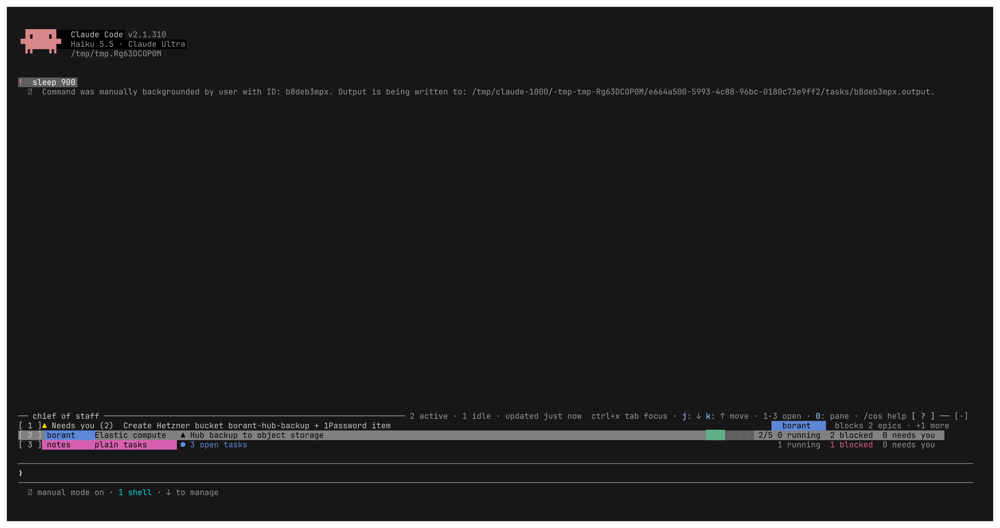
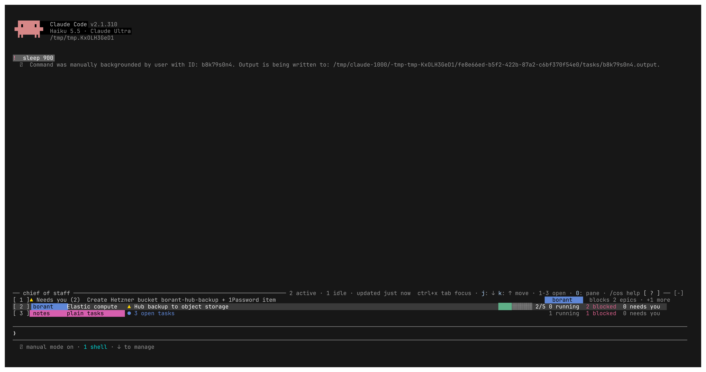
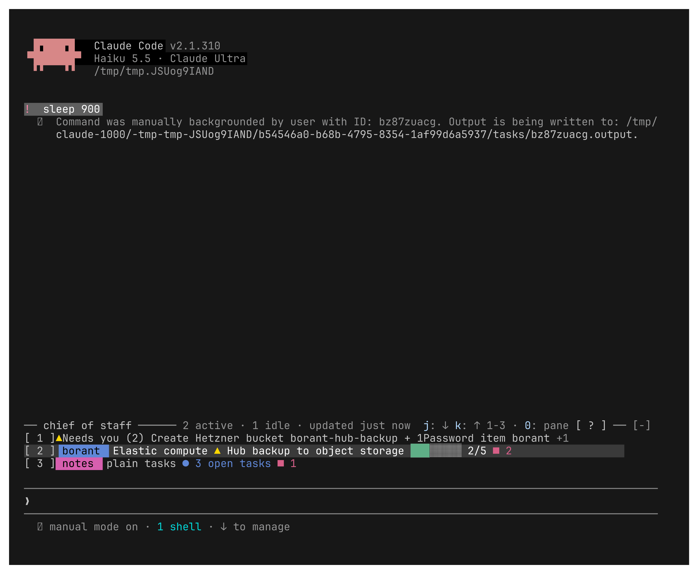

# The chief band's selection color

The band's selected row drew on `promptBorder`, a light grey, with every cell
forced to the inverse text color. Next to the engine's blue hotkeys it was
hard to read. It now draws on the theme's darker user-message grey. Colored
cells keep their color, dim cells draw at full strength, and a cell with no
color takes the theme's text color.

From `just cos-scenario`, step `03-band-j` (the band focused, then `j`):

| | |
|---|---|
| Before, 200 columns |  |
| After, 200 columns |  |
| After, 100 columns |  |

tmux draws 256 colors. A person's terminal may show these greys differently.
