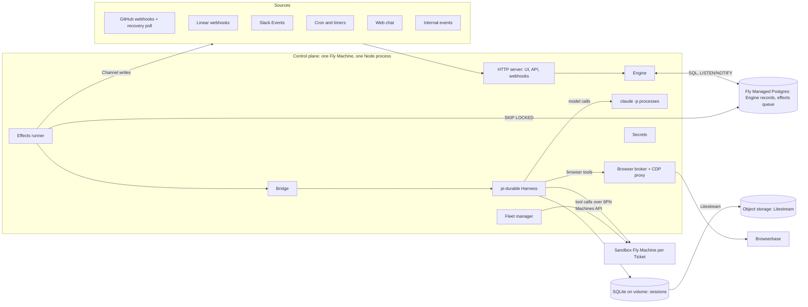
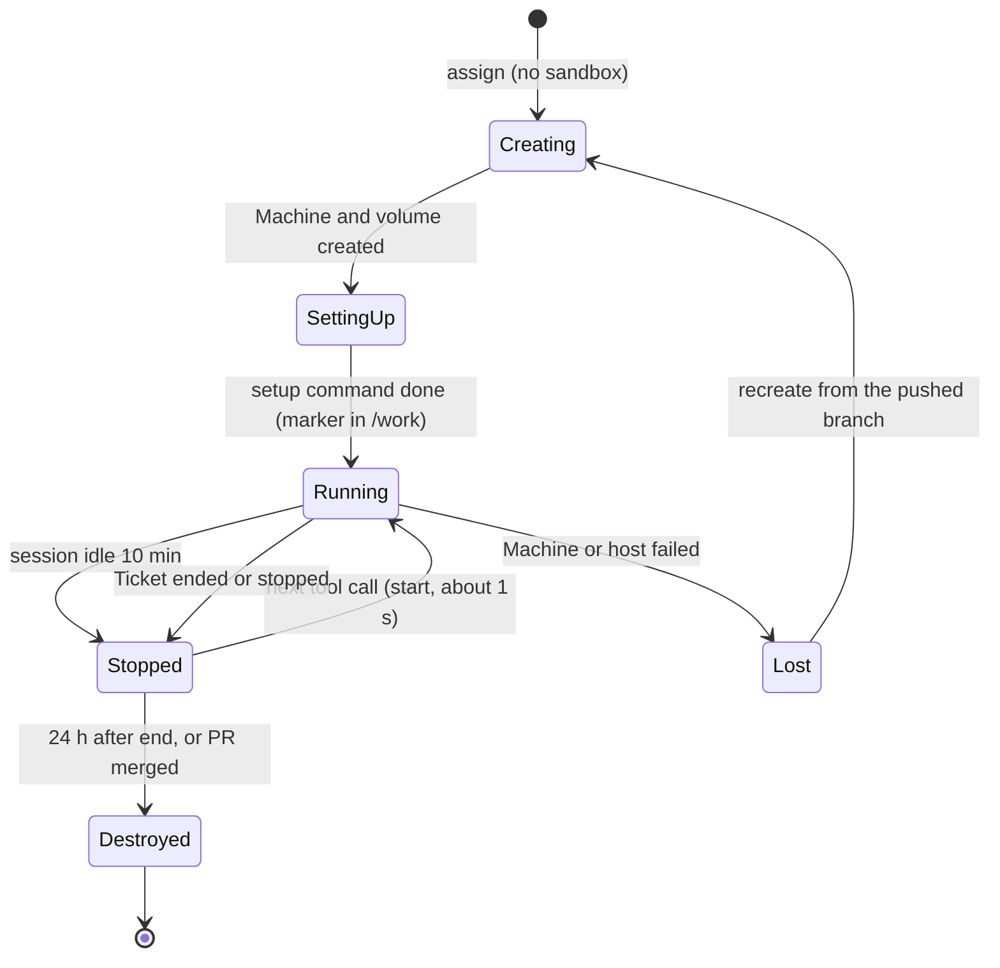
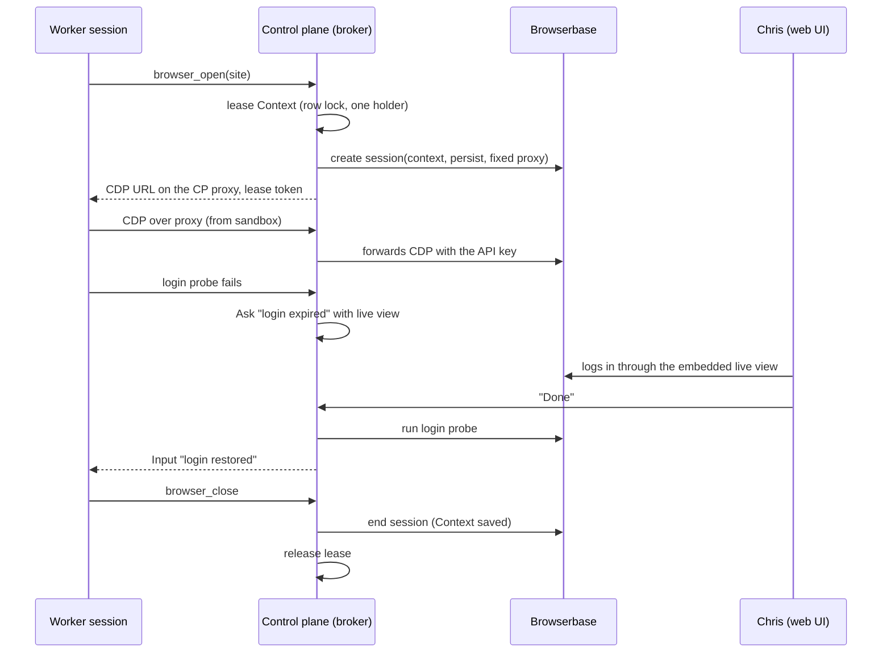

# Borant cloud control plane design

Date: 2026-11-03. Status: draft for Chris to review. Nothing is built.

This document describes the next Borant: one TypeScript service in the cloud
that receives work from many Sources, decides what work to start, runs every
agent's durable loop with pi-durable, and runs tools in a Fly Machine per
Ticket. It replaces the Rust hub, NATS JetStream, the host daemons, and the
Claude Code and omp sessions in tmux.

Marks in this document:

- "(Decided)" means that Chris made the decision. The reason follows it.
- "(My call)" means that the designer made the decision. A builder can change
  a call with a good reason, but must record the change in this document.

Inputs:

- The pi-durable spike: `~/Code/pi-durable-spike/REPORT.md` (2026-11-02),
  cited here as "spike Q1" to "spike Q9". Its scripts and raw output are in
  `src/` and `results/` of that folder.
- The superagent prototype: https://github.com/deepseek-ai/dsh-superagent-prototype
  (MIT), docs `001-domain.md` and `002-authorization.md`. It is a reference
  only. Borant copies no code from it.
- The approved chief mod v3 information design:
  https://claude.ai/artifact/XzyCdoGctUW5Ye7zQv3W3r and its four core specs
  (`2026-11-02-board-task-lines-design.md`, `2026-11-02-agent-activity-design.md`,
  `2026-11-02-person-changes-feed-design.md`, `2026-11-02-mod-actions-design.md`).
- The current design: `2026-10-24-borant-design.md`.

## 1. Intent and why

Chris runs about 20 coding agents across 10 projects in two collections (work
and personal). A chief of staff talks to him, orchestrators own projects, and
workers do tasks. Today these agents run as Claude Code and omp sessions in
tmux, on two Hetzner VPS hosts and on Chris's Mac, joined by a Rust hub over
NATS JetStream.

This week showed that the base does not hold:

- Hub takeovers started duplicate chiefs.
- Sessions lost their MCP connection to Borant and stopped receiving work.
- The Mac went to sleep and its chiefs stopped.
- Shared hosts ran out of memory, and the OS killed agents.
- State disagreed across NATS keys, leases, and WIP refs, and the system then
  acted on stale state.
- An orchestrator refused to trust an approval that the chief relayed from
  Chris, because nothing proved that Chris gave it.

Each failure comes from the same design: a long-lived interactive harness
process holds the agent loop, and Borant tries to keep that process alive, in
one place, and connected. The new design moves the agent loop into a durable
store that one service owns. A process crash then costs one tool call, not a
session.

The second reason is attention. Chris wants the system to take as little of
his attention as possible. Work comes from GitHub, Linear, Slack, timers, and
his own chat. The system decides which of it is work, asks him only when only
he can answer, and shows him one screen with what needs him.

## 2. Goals, non-goals, and anti-goals

### Goals

1. One TypeScript control-plane service runs the fleet manager, the Engine,
   the web UI, and the durable loop of every agent. (Decided)
2. No agent runs on Chris's Mac. A laptop that sleeps changes nothing.
   (Decided)
3. A crash of the control plane or of a sandbox loses at most the tool call
   that was running. Every Trigger, Input, report, and approval survives.
4. Work enters only through Sources. Only an Eval starts a Ticket, and every
   Ticket carries an immutable Mandate that says why the work is allowed.
   (Decided)
5. An approval reaches the worker from Chris directly, stamped with his login.
   No agent relays an approval. (Decided)
6. A loop (a Source, its Policy, and its prompts) is versioned, and stored
   Triggers can be replayed against a candidate version to see what changes.
   (Decided)
7. One web screen replaces the chief mod: what needs Chris, quiet work,
   changes since his last look, every project with tasks by name, the PRs
   closest to merge, and one-key actions. (Decided)

### Non-goals for this version

- High availability of the control plane, or sessions across several
  machines. One machine owns the sessions. (Decided)
- Several people as users. The Policy holds an allowed list per Source, and
  only Chris is on it. (My call)
- Mapping one person's identities across Sources. As in the prototype, a
  person is Trigger metadata. (My call)
- Account pools and placement across hosts. One subscription per provider.
  (My call)
- Moving sessions between harnesses. pi-durable is the only harness.
  (Decided)

### Anti-goals

- A second source of truth. If the system can reach a state where two stores
  disagree and nothing reconciles them, the design failed. This week's stale
  state is the failure this design exists to remove.
- Approvals that a model can forge. If an agent can make a worker believe that
  Chris approved something, the design failed, even if the agent meant well.
- More attention, not less. If Chris must check the system to learn whether
  it is working, the design failed.
- A framework. Every port, table, and command in this document exists for a
  named need. No plugin system, no generic workflow engine.

## 3. Constraints

| Constraint | Source |
|---|---|
| pi-durable 1.5.0 is experimental. The README says "The API changes without notice between releases." 18 releases in 6 weeks. | spike Q1 |
| One process owns a pi-durable storage. There is no cross-process locking. | spike Q2, README line 881 |
| pi-durable has no Postgres storage. Backends: SQLite, JSONL, IndexedDB, memory, Cloudflare Durable Object, Chord store. | spike Q5 |
| pi-durable has no approval-waiting state. A `beforeTool` hook must decide at once. | spike Q3 |
| pi-durable observers live in memory. After a restart, the Engine must look again at what it tracks. | spike Q3 |
| pi-claude-code runs `claude -p` on the machine of the Harness. It refuses to run when `ANTHROPIC_API_KEY`, `ANTHROPIC_AUTH_TOKEN`, or `ANTHROPIC_BASE_URL` is set. | spike Q8 |
| pi-claude-code is not on npm under `@earendil-works`. The npm package named `pi-claude-code` belongs to another author. Do not install it. | spike Q8 |
| Anthropic announced, then paused, a move of `claude -p` use to separate "Agent SDK credit" at API rates. | Chris |
| Browserbase: a Context cannot be used by two sessions at once. Google blocks automated sign-in. | Chris |
| Node >= 22.19 (the SDK requirement). | spike, setup |
| Hosts today have no inbound internet access. All traffic goes over the Tailscale tailnet. | `borant-infra/README.md` |
| Run focused tests only outside CI. | `AGENTS.md` |

## 4. Approaches

### The decided approach

One persistent Fly Machine with a volume runs one Node process: the control
plane. The Engine keeps its records in Fly Managed Postgres. pi-durable keeps
session state in SQLite on the volume. An idempotent bridge joins the two
stores. Tools run in one Fly Machine per Ticket. Logged-in browser work runs
in Browserbase. (Decided)

### Rejected approaches

| Approach | What it offered | Why it lost |
|---|---|---|
| Keep the Rust hub and adapt it | No rewrite. The hub, tasks, and channels work today. | The failures come from its core idea: interactive sessions on hosts, kept alive by leases, moves, and checkpoints. Adapting it keeps that idea. A durable agent loop in Rust does not exist, and pi-durable is TypeScript. |
| Control plane on Cloudflare Durable Objects | pi-durable supports Durable Object storage. No machine to run. | pi-claude-code needs a real process to run `claude -p`. Workers cannot run a CLI. Tools still need Fly Machines, so the system spans two clouds for no gain. |
| NATS JetStream as the queue | Today's bus. Push delivery. | A second store next to the Engine records, with its own state and its own failures. This week's stale state came partly from it. A Postgres outbox puts the queue row and the state change in one transaction. |
| SQLite only (option A) | Engine state as pi-durable documents commits atomically with the session (spike Q5). One file, one backup. | Durable documents are JSON blobs with no SQL. The Engine needs queries for the board, Threads, Decisions, replay, and the changes feed. Raw Engine SQL in the same file is a separate transaction anyway (spike Q5). Chris chose option B. |
| Postgres for both, with our own pi-durable `Storage` (option C) | One database, one backup, one restore point. | We write and maintain a storage adapter for an SDK that changes every few days, and pass its conformance suite at each release. It gives no shared transaction for Engine tables, and one process still owns the store. |
| A local Mac runner | Fast local builds, local browser logins. | Laptop sleep stopped chiefs this week. Secrets on the laptop. Chris decided cloud only. |

## 5. Architecture

### Components

| Component | Job |
|---|---|
| HTTP server | Serves the web UI and its API, receives webhooks, checks their signatures, and ends the web chat. |
| Source adapters | Turn outside events into Triggers. Each keeps a read position for recovery polls. |
| Engine | Owns every domain rule: Triggers, Threads, Evals, Decisions, Tickets, Mandates, Assignments, Subscriptions, Channels, approvals, stages, slots. It writes only to Postgres. |
| Effects runner | Takes effect rows from Postgres with `SELECT ... FOR UPDATE SKIP LOCKED`, wakes on `LISTEN/NOTIFY`, and runs each effect after the commit that wrote it. |
| Bridge | The only code that crosses from Postgres to SQLite and back: Inputs in, reports and activity out. Section 7. |
| Harness | pi-durable 1.5.0 behind our own `SessionPort`. One conversation per Ticket, one router conversation per Collection. |
| `claude -p` processes | Started by pi-claude-code for each Claude model request. They run on the control plane, not in sandboxes. |
| Fleet manager | Creates, starts, stops, and destroys sandbox Machines through the Fly Machines API. |
| Browser broker | Leases Browserbase Contexts, starts sessions, proxies CDP so that the Browserbase key stays in the control plane. |
| Secrets | Holds credentials and injects them into one tool call at a time. Section 13. |

The Node process is one deployable unit with one entry point. The Engine,
the effects runner, and the Harness are modules in that process. The Engine
must not import pi-durable. It talks to sessions only through the
`SessionPort` interface. (My call, because pi-durable changes often and the
port keeps those changes in one adapter.)

Code lives in this repo, in a new `cloud/` directory as a pnpm workspace,
next to the Rust crates until they retire. (My call)

The repo's ports-and-adapters rule carries over in a smaller form. The Engine
calls outside systems only through four ports with neutral types:
`SessionPort` (pi-durable), `SandboxPort` (Fly Machines), `BrowserPort`
(Browserbase), and `ChannelPort` (one adapter per Source kind). Vendor names
appear only in adapters. Postgres is the Engine's own database, not a port.
Only `SessionPort` gets a contract suite at first: the spike's crash tests.
The exec plugin protocol and the private-repo rule of the Rust system do not
apply to `cloud/`. The builder updates `AGENTS.md` to say so. (My call,
because a contract suite for each port is work that no change needs yet.)

### Network

- The control plane has a public HTTPS endpoint for the web UI and for
  webhooks. Every webhook route checks the provider signature. The UI
  requires a login (section 12). (My call)
- Sandboxes have no public address. The control plane reaches them over Fly's
  private network (6PN). Sandboxes reach the internet for git, package
  registries, and public web pages. (My call)
- Sandboxes cannot reach Postgres or the control plane's admin routes. They
  reach only the CDP proxy route, with a token per browser lease. (My call)

## 6. Domain model

The terms below are the names in code, API, UI, and docs. They follow the
superagent prototype where the idea came from it. Concepts that the prototype
has and this design cut: Correlation (adds context only, and Thread snapshots
already carry context) and Executor as a separate concept (the Assignment
names the session and the sandbox directly).

| Term | Definition | Rules it keeps |
|---|---|---|
| Collection | A group of Projects with one router: today `work` and `personal`. | Each Collection has its own router session and its own Policy part. |
| Project | Configuration: a repo, a setup command, a sandbox size, secret bundles, models, and its Policy part. | Configuration, not state. Versioned with the Policy (section 11). |
| Source | A stream of outside events. A Source kind is code (GitHub, Linear, Slack, cron, web chat, internal). A Source instance is one configuration of a kind. | Holds its read position. Drops its own bot's messages before they enter the domain. Says which Threads and Channel addresses an event belongs to. |
| Trigger | One immutable event from a Source, with the actor as the Source gives it and a `human` flag. | ID = hash of Source instance ID and the Source's own event ID. A second insert is a no-op. |
| Thread | Triggers in time order. The Source defines which Triggers form one Thread: a PR, an issue, a Slack thread, a chat conversation, a Ticket's own chat. | At most one Eval runs on a Thread at a time. Triggers that arrive meanwhile wait for the next batch. |
| Subscription | A link between a Ticket and a Thread. | A Trigger on a Thread goes to every live subscribed Ticket as an Input, with no Eval. A Trigger that a live Ticket took this way never goes to an Eval, whoever sent it. A person's message on a Thread whose Tickets all ended resumes them under their Mandates, with no Eval. A bot or CI Trigger on such a Thread goes to an Eval. (My call) |
| Eval | The judgment on a batch of Triggers on one Thread: a deterministic gate, then a model assessment with a schema. | Holds no state of its own. Its output is one Decision. |
| Decision | The stored result of one Eval: accept, ignore, stop, or unavailable. | Stores the candidate, the context snapshot, the gate result, the prompt revision, the model, and the raw model output (section 17). |
| Candidate | What the Eval judges: the Trigger batch, plus a proposed brief when the router or an allowed bot proposed one. | Stored with its Decision. |
| Policy | Versioned rules as data: who can originate work through each Source, the gate rules, standing permissions, accept mode (live or observe), and model choices. | Every Decision and Mandate records the Policy version. A change goes to each live Ticket as a notice. It revokes a Mandate only when the new allowed list no longer holds the Mandate's sender (section 8, `publish_policy`). |
| Mandate | What an accept grants: strength (`explicit` or `inferred`), scope, Policy version, basis (the Trigger IDs and the exact text that asked), and sender. | Immutable. A wider scope needs a new Ticket. Only a person's stop or a revocation by `publish_policy` withdraws it. |
| Scope | The structured part of a Mandate that code enforces: Project, repo, branch prefix, allowed gated actions, and secret bundles. The brief is free text next to it. | `authorize` and secret injection read the structured fields. The assessor writes them, inside what the gate allows. (My call) |
| Ticket | A unit of authorized work. | Only an Eval creates one. It holds its Mandate, Subscriptions, Channels, Inputs, Assignments, and stage. |
| Assignment | The binding of a Ticket to one pi-durable session and one sandbox. | A Ticket has one live Assignment at a time and can have several over its life. States: pending, running, ended. |
| Input | One message for a Ticket's session: the brief, a person's answer, a note, a CI result, a Policy notice. | Has a `requestId` (the Trigger ID or the Engine's own key). Submitted to pi-durable once. |
| Report | A structured result from a session: `ready`, `blocked`, `ask_person`, `progress`, `done`. | Written by a report tool to an outbox document keyed by the tool task ID. The Engine consumes each one once. |
| Ask | A question from a worker to a person, with the full question, why now, the kind (`answer` or `approve`), and the options. | Stays open until a person answers or the worker withdraws it. |
| Approval | A person's yes to an `approve` Ask, recorded from a Trigger with `human = true`. | Gated tools check for an Approval row. A model cannot create one. |
| Channel | The write side of a Thread: a GitHub comment, a PR review reply, a Slack thread reply, a Linear comment, a web chat message. | A Ticket holds a set of Channels. |
| Outbox message | One pending Channel write. | Fixed message ID, chosen before the first attempt. Delivered in order per conversation. |
| Effect | One unit of work that runs after a commit: submit an Input, run an Eval, write a Channel, start a sandbox, and the others in section 8. | Written in the same transaction as the state change that needs it. Idempotent by its key. |
| Router | The chief of staff: a long-lived pi-durable conversation per Collection that talks with Chris. | Reads the board, adds notes, and proposes briefs. Grants nothing. |
| Worker slot | Permission to run one working Ticket at a time. | A fixed number per control plane, plus one extra slot kept for a Ticket that just received a person's message. |
| Sandbox | The Fly Machine where a Ticket's tools run. | One per live Assignment. Holds no secrets at rest. |
| Browser Context | A Browserbase Context that holds one site login. | One user at a time, through a lease. |

### Ticket and router sessions

Each Ticket has one pi-durable conversation. The worker in it can start
subagents with pi-durable child tasks. The subagents share the Ticket's
sandbox. There is no orchestrator tier: today's chief, orchestrator, and
worker chain becomes router and Ticket worker. (Decided)

Each Collection has one router conversation that lives as long as the
Collection. (My call, because today's chiefs are split the same way and the
two Collections have different Policy parts and Slack workspaces.)

## 7. The Postgres and SQLite bridge

The Engine commits in Postgres. pi-durable commits in SQLite. No transaction
spans both. (Decided) The bridge makes every crossing idempotent, so that
each side can retry until both sides agree.

### Engine to session: Inputs

1. An Engine command writes an `inputs` row (Ticket, `request_id`, content,
   `when_busy`) and a `submit_input` effect in one Postgres transaction.
2. The effects runner calls `SessionPort.submit(conversation, { requestId,
   content, whenBusy })`. pi-durable returns the existing submission when the
   `requestId` is known and writes nothing (spike Q2).
3. The effects runner marks the effect done and stores the submission ID.
4. The commit observer (`observeCommits`) sees the submission reach `placed`
   and sets `inputs.placed_at` (spike Q3).

`request_id` is the Trigger ID for Inputs that come from Triggers, and
`engine:<ticket>:<kind>:<n>` for the Engine's own Inputs (the brief, a Policy
notice). `when_busy` is `steer` for a person's answer and for a stop, and
`followUp` for everything else. (My call)

### Admission: no run without a slot

pi-durable starts a run as soon as an idle conversation receives an Input.
So the Engine submits an Input at once only when the Ticket is `working`.
For any other stage, the Input row waits with `state = held`. (My call)

Each Input kind says whether it wakes the Ticket:

| Wakes the Ticket | Waits for the next run |
|---|---|
| A person's message, answer, approval, or stop. CI results and review comments on the Ticket's PR. "Login restored". | Router notes. Policy notices. Bot comments that are not reviews. |

A waking Input writes an `assign` effect. When `assign` admits the Ticket, it
writes one `submit_input` effect per held Input, in arrival order. A
non-waking Input stays held until a waking Input or the brief starts the next
run. A stop never waits: it takes the extra slot when no slot is free, like a
person's answer.

### Session to Engine: reports

1. A report tool (`report_ready`, `report_blocked`, `ask_person`,
   `report_progress`, `report_done`) writes its payload to the `Outbox`
   pi-durable document, keyed by `api.taskId`, with `consumed: false`. Every
   report tool except `report_progress` returns `control: { terminate: true }`,
   so the run ends without another model request (spike Q7). All report tools
   are `replay: "safe"`.
2. The bridge reads unconsumed outbox entries when the commit observer sees
   the document change, and on a 10 s timer as a fallback.
3. For each entry, the Engine runs `consume_report` in one Postgres
   transaction. The `reports` table has a unique key on the outbox key, so a
   second insert does nothing.
4. After the Postgres commit, the bridge marks the entry consumed, with
   `consumed_at`, in one pi-durable commit.

Consumed entries stay in the document for 35 days, longer than the longest
backup window, so that a restore can be reconciled. (My call)

### Activity

The commit observer also writes each session's last tool start, tool end,
and turn end into a `session_activity` row. These writes are best effort and
can be lost in a crash. The startup reconcile reads the live state from the
Harness and repairs them. Silent detection (section 10) reads this table.

### Run end

A run can end with no report: the model answers in text, the run fails, or
a replay-safe tool hits `restart_limit`. Slots must not leak, so run end is a
durable command, `run_ended`, found three ways (My call):

- The commit observer sees the run end in `pi.live`, or the submission reach
  `done` or `unanswered`.
- A sweep every 60 s asks `SessionPort` for the run state of every running
  Assignment.
- The startup reconcile, step 5.

`run_ended` is idempotent by the run ID, so all three can fire for one run.

### Failure windows

| Window | What is true after the crash | Recovery |
|---|---|---|
| Crash after the Postgres commit, before `submit` | Input row and effect exist. No submission. | The effect is still pending. The runner retries it after the restart. |
| Crash after `submit` commits in SQLite, before the effect is marked done | Submission exists. Effect still pending. | The retry submits with the same `requestId`. pi-durable returns the existing submission and writes nothing (spike Q2, Q9). |
| Postgres down when the runner marks the effect done | Submission exists. Effect still pending. | The runner retries the mark with backoff. A later retry of the submit is also a no-op. |
| Crash during a model call or a tool call | The session's task checkpoint is in SQLite. | `harness.resume()` continues. A default tool returns "interrupted" to the model. A `replay: "safe"` tool runs again with the same task ID and reattaches to its job in the sandbox (spike Q6, Q9). |
| Crash after the report tool writes the outbox entry, before its tool result commits | Outbox entry exists, unconsumed. | The replay-safe tool runs again and writes the same key. One entry (spike Q7). |
| Crash after `consume_report` commits in Postgres, before the entry is marked consumed | Report row exists. Entry unconsumed. | The bridge reads the entry again. The insert hits the unique key and does nothing. The bridge marks it consumed. |
| Postgres down while sessions run | Sessions continue their model calls and tools. Reports wait unconsumed. No new Triggers, Evals, or Channel writes. | The bridge retries. Nothing is lost. The UI shows "Engine paused: Postgres unreachable". Webhooks return 503 (section 8). |
| SQLite restored to a point older than Postgres | Postgres knows Inputs and Tickets that SQLite does not. Some consumed reports appear unconsumed again. | Startup reconcile, below. |
| Postgres restored to a point older than SQLite | SQLite holds submissions and consumed reports that Postgres does not know. | Startup reconcile, below. |
| Commit observer missed events (it lives in memory) | `placed_at` and activity are stale. | Startup reconcile reads submission status for every Input that is not `done`. |

### Startup reconcile

The control plane runs this before it accepts traffic, and the operator can
run it from the admin page:

1. For every open Ticket, make sure that its conversation exists. If it does
   not exist, rebuild it:
   - Create a new conversation. End the old Assignment with reason
     `session_lost`, and write a new Assignment that names the new
     conversation and the same sandbox.
   - Submit one Input with `requestId` `rebuild:<ticket>:<n>`. It holds the
     brief, the Mandate, and every Input of the old conversation in order,
     as a transcript summary.
   - Mark every Input of the old conversation `superseded`. Step 2 skips
     them.
   - Record a `session_rebuilt` event on the Ticket.
2. For every Input of a current conversation that is not `superseded`, ask
   the Harness for its submission by `requestId`. If none exists, or it is not
   `done` or `unanswered`, submit it again with its `requestId`. This is a
   no-op where the submission exists. Held Inputs stay held.
3. For every outbox entry, unconsumed or consumed in the last 35 days, run
   `consume_report`. This is a no-op where the report row exists, and it
   restores report rows that a Postgres restore lost.
4. For every conversation with no Ticket in Postgres, list it on the admin
   page as an orphan. Do not delete it. A person decides.
5. For every running Assignment whose conversation has no active run, run
   `run_ended` (section 8).
6. Run `harness.resume()`.

Both stores back up continuously: Fly Managed Postgres with its point-in-time
recovery, and SQLite with Litestream to object storage. To restore, pick one
time T and restore both to T. The reconcile repairs the seconds of difference.
(My call, and the builder must make sure that the MPG plan includes
point-in-time recovery.)

## 8. Engine commands and transactions

Every command is one Postgres transaction. It reads with row locks where it
changes state, writes state and effects together, and commits. Effects run
after the commit. No command calls a model or an outside API inside a
transaction.

| Command | Locks | Writes | Effects |
|---|---|---|---|
| `ingest(sourceInstance, event)` | none | Trigger (`ON CONFLICT DO NOTHING`), Thread links, Source read position. For each live Ticket subscribed to the Thread: an Input (submitted or held, section 7). A person's message resumes ended subscribed Tickets. If no live Ticket took the Trigger and no person's message resumed one: `threads.eval_pending = true`. | `submit_input` or `assign` per Input. `run_eval` for the Thread. |
| `claim_eval(thread)` | Thread row `FOR UPDATE` | `eval_running = <eval id>`, the batch of pending Trigger IDs, the Policy version. | none |
| `decide(evalId, gateResult, assessment)` | Thread row `FOR UPDATE` | If the claim or the Policy version changed: nothing, and a new `run_eval`. Else the Decision. On accept: Ticket, Mandate, Subscriptions, Channels, Assignment (pending), brief Input, stage `queued`. Clear `eval_running`. | `channel_write` (acknowledgment). `assign`. `run_eval` again if Triggers arrived meanwhile. |
| `assign(ticket)` | slot counter row `FOR UPDATE`, Ticket row | If a slot is free: Assignment running, stage `working`. | `ensure_sandbox`, `submit_input`. |
| `consume_report(entry)` | Ticket row `FOR UPDATE` | Report (unique outbox key), stage change, Ask, changes-feed event. | `channel_write` per Channel the report names. `stop_sandbox` after `done`. |
| `run_ended(assignment, outcome)` | Ticket row, slot counter row | Slot release. Stage: kept if a report already set it, `blocked/failed` for a run failure or `restart_limit`, else `idle`. Idempotent: a second call for the same run does nothing. | `assign` for the next queued Ticket. `stop_sandbox` timer. |
| `answer(person, ask, text)` | Ask row | Through `ingest` on the Ticket's chat Thread, as a Trigger with `human = true`. | `submit_input` with `whenBusy: "steer"`. |
| `approve(person, ask)` | Ask row | Trigger, then an Approval row linked to the Ask. | `submit_input`. |
| `stop(person, ticket)` | Ticket row | Trigger, Ticket stopped, Subscriptions kept but muted. | `submit_input` (stop notice, steer). `stop_sandbox`. |
| `note(router, ticket, text)` | none | An Input with `actor = router`, `human = false`. | `submit_input`. |
| `propose(router, fromTrigger, project, brief)` | none | A candidate on the Thread of `fromTrigger`, and `eval_pending = true`. | `run_eval`. |
| `publish_policy(commitSha)` | policy row, then each live Ticket row | New Policy version. For each live Ticket: if the new allowed list no longer holds the Mandate's sender, revoke the Mandate and stop the Ticket. Else, if a rule it used changed, a notice Input. | `submit_input` per notice or stop. `channel_write` for each revocation. |
| `mark_seen(person, upToEventId)` | none | Seen position. | none |

### Eval

An Eval runs in two steps between `claim_eval` and `decide`:

1. Gate. Deterministic code reads the Trigger batch and the Policy. It
   answers: is the actor on the Source's allowed list, is the actor human, is
   the Source in observe mode, and which strength can this sender grant. A
   Trigger from an actor who is not allowed ends here with `ignore`. A bot or
   CI Trigger can lead only to an `inferred` accept, and only when a Policy
   rule names that event, for example "CI failed on a PR of an ended Ticket
   in this Project". (My call)
2. Assessment. One model call with no chat history. Its input is the stored
   context snapshot: the Trigger batch, the last 50 Triggers of the Thread,
   every Ticket on the Thread with its stage (ended ones too), the Project
   list, and the candidate. Its output follows a JSON schema: decision,
   project, brief, scope, strength, reasons. (Decided)

The assessment calls pi-ai directly, not through a pi-durable conversation,
because an Eval holds no state and runs again in full after a crash. (My call)

If the assessment fails or times out after 3 attempts, the Decision is
`unavailable`, and the Triggers go back to pending with a 10 minute delay.
(My call)

### Router and the web chat

Chris's chief chat is a Source. Each message is a Trigger with
`actor = <logged-in person>`, `human = true`, on the Collection's chat
Thread. The router conversation is subscribed to that Thread and receives
each message as an Input. It answers in the chat. (Decided)

The router does not create work. When Chris asks for work, the router calls
`propose` with the ID of his Trigger and a clear brief. The Eval then judges
the candidate. The gate takes the strength from Chris's Trigger, not from the
router, and the assessment checks that the brief stays inside what his text
asked for. The Mandate's basis stores his exact text. (My call, because the
router has the conversation context to write a good brief, and this keeps the
router unable to grant anything.)

Triggers from GitHub, Linear, Slack, and cron go to the Eval directly. The
router does not see them except through the board.

### Effects and the queue

The `effects` table is the only queue. (Decided)

| Column | Meaning |
|---|---|
| `id` | Row ID |
| `kind` | `submit_input`, `run_eval`, `assign`, `channel_write`, `ensure_sandbox`, `stop_sandbox`, `destroy_sandbox`, `recover_poll`, `browser_release` |
| `key` | Unique idempotency key, for example `submit_input:<request_id>` |
| `payload` | JSON |
| `state` | `pending`, `running`, `done`, `dead` |
| `attempts`, `run_after`, `locked_until`, `last_error` | Retry state |

The runner takes rows with `SELECT ... WHERE state = 'pending' AND run_after
<= now() ORDER BY id FOR UPDATE SKIP LOCKED LIMIT 20`, sets `running` with a
lease of 5 minutes, and commits. It wakes on `NOTIFY effects`, which the
writing transaction sends, and polls every 5 s as a fallback. A failure sets
`run_after` with exponential backoff from 5 s to 10 minutes. After 20
attempts, the effect is `dead` and appears on the admin page. (My call)

A row whose lease ended while `running` returns to `pending`. Each handler
must be idempotent by `key`, because a crash after the work and before the
`done` commit runs it again.

### Webhooks while Postgres is down

A webhook that cannot commit its Trigger returns 503. GitHub does not retry by
itself, so a `recover_poll` effect runs for each Source when Postgres returns,
and every 15 minutes. It reads events since the Source's read position and
ingests them. Trigger IDs make the overlap harmless. Slack and Linear retry
on their own, and the poll covers the rest. (My call, because a local spool
file is one more store to reconcile.)

## 9. Delivery guarantees

| Path | Guarantee | How |
|---|---|---|
| Outside event to Trigger | Exactly one Trigger per event | At-least-once intake. Trigger ID is a hash of Source instance and event ID. |
| Trigger to Eval | Each Trigger is in exactly one Decision batch | `claim_eval` takes the batch under a row lock. A discarded Eval returns its batch. |
| Trigger to a Ticket's session | Exactly once in the transcript | `requestId` = Trigger ID (spike Q2). |
| Report to Engine | Exactly once | Outbox key = tool task ID, unique key in `reports` (spike Q7). |
| Tool call in the sandbox | At most once per task ID for replay-safe tools. An `interrupted` result for the others. | The sandbox daemon dedupes on the task ID (spike Q6). |
| Engine to outside Channel | Effectively once, in order per conversation | At-least-once attempts. Before a retry after an unknown result, the handler looks for the message ID: a hidden `<!-- borant:<id> -->` marker in GitHub and Linear comments, Slack message `metadata`. The next message in a conversation waits until the one before it is `done`. |
| Effects | At least once | Idempotent handlers by `key`. |

## 10. Ticket stages and the board

A Ticket's stage is derived by the Engine and stored on the Ticket for the
board query. (Decided)

| Stage | Means | Set by |
|---|---|---|
| `person/answer` | The worker asked a question and waits. | `ask_person` with kind `answer` |
| `person/review` | A result waits for Chris: an approval, or a PR he must review. | `ask_person` with kind `approve`, or `report_ready` |
| `blocked/failed` | The worker cannot continue, or the session or sandbox failed. | `report_blocked`, `run_ended` with a failure, a dead effect, a lost sandbox |
| `queued` | Accepted, waiting for a worker slot. | `decide` accept, or a waking Input while no slot is free |
| `working` | A run is active. | `assign` |
| `idle` | Open, no run, nothing waits on a person: for example a PR waiting for CI. | `run_ended` with no report that needs a person |

`ended` and `stopped` are Ticket states, not board stages. An ended Ticket
leaves the board and shows in "changes".

Silent work is a view, not a stage: a `working` Ticket with no tool call in
30 minutes, from `session_activity`. This follows the agent activity spec.
"Offline" from the mod v3 design becomes a `blocked/failed` Ticket with the
reason "sandbox lost" or "session failed". (My call)

### Worker slots

The control plane runs at most `slots.working` Tickets at a time (start: 6),
plus one extra slot. When a person answers or approves an Ask, that Ticket
takes a free normal slot, or the extra slot when none is free. So Chris never
waits behind the queue. (Decided) The start value of 6 is my call. It is a
guess at what one Claude Max subscription carries before rate limits, and the
builder must tune it from the first week's data.

### Board query

One query returns the whole board: every open Ticket with its Project,
stage, title, who (the session name), since when, its open Ask, its PR state,
and the last change. This replaces the "board task lines" read of the mod v3
specs. The changes feed is the `events` table (section 18) after the person's
seen position.

## 11. Authorization and Mandates

1. Work starts only from an accept Decision. The Mandate records the
   strength, scope, Policy version, basis, and sender. (Decided)
2. `explicit` strength needs a human actor on the Source's allowed list whose
   text asks for the work. `inferred` covers work the assessment derived, for
   example "CI on my PR failed, fix it" from a CI failure on a PR that an
   explicit Ticket opened. (Decided)
3. Approvals never travel through an agent. Chris's answer and his approval
   are Triggers from the web chat Source with his login as actor and
   `human = true`, on the Ticket's own Thread. The worker reads them as
   Inputs. (Decided)
4. Gated tools check the Engine, not the transcript. A tool that needs
   approval (for example `merge_pr`, `deploy`, `spend`) calls
   `engine.authorize(ticket, action, params)`. The action must be in the
   Mandate's scope. Then it returns `allowed` when a standing permission in
   the current Policy version covers the action, or when an Approval row
   exists for an Ask that named this action and these params. Otherwise the
   tool returns "needs approval" to the model, and the model raises an
   `approve` Ask. The current version applies, so that removing a standing
   permission takes effect at once. (My call on the mechanism)
5. The router can add notes. A note is an Input with `human = false`. It
   grants nothing, and `authorize` never reads notes. (Decided)
6. Standing permissions are Policy data, for example "a worker in `borant`
   can merge its own PR when CI is green and a person approved the review".
   (Decided)

This removes this week's relay problem: no worker needs to trust what the
router says Chris said.

### Policy as data

Policy, Project configuration, and prompts live as YAML and Markdown files in
a config repo, `willisrocks/borant-config`. A push to its main branch
publishes a new Policy version, and the version is the commit SHA. A replay
candidate is any other commit or branch. (My call, because git gives versions,
diffs, review, and rollback with no new code.)

## 12. Web UI

The web UI is the native chief-of-staff screen. It replaces the Claude Code
mod. It reuses the approved mod v3 information design. (Decided) It is a
web page, so the terminal limits of mod v3 (one chord, digits at the prompt,
band height) do not apply. The keys keep the same meaning.

Login: GitHub OAuth, with an allowed list of GitHub user IDs in the Policy.
The session cookie is `HttpOnly`, `Secure`, `SameSite=Strict`. (My call)

### The chief-of-staff screen

| Area | Shows |
|---|---|
| Needs you | Each open Ask and each `person/review` and `blocked/failed` Ticket: the full question, why now, who asked, the Project, how long it waits, the router's note if any. Order: decide, approve, answer, unblock, then age. |
| Silent and failed | Working Tickets with no tool call in 30 minutes, with the last tool call shown. Failed sessions and lost sandboxes. |
| Changes since your last look | New Tickets, done Tickets, merged and approved PRs, releases, answered Asks, Policy versions. "Mark seen" sets the seen position. Nothing else does. |
| Projects | Every Project with its Tickets by name: who works on each, for how long, its stage, what it waits on. Idle Projects on one line. |
| PRs closest to merge | Open PRs from Tickets, ordered by how close to merge: ready to merge, approved, review requested, CI running, CI failed. |
| Chat | The router chat for the Collection, at the side. |

| Key | Action |
|---|---|
| `j` `k` or arrows | Move the selection. The detail follows. |
| `1` to `5` | Jump to needs you, silent, PRs, changes, projects. |
| `r` | Answer the selected Ask. A text field opens. Enter sends, Esc keeps the draft. |
| `y` | Approve. A second `y` confirms when the Ask names money or a deploy. `n` cancels. |
| `a` | Ask the router about the selected item. |
| `o` | Open the PR. |
| `g` | Go to the Ticket detail. |
| `x` | Mark the listed changes seen. |
| `/` | Focus the chat. |

### Ticket detail

The Mandate (strength, scope, basis with Chris's exact words, Policy
version), the stage, the open Ask with the answer box, the Trigger history of
every subscribed Thread with the Decisions on them, the live session
transcript (`ConversationTranscript` watch), the sandbox state, the Channels,
and the usage and list-price cost of the session.

### Browser logins

Every Browser Context with its site, state (valid, expired, in use, never
used), time of the last login check, and the Ticket that holds its lease. "Log in"
opens the Browserbase live view in the page (section 15).

### Loops

Policy versions with their diffs, Decision lists with filters, the Decisions
of observe mode ("would accept"), and replay runs with their diffs and scores
(section 17).

### Admin

Dead effects, orphan conversations, the reconcile button, bridge lag (oldest
pending Input and oldest unconsumed report), the count of `claude` processes,
Postgres reachability.

## 13. Secrets

Secrets live in the control plane and are injected only into the tool call
that needs them. (Decided)

| Secret | Where | Used by |
|---|---|---|
| Master key, `DATABASE_URL`, GitHub App private key, Slack and Linear tokens, Browserbase API key, GitHub OAuth client | Fly secrets on the control-plane app | The control plane only |
| Claude subscription login | `claude` CLI credentials on the control-plane volume | pi-claude-code |
| Codex OAuth, LunaRoute key, Project secret bundles (for example `boopmark-staging`) | `secrets` table in Postgres, AES-256-GCM under the master key | The control plane, and injected tool calls |
| GitHub tokens for git | Minted per tool call as a GitHub App installation token, scoped to the Project repo, valid for 1 hour | `bash` in the sandbox |

Rules:

1. A Project's configuration names the secret bundles its Tickets can use.
   The Mandate scope can narrow the list.
2. The control plane sends a bundle's values as environment variables of one
   `exec` request. The sandbox daemon does not write them to disk and does not
   keep them after the command ends.
3. The control plane replaces every injected value with `[secret:<name>]` in
   tool output before the output enters the transcript.
4. The control plane gets its own Codex and LunaRoute logins. It does not
   reuse Chris's `~/.pi/agent/auth.json`, because a refresh rotates the token
   and logs out his CLI (spike Q8).
5. Chris copies today's 1Password Agents vault items into the control plane
   once, through the admin page. The control plane does not call 1Password at
   runtime. (My call, because it removes a runtime dependency. Rotation then
   happens in the admin page.)

## 14. Sandboxes

One Fly Machine per Ticket runs its tools: bash, git, builds, and headless
Chrome for public pages. (Decided) The agent loop stays in the control
plane, so a sandbox crash costs only the current tool call. (Decided)

### Image and daemon

- One image, `borant-sandbox`, with git, Node, the toolchains of the
  Projects, Chromium for Playwright, and `sandboxd`. Projects that need more
  install it in their setup command. (My call)
- `sandboxd` is a small TypeScript HTTP daemon on the 6PN address. It does
  `exec`, `read`, `write`, and `edit`, each keyed by the pi-durable tool task
  ID. A second request with a known key reattaches to the running job or
  returns its stored result. Results stay 24 hours in `/work/.jobs`. Each
  request carries the Assignment's bearer token. (My call, one protocol that
  we control, instead of pi-env's SSH daemon plus SSH keys.)
- Borant's `bash`, `read`, `write`, and `edit` tools call `sandboxd` and are
  `replay: "safe"`.
- Each sandbox has a 20 GB Fly volume at `/work` for the clone and build
  caches, so that the work survives a stop and a restart. (My call)
- Size comes from the Project. Default: `shared-cpu-4x`, 8 GB. (My call)

### Lifecycle

1. `assign` writes `ensure_sandbox`. The fleet manager creates the Machine and
   the volume if the Assignment has none, or starts the stopped Machine.
2. The setup command (clone, install) runs once. A marker file in `/work`
   records its success, so a rerun skips it.
3. A tool call to a stopped sandbox starts it first. The fleet manager waits
   for `sandboxd` health, then the call goes through.
4. After 10 minutes with no run on the Ticket, the fleet manager stops the
   Machine.
5. If the Machine is lost, the Ticket goes to `blocked/failed` with "sandbox
   lost". A new sandbox clones the Ticket's branch. Work that the worker did
   not push is lost. The worker prompt says to commit and push at each step
   that passes its checks.
6. When the Ticket ends, the Machine stops. After 24 hours, or when its PR
   merges, the fleet manager destroys the Machine and the volume. A Ticket that
   a person resumes in that time gets the same sandbox.

## 15. Browser for logged-in sites

Logged-in browser work uses Browserbase. One persistent Context per site
login stores the full Chromium user data directory, encrypted, until it is
deleted. (Decided)

1. A Context has a lease row. `browser_open` waits up to 10 minutes for a busy
   Context, then returns "in use by Ticket X" to the model. `run_ended`
   releases the lease, except while a `login` Ask of that Ticket is open.
   (My call)
2. Each session uses the Context with `persist: true` and a fixed proxy
   location per Context, so the site sees one place. (Decided)
3. Each site in the configuration has a login probe: a URL and a check that
   is true only when logged in. A failed probe raises a "needs you" item of
   kind `login`, with the live view. (Decided)
4. Chris does Google logins himself, in the live view, and must re-verify
   sometimes. No tool types a Google password. (Decided)
5. The CDP proxy in the control plane keeps the Browserbase API key out of
   the sandbox. If the builder finds that a Browserbase session connect URL
   carries no account key, the proxy can go. (My call)
6. Public pages use Chromium in the sandbox, not Browserbase. (Decided)

## 16. Models and providers

| Provider | How | State |
|---|---|---|
| Claude | pi-claude-code `createClaudeCodeProvider()`, which runs `claude -p` on the control plane with Chris's subscription. Install it from the `earendil-works/pi-claude-code` git repo at a pinned commit, not from npm. Call `models.getAvailable("claude-code")` at startup (spike Q8). | One real Haiku turn ran in the spike. |
| Codex | pi-ai `openaiProvider()` "Sign in with ChatGPT" OAuth, with a `CredentialStore` on the `secrets` table. | Registered, no real turn yet. |
| LunaRoute | A provider of about 20 lines with `createProvider()` and `openAIResponsesApi()` (spike Q8). | Registered, no real turn yet. |

(Decided)

Model choice per role is Policy data: the router, the assessor, the worker
per Project, and summaries. The configuration names a provider and a model
alias. The control plane resolves the alias from discovery at startup. (My
call)

The builder must run one real turn with Codex and one with LunaRoute before
any Project depends on them.

The spike ran its Claude turn on the Mac, where the `claude` login lives in
the Keychain. No test yet shows that a `claude` login works and refreshes on
a headless Linux Fly Machine under pi-claude-code's environment checks. This
is the first task of the build, before any other work: one real turn from a
Fly Machine, and one more after 24 hours to prove the refresh. If it fails,
the fallback is open question 2 in section 22.

Every session records usage and list-price cost (pi-durable reports both).
The Ticket detail and a monthly total show it. This number is also the
estimate of what Claude work costs if Anthropic moves `claude -p` to API
rates.

## 17. Loop engineering and replay

A loop is a Source, its Policy part, and its prompts, all versioned in the
config repo. (Decided)

Each Decision stores (Decided):

- The candidate: the Trigger batch and any proposed brief
- The context snapshot that the assessment read, as JSON
- The gate result
- The prompt revision: config commit SHA and prompt path
- The model: provider, model ID, settings
- The raw model output and the parsed result, latency, and usage

The assessor is a separate model call with no chat history. The prototype's
assessor lived in a long chat and read context live, so a replay cannot show
it the same input. Here the snapshot is the input, so a replay is honest.
(Decided)

### Replay

A replay run takes a filter (time window, Source, Thread, Decision kind) and
a candidate config commit. For each stored Decision it runs the gate of the
candidate Policy and the assessment of the candidate prompts and model on the
stored snapshot. It writes the new Decisions to `replay_decisions`. It
creates no Ticket and runs no effect. (Decided, this is new work that the
prototype does not have.)

The run report shows:

- Changed Decisions: accept to ignore, ignore to accept, a different
  Project, scope, or strength
- A score: agreement with labeled Decisions. A label is Chris's "right" or
  "wrong" on a Decision in the Loops page. A Ticket that Chris stopped in its
  first hour counts as a suggested "wrong accept" for him to confirm. (My call)
- Cost and duration of the run

A replay run has a cap of 200 Decisions by default, because each one is a
model call. (My call)

### Observe mode

A Source instance or a single rule can be in observe mode. Its Evals run and
store "would accept" Decisions, but create no Ticket. New Sources start in
observe mode. (Decided for the mode, my call for the start state.)

## 18. Observability and audit

- Logs: structured JSON lines to Fly's log stream, with Ticket, Thread,
  Trigger, and effect IDs on each line. Never secret values.
- Metrics: a `/metrics` endpoint for Fly's managed Prometheus. Effects pending
  and dead, Eval latency, bridge lag, slots in use, sessions, `claude`
  processes, sandbox count by state, Postgres reachability.
- Events: an append-only `events` table for every domain change (Trigger
  received, Decision, Ticket stage change, Ask, Approval, Channel write,
  Policy version, sandbox state). The changes feed and the audit view read
  it.
- Audit: Triggers, Decisions, Mandates, Approvals, and `events` are never
  updated or deleted. Transcripts stay in SQLite for the life of the Ticket
  plus 90 days. (My call)
- Dead man's switch: the control plane pings an outside check every 5
  minutes. If the pings stop, the check sends Chris a push notification, so a
  dead control plane does not stay silent. (My call)

## 19. Cost per month at today's load

Prices are Fly.io list prices read on 2026-11-02 from
https://docs.fly.io/about/pricing: shared CPU about $0.69 per vCPU and
$6.01 per GB RAM per 30 days, volumes and stopped rootfs $0.15 per GB, Managed
Postgres Basic $38, outbound transfer $0.02 per GB in North America.

| Item | Assumption | Per month |
|---|---|---|
| Control-plane Machine | `shared-cpu-4x`, 8 GB, always on. 8 GB holds Node and about 10 `claude -p` processes at once. | $51 |
| Control-plane volume | 40 GB | $6 |
| Litestream object storage | Under 10 GB | $1 |
| Fly Managed Postgres | Basic plan | $38 |
| Sandbox compute | `shared-cpu-4x`, 8 GB at $0.071 per hour. 4 sandboxes running on average for 10 hours a day, 30 days: 1200 hours. | $85 |
| Sandbox volumes | 15 sandboxes alive at a time, 20 GB each | $45 |
| Browserbase | Developer plan, about 60 hours | $32 |
| Outbound transfer | Under 100 GB | $2 |
| Models | Claude Max, ChatGPT, and LunaRoute subscriptions that Chris already pays | $0 more |
| Total | | about $260 |

The sandbox hours are the weakest number. Today's load is about 20 agents,
but most of them wait. If 10 sandboxes run 12 hours a day, sandbox compute is
about $255 and the total is about $430. The first two weeks of metrics give
the real number.

What this estimate leaves out: the Hetzner boxes that retire (their cost
goes away), and model cost if Anthropic moves `claude -p` to API rates
(section 16 measures it).

## 20. Migration from today's Borant

Old and new run in parallel until each Project moves. No session moves
between them. Work moves by Project. (My call)

1. Build stage. The control plane runs with the web chat and GitHub Sources
   and one personal Project, `taglab`. The old Borant runs everything else.
   GitHub, Linear, and Slack Sources start in observe mode.
2. Personal Collection. Projects move one at a time: `taglab`, then
   `boopmark`, then `steve`, then `borant` last, because the old Borant
   builds the new one. For each Project:
   - The old orchestrator takes no new tasks.
   - An import script reads its open Borant tasks and lists them in the UI.
     Chris approves each one he wants. Each approval is a web chat Trigger,
     so the imported Ticket gets an `explicit` Mandate whose basis is "import
     of Borant task <id>, approved by Chris".
   - Running old workers finish on the old system. Their PRs get Tickets
     through the GitHub Source when Chris approves the import.
   - When the old Project has no running worker, its orchestrator ends.
3. The personal chief ends when its last Project moved.
4. Work Collection. It moves after the personal Collection runs one week
   with no lost Trigger, no duplicate Ticket, and no reconcile repair that a
   person had to do. Roger Projects move in the same steps.
5. Retirement. Two weeks after the last old task ends: stop the Rust hub,
   NATS, and the host daemons, delete the Hetzner boxes with `borant-infra`,
   remove the Borant plugin and daemon from the Mac, tag the last Rust commit,
   and delete the Rust crates from `main`.

## 21. Risks

| Risk | Effect | Mitigation |
|---|---|---|
| pi-durable changes its API often (18 releases in 6 weeks) | An upgrade breaks the control plane. | Pin exact versions. Keep it behind `SessionPort`. Promote the spike's crash tests (Q2, Q6, Q7, Q9) to a contract suite that each upgrade must pass. Upgrade on purpose, not on a schedule. |
| Anthropic moves `claude -p` use to API rates | Claude work costs list price. | Measure list-price cost per session from day one. Keep the Codex and LunaRoute providers working with a real turn, so the Policy can move roles to them. |
| The `claude` login does not work headless on Fly | No Claude model in the control plane. | First build task proves it (section 16). Fallback: open question 2. |
| One machine owns all sessions | A Fly host failure stops all agents. The volume lives on one host. | Litestream to object storage, a written restore runbook, the dead man's switch. Recovery is a new Machine, a restore, and the reconcile. |
| Google logins | An agent cannot log in to Google. Logins expire. | Chris logs in through the live view. Login probes raise a "needs you" item early. |
| Bridge bugs | A lost or doubled Input or report. | Every crossing is keyed. The reconcile is the same code at every startup, so it runs often. Bridge lag is a metric with an alert. Contract tests kill the process inside each failure window of section 7. |
| Many `claude -p` processes on one machine | Memory pressure, subscription rate limits. | Worker slots cap concurrency. A metric counts the processes. The Machine can grow to more RAM with one command. |
| Litestream and pi-durable's own WAL checkpoints | A broken SQLite replica. | The builder makes sure that pi-durable's `node:sqlite` settings work with Litestream before the first Project moves, with one restore test. |

## 22. Open questions for Chris

Only Chris can answer these, and each answer changes what gets built. Each
one names the default that this document uses until he answers. Most
important first.

1. Do the Roger work Projects move to this control plane? The work
   Collection brings Roger's GitHub org, Roger's Slack workspace, Roger
   secret bundles, and Roger work on Chris's personal Claude Max
   subscription, all in a Fly app on his personal account. Healthcare data
   rules can also apply to sandboxes and Browserbase. The answer decides
   whether Source instances, secrets, and subscriptions must be split per
   Collection from the start, and whether the old Borant must keep running
   for work. Default: one control plane for both Collections, with separate
   Source instances and secret bundles per Collection, and work moves last
   (section 20, step 4).
2. If `claude -p` cannot run headless on Fly, or Anthropic moves it to API
   rates, what replaces it? The choices are Codex for the workers with Claude
   kept for the router and the assessor, an Anthropic API key at list price
   with a monthly cap, or a stop to decide then. The answer decides which
   provider gets real tests first and whether the build needs a spend cap.
   Default: Codex for the workers.
3. Do agents act on GitHub as a GitHub App or as Chris? A GitHub App gives
   scoped tokens that last 1 hour per repo, and PRs show as the app's bot.
   It needs an org admin to install it on the Roger org. Chris's token makes
   PRs his own, so GitHub does not let him approve them, and one broad token
   then lives in the control plane. The answer changes the GitHub adapter,
   the review flow, and the secrets. Default: a GitHub App.

## 23. Left to the builder

- The HTTP framework, the UI framework, the migration tool, and the test
  runner.
- Exact table columns beyond what this document names.
- Retry and timeout values that this document does not set.
- The sandbox image build and the toolchains in it.
- The Fly app layout (one app for the control plane, one for sandboxes, or
  one app for both).
- The schema of each report tool and of the assessment output, inside the
  fields named here.
- The prompts of the router, the assessor, and the worker, in the config repo.
- The login probe for each site.

## 24. What this design cut

- Correlation and Executor from the prototype (section 6)
- A webhook spool file for Postgres outages (section 8)
- Sharding sessions across machines
- Account pools, placement, moves, checkpoints, and WIP refs from today's
  Borant
- A 1Password runtime connection (section 13)
- Several users and cross-Source identity mapping
- Feishu, which the prototype supports
