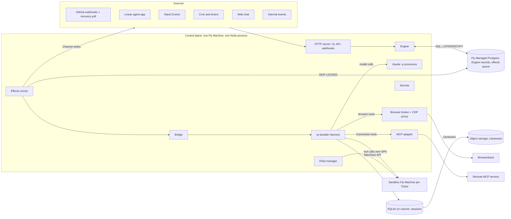
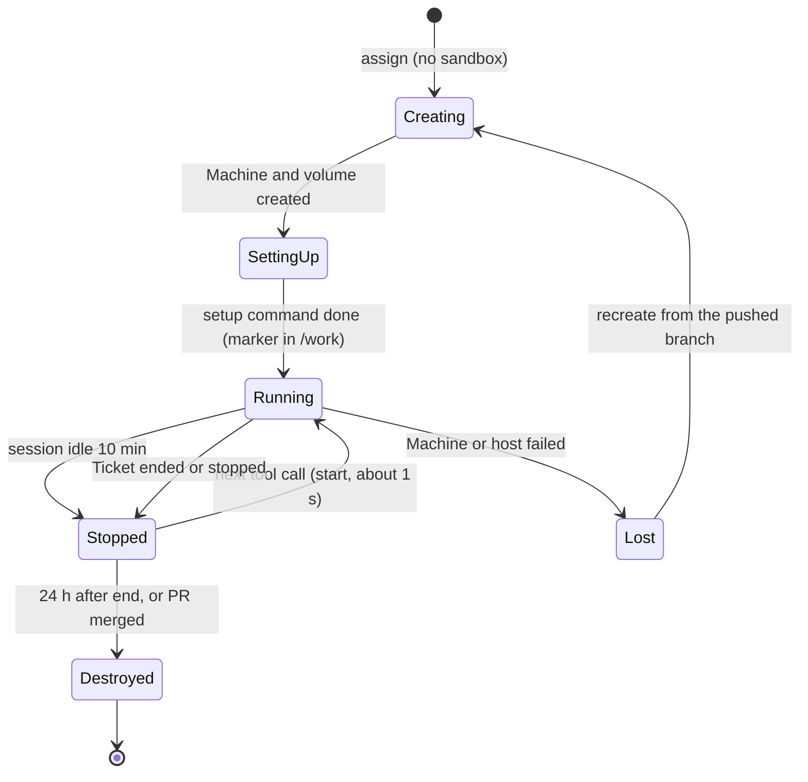
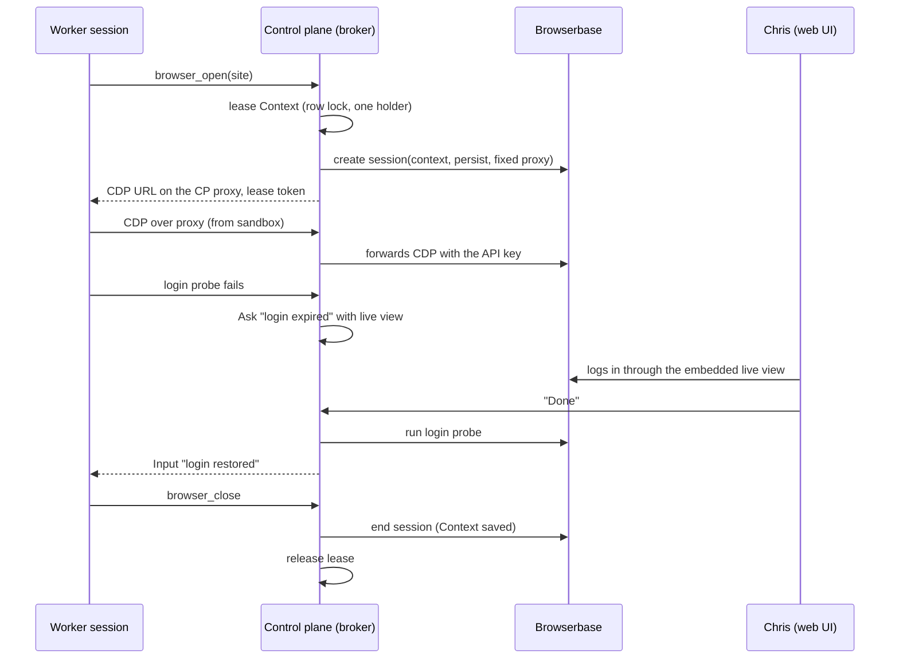

# Borant cloud control plane design

Date: 2026-11-03. Status: draft for Chris to review. Nothing is built, and no
cloud money is spent.

This document describes a new system, the Borant cloud control plane: one
TypeScript service in the cloud. It receives work from many Sources and decides
what work to start. It runs every agent's durable loop with pi-durable, and it
runs tools in a Fly Machine per Ticket.

The new system runs in parallel with current Borant: the Rust hub, NATS
JetStream, the host daemons, and the Claude Code and omp sessions in tmux. The
two systems share no hub, state, credentials, hosts, or NATS. This work changes
nothing in current Borant and moves nothing off it (section 21).

Marks in this document:

- "(Decided)" means that Chris made the decision. The reason follows it.
- "(My call)" means that the designer made the decision. A builder can change
  a call with a good reason, but must record the change in this document.
- "(Chief default, for Chris to check)" means that the chief set a default
  until Chris answers. It is not Chris's decision.
- "(Recommendation)" means that the designer answers a question that Chris
  left open, and gives the reason. Chris can overrule it.

Section 24 lists every default and recommendation in one table.

Inputs:

- The pi-durable spike: `~/Code/pi-durable-spike/REPORT.md` (2026-11-02),
  cited here as "spike Q1" to "spike Q9". Its scripts and raw output are in
  `src/` and `results/` of that folder.
- The superagent prototype: https://github.com/deepseek-ai/dsh-superagent-prototype
  (MIT), docs `001-domain.md` and `002-authorization.md`. It is a reference
  only. Borant copies no code from it.
- The approved chief mod v3 information design:
  https://claude.ai/artifact/XzyCdoGctUW5Ye7zQv3W3r and its four core specs
  (`2026-11-02-board-task-lines-design.md`, `2026-11-02-agent-activity-design.md`,
  `2026-11-02-person-changes-feed-design.md`, `2026-11-02-mod-actions-design.md`).
- The current design: `2026-10-24-borant-design.md`.
- The review page: https://claude.ai/artifact/KPQ3CGCqFGsbjaySSFUbTX, read on
  2026-11-03 (private to Chris). It has the diagrams. It does not have the
  parallel rule or the chief's defaults, so this document wins where they
  differ.

## 1. Intent and why

Chris runs about 20 coding agents across 10 projects in two collections (work
and personal). A chief of staff talks to him, orchestrators own projects, and
workers do tasks. Today these agents run as Claude Code and omp sessions in
tmux, on two Hetzner VPS hosts and on Chris's Mac, joined by a Rust hub over
NATS JetStream.

This week showed that the base does not hold:

- Hub takeovers started duplicate chiefs.
- Sessions lost their MCP connection to Borant and stopped receiving work.
- The Mac went to sleep and its chiefs stopped.
- Shared hosts ran out of memory, and the OS killed agents.
- State disagreed across NATS keys, leases, and WIP refs, and the system then
  acted on stale state.
- An orchestrator refused to trust an approval that the chief relayed from
  Chris, because nothing proved that Chris gave it.

Each failure comes from the same design: a long-lived interactive harness
process holds the agent loop, and Borant tries to keep that process alive, in
one place, and connected. The new design moves the agent loop into a durable
store that one service owns. A process crash then costs one tool call, not a
session.

The second reason is attention. Chris wants the system to take as little of
his attention as possible. Work comes from GitHub, Linear, Slack, timers, and
his own chat. The system decides which of it is work, asks him only when only
he can answer, and shows him one screen with what needs him.

The new system runs beside current Borant, not in place of it. Current Borant
does Chris's real work every day, and the new system is unproven. So a failure
of the new system must cost that work nothing. (Decided, order from Chris
through the chief)

## 2. Goals, non-goals, and anti-goals

### Goals

1. One TypeScript control-plane service runs the fleet manager, the Engine,
   the web UI, and the durable loop of every agent. (Decided)
2. No agent of the new system runs on Chris's Mac. A laptop that sleeps changes
   nothing. (Decided)
3. A crash of the control plane or of a sandbox loses at most the tool call
   that was running. Every Trigger, Input, report, and approval survives.
4. Work enters only through Sources. Only an Eval starts a Ticket, and every
   Ticket carries an immutable Mandate that says why the work is allowed.
   (Decided)
5. An approval reaches the worker from Chris directly, stamped with his login.
   No agent relays an approval. (Decided)
6. A loop (a Source, its Policy, and its prompts) is versioned, and stored
   Triggers can be replayed against a candidate version to see what changes.
   (Decided)
7. One web screen shows the new system: what needs Chris, quiet work, changes
   since his last look, every project with tasks by name, the PRs closest to
   merge, and one-key actions. (Decided) The chief mod stays as it is for
   current Borant.
8. The new system runs in parallel with current Borant. It has a separate hub,
   state, credentials, and hosts, and no shared NATS. (Decided, order from
   Chris through the chief)
9. The first Profile is `personal`, and its first Project is `boopmark`.
   (Chief default, for Chris to check, on the Profile. My call on the Project,
   section 21.)

### Non-goals for this version

- High availability of the control plane, or sessions across several
  machines. One machine owns the sessions. (Decided)
- Several people as users. The Policy holds an allowed list per Source, and
  only Chris is on it. (My call)
- Mapping one person's identities across Sources. As in the prototype, a
  person is Trigger metadata. (My call)
- Account pools and placement across hosts. One subscription per provider.
  (My call)
- Moving sessions between harnesses. pi-durable is the only harness.
  (Decided)
- A cutover. No Project, Profile, or agent moves off current Borant in this
  work. A move is a later, separate decision (section 21). (Decided, order
  from Chris through the chief)
- Retiring the Rust hub, NATS, the host daemons, or the Hetzner hosts. (Decided,
  order from Chris through the chief)
- The Roger work Projects. Roger work stays on Steve and Steve personal agents
  (section 22). (Chief default, for Chris to check)
- A link between the two systems: no shared board, no messages, no task import.
  (My call)

### Anti-goals

- A second source of truth. If the system can reach a state where two stores
  disagree and nothing reconciles them, the design failed. This week's stale
  state is the failure this design exists to remove.
- Approvals that a model can forge. If an agent can make a worker believe that
  Chris approved something, the design failed, even if the agent meant well.
- More attention, not less. If Chris must check the system to learn whether
  it is working, the design failed.
- A change to current Borant. If this work needs a change to the hub, the host
  daemons, NATS, the mod, or the hosts, the design failed.
- A framework. Every port, table, and command in this document exists for a
  named need. No plugin system, no generic workflow engine.

## 3. Constraints

| Constraint | Source |
|---|---|
| pi-durable 1.5.0 is experimental. The README says "The API changes without notice between releases." 18 releases in 6 weeks. | spike Q1 |
| One process owns a pi-durable storage. There is no cross-process locking. | spike Q2, README line 881 |
| pi-durable has no Postgres storage. Backends: SQLite, JSONL, IndexedDB, memory, Cloudflare Durable Object, Chord store. | spike Q5 |
| pi-durable has no approval-waiting state. A `beforeTool` hook must decide at once. | spike Q3 |
| pi-durable observers live in memory. After a restart, the Engine must look again at what it tracks. | spike Q3 |
| pi-claude-code runs `claude -p` on the machine of the Harness. It refuses to run when `ANTHROPIC_API_KEY`, `ANTHROPIC_AUTH_TOKEN`, or `ANTHROPIC_BASE_URL` is set. | spike Q8 |
| pi-claude-code is not on npm under `@earendil-works`. The npm package named `pi-claude-code` belongs to another author. Do not install it. | spike Q8 |
| Anthropic announced, then paused, a move of `claude -p` use to separate "Agent SDK credit" at API rates. | Chris |
| Browserbase: a Context cannot be used by two sessions at once. Google blocks automated sign-in. | Chris |
| Node >= 22.19 (the SDK requirement). | spike, setup |
| Run focused tests only outside CI. | `AGENTS.md` |
| Runs in parallel with current Borant: separate hub, state, credentials, and hosts. No shared NATS. No change to the running system. No cutover in this work. | Chris, through the chief |
| No build, no infrastructure, and no cloud spend before Chris approves this document. | Chris, through the chief |
| The `borant` repo is public. This document holds no internal details of Roger's systems. | `gh repo view` on 2026-11-03 |

### Evidence from the pi-durable spike

The design rests on these results. The scripts and raw output are in
`~/Code/pi-durable-spike`.

| What the design needs | Result | Spike |
|---|---|---|
| A retry of an Input does not duplicate it | The same `requestId` returned the same submission and wrote nothing: `follow-up id=13 retry id=13 same=true`. | Q2 |
| The Engine can see delivery and run end | `observeCommits` reports `queued`, `placed`, `done`, tool start and end, and `pi.live`. Observers live in memory. | Q3 |
| One process can hold every session | 50 conversations: about 84 KB heap each when idle. 500: about 25 KB each, RSS 172 MB. The `claude -p` processes are the limit, not the sessions. | Q4 |
| Postgres and SQLite need a keyed bridge | No Postgres storage exists. The `Tx` object has no SQL method, so Engine SQL is always a separate transaction. | Q5 |
| A control-plane crash does not repeat a sandbox job | The process was killed with `kill -9` 6 s into a 20 s job. The rerun reattached by task ID: `starts: 1, tookMs: 20002`. | Q6, Q9 |
| A tool with no idempotency key is not run twice | After the same kill, the model got an error result: `Tool sleep20 was interrupted and may have partially run`. | Q9 |
| A report is consumed once | The tool wrote the outbox entry, and the process killed itself before the result committed (exit status 137). After the restart, the outbox held one report, and the Engine consumed it once. | Q7 |
| Claude runs on the subscription, with Pi running the tools | One real Haiku turn took 2047 ms and called `report_ready`. List price $0.0022, billed to the Claude Max subscription. | Q8 |

The spike does not prove these points:

- It ran on the Mac. The Fly Machine was a stand-in, `src/fake-fly.ts`.
- Only one turn used a real model. All other runs used pi-ai's faux provider.
- No real turn ran with Codex or LunaRoute. Both only register.
- Nothing tested a `claude` login on a headless Linux machine.
- Nothing tested the bridge with Postgres, a Litestream restore, or long
  transcripts.

The builder proves these points before the first Project runs, except LunaRoute.
Section 21 lists them in order, and section 17 sets the model tests.

## 4. Approaches

### The decided approach

One persistent Fly Machine with a volume runs one Node process: the control
plane. The Engine keeps its records in Fly Managed Postgres. pi-durable keeps
session state in SQLite on the volume. An idempotent bridge joins the two
stores. Tools run in one Fly Machine per Ticket. Logged-in browser work runs
in Browserbase. (Decided) The whole system runs beside current Borant and
shares nothing with it. (Decided, order from Chris through the chief)

### Rejected approaches

| Approach | What it offered | Why it lost |
|---|---|---|
| Keep the Rust hub and adapt it | No rewrite. The hub, tasks, and channels work today. | The failures come from its core idea: interactive sessions on hosts, kept alive by leases, moves, and checkpoints. Adapting it keeps that idea. A durable agent loop in Rust does not exist, and pi-durable is TypeScript. |
| Control plane on Cloudflare Durable Objects | pi-durable supports Durable Object storage. No machine to run. | pi-claude-code needs a real process to run `claude -p`. Workers cannot run a CLI. Tools still need Fly Machines, so the system spans two clouds for no gain. |
| NATS JetStream as the queue | Today's bus. Push delivery. | A second store next to the Engine records, with its own state and its own failures. This week's stale state came partly from it. A Postgres outbox puts the queue row and the state change in one transaction. |
| SQLite only (option A) | Engine state as pi-durable documents commits atomically with the session (spike Q5). One file, one backup. | Durable documents are JSON blobs with no SQL. The Engine needs queries for the board, Threads, Decisions, replay, and the changes feed. Raw Engine SQL in the same file is a separate transaction anyway (spike Q5). Chris chose option B. Section 20 asks Chris about one variant for cost: raw Engine tables in the same file, with the keyed crossings kept. |
| Postgres for both, with our own pi-durable `Storage` (option C) | One database, one backup, one restore point. | We write and maintain a storage adapter for an SDK that changes every few days, and pass its conformance suite at each release. It gives no shared transaction for Engine tables, and one process still owns the store. |
| A local Mac runner | Fast local builds, local browser logins. | Laptop sleep stopped chiefs this week. Secrets on the laptop. Chris decided cloud only. |
| Attach the new system to current Borant's hub and NATS | One board and one task list across both systems. | It shares state and failures with the running system, and it needs changes to that system. Chris's order rules it out. |
| Cut over Project by Project as part of this work | One system sooner, and no double running. | It puts daily work on an unproven system. Chris's order rules it out. A move stays open as a later decision (section 21). |

## 5. Architecture

### Components

| Component | Job |
|---|---|
| HTTP server | Serves the web UI and its API, receives webhooks, checks their signatures, and ends the web chat. |
| Source adapters | Turn outside events into Triggers. Each keeps a read position for recovery polls. |
| Engine | Owns every domain rule: Triggers, Threads, Evals, Decisions, Tickets, Mandates, Assignments, Subscriptions, Channels, approvals, stages, slots. It writes only to Postgres. |
| Effects runner | Takes effect rows from Postgres with `SELECT ... FOR UPDATE SKIP LOCKED`, wakes on `LISTEN/NOTIFY`, and runs each effect after the commit that wrote it. |
| Bridge | The only code that crosses from Postgres to SQLite and back: Inputs in, reports and activity out. Section 7. |
| Harness | pi-durable 1.5.0 behind our own `SessionPort`. One conversation per Ticket, one router conversation per Profile. |
| `claude -p` processes | Started by pi-claude-code for each Claude model request. They run on the control plane, not in sandboxes. |
| Fleet manager | Creates, starts, stops, and destroys sandbox Machines through the Fly Machines API. |
| Browser broker | Leases Browserbase Contexts, starts sessions, proxies CDP so that the Browserbase key stays in the control plane. |
| Secrets | Holds credentials and injects them into one tool call at a time. Section 13. |
| Git proxy | Forwards git from sandboxes to GitHub with an App token, and refuses a push outside the Ticket's branch prefix. Section 11. |
| MCP adapter | Registers each tool of a Connection as a pi-durable tool and calls the remote MCP server. Section 14. |

The Node process is one deployable unit with one entry point. The Engine,
the effects runner, and the Harness are modules in that process. The Engine
must not import pi-durable. It talks to sessions only through the
`SessionPort` interface. (My call, because pi-durable changes often and the
port keeps those changes in one adapter.)

Code lives in a new private repo, `willisrocks/borant-cloud`, as a pnpm
workspace. (My call, because a directory in the `borant` repo runs its CI and
its releases, and a change to those is a change to current Borant.)

The `borant` repo's ports-and-adapters rule carries over in a smaller form. The Engine
calls outside systems only through four ports with neutral types:
`SessionPort` (pi-durable), `SandboxPort` (Fly Machines), `BrowserPort`
(Browserbase), and `ChannelPort` (one adapter per Source kind). Vendor names
appear only in adapters. Postgres is the Engine's own database, not a port.
Only `SessionPort` gets a contract suite at first: the spike's crash tests.
The exec plugin protocol and the private-repo rule of the Rust system do not
apply to the new repo. Its own `AGENTS.md` says so. (My call, because a
contract suite for each port is work that no change needs yet.)

### Network

- The control plane has a public HTTPS endpoint for the web UI and for
  webhooks. Every webhook route checks the provider signature. The UI
  requires a login (section 12). (My call)
- Sandboxes have no public address. The control plane reaches them over Fly's
  private network (6PN). Sandboxes reach the internet for package registries and
  public web pages. Git to GitHub goes through the git proxy. (My call)
- Sandboxes cannot reach Postgres or the control plane's admin routes. They
  reach only the CDP proxy route and the git proxy route, with a token per
  browser lease and per Assignment. (My call)
- The Fly Machines do not join the Tailscale tailnet of current Borant. (My
  call)

### Separate from current Borant

| Part | Current Borant | New system |
|---|---|---|
| Hub | The Rust hub | The control plane. It never connects to the Rust hub. |
| State | NATS JetStream | Postgres and SQLite. No NATS server, client, or subject. |
| Hosts | Two Hetzner hosts and the Mac, on the tailnet | Fly Machines in their own Fly apps |
| Credentials | Its own | New values, none copied (section 13) |
| Code | Rust crates in `willisrocks/borant` | `willisrocks/borant-cloud`, no shared code |
| Person's view | The chief mod | The web screen (section 12) |
| Group of Projects | "collection" | "Profile" (Chief default, for Chris to check) |

The rules that follow from this table (Decided, order from Chris through the
chief, with the details as my call):

1. No code path joins the two systems at runtime. The control plane does not
   call the `borant` CLI, the Borant MCP tools, or the hub. Current Borant does
   not know that the new system exists.
2. The build changes no file in the `borant` or `borant-infra` repos, except
   this document.
3. Agents of current Borant can write the new code, as normal tasks in the new
   repo. That is use of a tool, not a runtime link.
4. Only two outside things touch both systems: a Claude subscription's usage
   limit, and a GitHub repo that both work on. Section 21 sets the rules for
   each.

## 6. Domain model

The terms below are the names in code, API, UI, and docs. They follow the
superagent prototype where the idea came from it. Concepts that the prototype
has and this design cut: Correlation (adds context only, and Thread snapshots
already carry context) and Executor as a separate concept (the Assignment
names the session and the sandbox directly).

| Term | Definition | Rules it keeps |
|---|---|---|
| Profile | A group of Projects with one router. The first and only Profile is `personal`. The word applies to the new system only. Current Borant keeps "collection". (Chief default, for Chris to check) | Each Profile has its own router session, Policy part, Source instances, and Connections. |
| Project | Configuration: a repo, a setup command, a sandbox size, secret bundles, Connections, models, and its Policy part. | Configuration, not state. Versioned with the Policy (section 11). |
| Source | A stream of outside events. A Source kind is code (GitHub, Linear, Slack, cron, web chat, internal). A Source instance is one configuration of a kind. | Holds its read position. Drops its own bot's messages before they enter the domain. Says which Threads and Channel addresses an event belongs to. |
| Trigger | One immutable event from a Source, with the actor as the Source gives it and a `human` flag. | ID = hash of Source instance ID and the Source's own event ID. A second insert is a no-op. |
| Thread | Triggers in time order. The Source defines which Triggers form one Thread: a PR, an issue, a Slack thread, a chat conversation, a Ticket's own chat. | At most one Eval runs on a Thread at a time. Triggers that arrive meanwhile wait for the next batch. |
| Subscription | A link between a Ticket and a Thread. | A Trigger from an allowed sender goes to every live subscribed Ticket as an Input, with no Eval. Allowed senders are the Source's allowed list and the CI and bot events that the Policy names. A Trigger from anyone else is recorded and does nothing else. A Trigger that a live Ticket took never goes to an Eval. A message from a person on the allowed list, on a Thread whose Tickets all ended, resumes them under their Mandates, with no Eval. A bot or CI Trigger on such a Thread goes to an Eval. (My call) |
| Eval | The judgment on a batch of Triggers on one Thread: a deterministic gate, then a model assessment with a schema. | Holds no state of its own. Its output is one Decision. |
| Decision | The stored result of one Eval: accept, ignore, stop, or unavailable. | Stores the candidate, the context snapshot, the gate result, the prompt revision, the model, and the raw model output (section 18). |
| Candidate | What the Eval judges: the Trigger batch, plus a proposed brief when the router or an allowed bot proposed one. | Stored with its Decision. |
| Policy | Versioned rules as data: who can originate work through each Source, the gate rules, standing permissions, accept mode (live or observe), and model choices. | Every Decision and Mandate records the Policy version. A change goes to each live Ticket as a notice. It revokes a Mandate only when the new allowed list no longer holds the Mandate's sender (section 8, `publish_policy`). |
| Mandate | What an accept grants: strength (`explicit` or `inferred`), scope, Policy version, basis (the Trigger IDs and the exact text that asked), and sender. | Immutable. A wider scope needs a new Ticket. Only a person's stop or a revocation by `publish_policy` withdraws it. |
| Scope | The structured part of a Mandate that code enforces: Project, repo, branch prefix, allowed gated actions, and secret bundles. The brief is free text next to it. | `authorize` and secret injection read the structured fields. The assessor writes them, inside what the gate allows. (My call) |
| Ticket | A unit of authorized work. | Only an Eval creates one. It holds its Mandate, Subscriptions, Channels, Inputs, Assignments, and stage. |
| Assignment | The binding of a Ticket to one pi-durable session and one sandbox. | A Ticket has one live Assignment at a time and can have several over its life. States: pending, running, ended. |
| Input | One message for a Ticket's session: the brief, a person's answer, a note, a CI result, a Policy notice. | Has a `requestId` (the Trigger ID or the Engine's own key). Submitted to pi-durable once. |
| Report | A structured result from a session: `ready`, `blocked`, `ask_person`, `progress`, `done`. | Written by a report tool to an outbox document keyed by the tool task ID. The Engine consumes each one once. |
| Ask | A question from a worker to a person, with the full question, why now, the kind (`answer` or `approve`), and the options. | Stays open until a person answers or the worker withdraws it. |
| Approval | A person's yes to an `approve` Ask, recorded from a Trigger with `human = true`. | Gated tools check for an Approval row. A model cannot create one. |
| Channel | The write side of a Thread: a GitHub comment, a PR review reply, a Slack thread reply, a Linear comment, a web chat message. | A Ticket holds a set of Channels. |
| Outbox message | One pending Channel write. | Fixed message ID, chosen before the first attempt. Delivered in order per conversation. |
| Effect | One unit of work that runs after a commit: submit an Input, run an Eval, write a Channel, start a sandbox, and the others in section 8. | Written in the same transaction as the state change that needs it. Idempotent by its key. |
| Router | The chief of staff: a long-lived pi-durable conversation per Profile that talks with Chris. | Reads the board, adds notes, and proposes briefs. Grants nothing. Owns the Profile's chat Thread (section 8). |
| Worker slot | Permission to run one working Ticket at a time. | A fixed number per control plane, plus one extra slot kept for a Ticket that just received a person's message. |
| Sandbox | The Fly Machine where a Ticket's tools run. | One per live Assignment. Holds no secrets at rest. |
| Browser Context | A Browserbase Context that holds one site login. | One user at a time, through a lease. |
| Connection | One remote MCP server with one person's login, for one Profile. | The control plane holds its token and makes its calls. A sandbox never does (section 14). |

### Ticket and router sessions

Each Ticket has one pi-durable conversation. The worker in it can start
subagents with pi-durable child tasks. The subagents share the Ticket's
sandbox. There is no orchestrator tier: today's chief, orchestrator, and
worker chain becomes router and Ticket worker. (Decided)

Each Profile has one router conversation that lives as long as the Profile.
(My call, because a later Profile has its own Policy part, Source instances,
and Connections.)

## 7. The Postgres and SQLite bridge

The Engine commits in Postgres. pi-durable commits in SQLite. No transaction
spans both. (Decided) The bridge makes every crossing idempotent, so that
each side can retry until both sides agree.

### Engine to session: Inputs

1. An Engine command writes an `inputs` row (Ticket, `request_id`, content,
   `when_busy`) and a `submit_input` effect in one Postgres transaction.
2. The effects runner calls `SessionPort.submit(conversation, { requestId,
   content, whenBusy })`. pi-durable returns the existing submission when the
   `requestId` is known and writes nothing (spike Q2).
3. The effects runner marks the effect done and stores the submission ID.
4. The commit observer (`observeCommits`) sees the submission reach `placed`
   and sets `inputs.placed_at` (spike Q3).

`request_id` is the Trigger ID for Inputs that come from Triggers, and
`engine:<ticket>:<kind>:<n>` for the Engine's own Inputs (the brief, a Policy
notice). `when_busy` is `steer` for a person's answer and for a stop, and
`followUp` for everything else. (My call)

### Admission: no run without a slot

pi-durable starts a run as soon as an idle conversation receives an Input.
So the Engine submits an Input at once only when the Ticket is `working`.
For any other stage, the Input row waits with `state = held`. (My call)

Each Input kind says whether it wakes the Ticket:

| Wakes the Ticket | Waits for the next run |
|---|---|
| A person's message, answer, approval, or stop. CI results and review comments on the Ticket's PR. "Login restored". | Router notes. Policy notices. Bot comments that are not reviews. |

A waking Input writes an `assign` effect. When `assign` admits the Ticket, it
writes one `submit_input` effect per held Input, in arrival order. A
non-waking Input stays held until a waking Input or the brief starts the next
run. A stop never waits: it takes the extra slot when no slot is free, like a
person's answer.

### Session to Engine: reports

1. A report tool (`report_ready`, `report_blocked`, `ask_person`,
   `report_progress`, `report_done`) writes its payload to the `Outbox`
   pi-durable document, keyed by `api.taskId`, with `consumed: false`. Every
   report tool except `report_progress` returns `control: { terminate: true }`,
   so the run ends without another model request (spike Q7). All report tools
   are `replay: "safe"`.
2. The bridge reads unconsumed outbox entries when the commit observer sees
   the document change, and on a 10 s timer as a fallback.
3. For each entry, the Engine runs `consume_report` in one Postgres
   transaction. The `reports` table has a unique key on the outbox key, so a
   second insert does nothing.
4. After the Postgres commit, the bridge marks the entry consumed, with
   `consumed_at`, in one pi-durable commit.

Consumed entries stay in the document for 35 days, longer than the longest
backup window, so that a restore can be reconciled. (My call)

### Activity

The commit observer also writes each session's last tool start, tool end,
and turn end into a `session_activity` row. These writes are best effort and
can be lost in a crash. The startup reconcile reads the live state from the
Harness and repairs them. Silent detection (section 10) reads this table.

### Run end

A run can end with no report: the model answers in text, the run fails, or
a replay-safe tool hits `restart_limit`. Slots must not leak, so run end is a
durable command, `run_ended`, found three ways (My call):

- The commit observer sees the run end in `pi.live`, or the submission reach
  `done` or `unanswered`.
- A sweep every 60 s asks `SessionPort` for the run state of every running
  Assignment.
- The startup reconcile, step 5.

`run_ended` is idempotent by the run ID, so all three can fire for one run.

### Failure windows

| Window | What is true after the crash | Recovery |
|---|---|---|
| Crash after the Postgres commit, before `submit` | Input row and effect exist. No submission. | The effect is still pending. The runner retries it after the restart. |
| Crash after `submit` commits in SQLite, before the effect is marked done | Submission exists. Effect still pending. | The retry submits with the same `requestId`. pi-durable returns the existing submission and writes nothing (spike Q2, Q9). |
| Postgres down when the runner marks the effect done | Submission exists. Effect still pending. | The runner retries the mark with backoff. A later retry of the submit is also a no-op. |
| Crash during a model call or a tool call | The session's task checkpoint is in SQLite. | `harness.resume()` continues. A default tool returns "interrupted" to the model. A `replay: "safe"` tool runs again with the same task ID and reattaches to its job in the sandbox (spike Q6, Q9). |
| Crash after the report tool writes the outbox entry, before its tool result commits | Outbox entry exists, unconsumed. | The replay-safe tool runs again and writes the same key. One entry (spike Q7). |
| Crash after `consume_report` commits in Postgres, before the entry is marked consumed | Report row exists. Entry unconsumed. | The bridge reads the entry again. The insert hits the unique key and does nothing. The bridge marks it consumed. |
| Postgres down while sessions run | Sessions continue their model calls and tools. Reports wait unconsumed. No new Triggers, Evals, or Channel writes. | The bridge retries. Nothing is lost. The UI shows "Engine paused: Postgres unreachable". Webhooks return 503 (section 8). |
| SQLite restored to a point older than Postgres | Postgres knows Inputs and Tickets that SQLite does not. Some consumed reports appear unconsumed again. | Startup reconcile, below. |
| Postgres restored to a point older than SQLite | SQLite holds submissions and consumed reports that Postgres does not know. | Startup reconcile, below. |
| Commit observer missed events (it lives in memory) | `placed_at` and activity are stale. | Startup reconcile reads submission status for every Input that is not `done`. |

### Startup reconcile

The control plane runs this before it accepts traffic, and the operator can
run it from the admin page:

1. For every open Ticket, make sure that its conversation exists. If it does
   not exist, rebuild it:
   - Create a new conversation. End the old Assignment with reason
     `session_lost`, and write a new Assignment that names the new
     conversation and the same sandbox.
   - Submit one Input with `requestId` `rebuild:<ticket>:<n>`. It holds the
     brief, the Mandate, and every Input of the old conversation in order,
     as a transcript summary.
   - Mark every Input of the old conversation `superseded`. Step 2 skips
     them.
   - Record a `session_rebuilt` event on the Ticket.
2. For every Input of a current conversation that is not `superseded`, ask
   the Harness for its submission by `requestId`. If none exists, or it is not
   `done` or `unanswered`, submit it again with its `requestId`. This is a
   no-op where the submission exists. Held Inputs stay held.
3. For every outbox entry, unconsumed or consumed in the last 35 days, run
   `consume_report`. This is a no-op where the report row exists, and it
   restores report rows that a Postgres restore lost.
4. For every conversation with no Ticket in Postgres, list it on the admin
   page as an orphan. Do not delete it. A person decides.
5. For every running Assignment whose conversation has no active run, run
   `run_ended` (section 8).
6. Run `harness.resume()`.

Both stores back up continuously: Fly Managed Postgres with its point-in-time
recovery, and SQLite with Litestream to object storage. To restore, pick one
time T and restore both to T. The reconcile repairs the seconds of difference.
(My call, and the builder must make sure that the MPG plan includes
point-in-time recovery.)

## 8. Engine commands and transactions

Every command is one Postgres transaction. It reads with row locks where it
changes state, writes state and effects together, and commits. Effects run
after the commit. No command calls a model or an outside API inside a
transaction.

| Command | Locks | Writes | Effects |
|---|---|---|---|
| `ingest(sourceInstance, event)` | none | Trigger (`ON CONFLICT DO NOTHING`), Thread links, Source read position. A Subscription when the Trigger is a PR on a `cloud/<ticket id>/` branch of a live Ticket. On a Profile chat Thread: an Input for the router, and nothing else. On other Threads, if the sender is allowed: an Input for each live subscribed Ticket (submitted or held, section 7). A message from an allowed person resumes ended subscribed Tickets. If the Thread has no live subscribed Ticket and no message resumed one: `threads.eval_pending = true`. | `submit_input` or `assign` per Input. `run_eval` for the Thread. |
| `claim_eval(thread)` | Thread row `FOR UPDATE` | `eval_running = <eval id>`, the batch of pending Trigger IDs, the Policy version. | none |
| `decide(evalId, gateResult, assessment)` | Thread row `FOR UPDATE` | If the claim or the Policy version changed: nothing, and a new `run_eval`. Else the Decision. On accept: Ticket, Mandate, its own chat Thread, Subscriptions to that Thread and to each Thread of the batch except a Profile chat Thread, Channels, Assignment (pending), brief Input, stage `queued`. Clear `eval_running`. | `channel_write` (acknowledgment). `assign`. `run_eval` again if Triggers arrived meanwhile. |
| `assign(ticket)` | slot counter row `FOR UPDATE`, Ticket row | If a slot is free: Assignment running, stage `working`. | `ensure_sandbox`, `submit_input`. |
| `consume_report(entry)` | Ticket row `FOR UPDATE` | Report (unique outbox key), stage change, Ask, changes-feed event. | `channel_write` per Channel the report names. `stop_sandbox` after `done`. |
| `run_ended(assignment, outcome)` | Ticket row, slot counter row | Slot release. Stage: kept if a report already set it, `blocked/failed` for a run failure or `restart_limit`, else `idle`. Idempotent: a second call for the same run does nothing. | `assign` for the next queued Ticket. `stop_sandbox` timer. |
| `answer(person, ask, text)` | Ask row | Through `ingest` on the Ticket's chat Thread, as a Trigger with `human = true`. | `submit_input` with `whenBusy: "steer"`. |
| `approve(person, ask)` | Ask row | Trigger, then an Approval row linked to the Ask. | `submit_input`. |
| `stop(person, ticket)` | Ticket row | Trigger, Ticket stopped, Subscriptions kept but muted. | `submit_input` (stop notice, steer). `stop_sandbox`. |
| `note(router, ticket, text)` | none | An Input with `actor = router`, `human = false`. | `submit_input`. |
| `propose(router, fromTrigger, project, brief)` | none | A candidate on the Thread of `fromTrigger`, and `eval_pending = true`. | `run_eval`. |
| `publish_policy(commitSha)` | policy row, then each live Ticket row | New Policy version. For each live Ticket: if the new allowed list no longer holds the Mandate's sender, revoke the Mandate and stop the Ticket. Else, if a rule it used changed, a notice Input. | `submit_input` per notice or stop. `channel_write` for each revocation. |
| `mark_seen(person, upToEventId)` | none | Seen position. | none |

### Eval

An Eval runs in two steps between `claim_eval` and `decide`:

1. Gate. Deterministic code reads the Trigger batch and the Policy. It
   answers: is the actor on the Source's allowed list, is the actor human, is
   the Source in observe mode, and which strength can this sender grant. A
   Trigger from an actor who is not allowed ends here with `ignore`. A bot or
   CI Trigger can lead only to an `inferred` accept, and only when a Policy
   rule names that event, for example "CI failed on a PR of an ended Ticket
   in this Project". (My call)
2. Assessment. One model call with no chat history. Its input is the stored
   context snapshot: the Trigger batch, the last 50 Triggers of the Thread,
   every Ticket on the Thread with its stage (ended ones too), the Project
   list, and the candidate. Its output follows a JSON schema: decision,
   project, brief, scope, strength, reasons. (Decided)

The assessment calls pi-ai directly, not through a pi-durable conversation,
because an Eval holds no state and runs again in full after a crash. (My call)

If the assessment fails or times out after 3 attempts, the Decision is
`unavailable`, and the Triggers go back to pending with a 10 minute delay.
(My call)

### Why subscribed Triggers skip the Eval

Two paths leave a Thread. The Eval path is the only way to start work. An accept
creates the Ticket, its Mandate, and a Subscription to the Thread. After that,
later Triggers on that Thread go straight to the Ticket's session as Inputs.
They start no new work and add no authority.

For example, Chris asks for a fix. The Eval accepts it, and the worker opens PR
#50. The branch name holds the Ticket ID, so `ingest` subscribes the Ticket to
the Thread of that PR. Later
CI results, review comments, and Chris's replies on #50 go to that worker as
Inputs. Each Eval costs a model call and adds delay. On a subscribed Thread, an
Eval protects nothing, because the Trigger asks for no new authority. (My call)

So a Subscription has two origins: the accept itself, and a PR whose head branch
is `cloud/<ticket id>/...`. No other path creates one. (My call)

The router path goes through the Eval because a proposal asks for a new Ticket.
A new Ticket means new authority and new spend. The router also reads untrusted
text, such as issue bodies and PR comments, and a prompt injection can make it
propose work that Chris never asked for. So the Eval guards the start of work,
not each event inside approved work. (Decided)

The sender filter in `ingest` stops a stranger's comment in code, which matters
because `boopmark` is a public repo. The remaining risk is untrusted text that
the worker reads: a PR diff, an issue body, or the output of a tool. The worker
prompt marks that text as untrusted data, and section 11 sets what holds if the
text takes over the worker. (My call)

### Router and the web chat

Chris's chief chat is a Source. Each message is a Trigger with
`actor = <logged-in person>`, `human = true`, on the Profile's chat
Thread. The router conversation is subscribed to that Thread and receives
each message as an Input. It answers in the chat. (Decided)

The router does not create work. When Chris asks for work, the router calls
`propose` with the ID of his Trigger and a clear brief. The Eval then judges
the candidate. The gate takes the strength from Chris's Trigger, not from the
router, and the assessment checks that the brief stays inside what his text
asked for. The Mandate's basis stores his exact text. (My call, because the
router has the conversation context to write a good brief, and this keeps the
router unable to grant anything.)

Triggers from GitHub, Linear, Slack, and cron go to the Eval directly. The
router does not see them except through the board.

The Profile's chat Thread belongs to the router alone. `ingest` gives each message
to the router conversation and never sets `eval_pending` there, so only `propose`
starts an Eval from chat. An accepted Ticket does not subscribe to this Thread. It
gets its own chat Thread, and Chris answers a Ticket there, from the Ticket detail
or with `r`. Router runs take no worker slot, because each Profile has one router
and its runs are short. (My call)

### Effects and the queue

The `effects` table is the only queue. (Decided)

| Column | Meaning |
|---|---|
| `id` | Row ID |
| `kind` | `submit_input`, `run_eval`, `assign`, `channel_write`, `ensure_sandbox`, `stop_sandbox`, `destroy_sandbox`, `recover_poll`, `browser_release`, `notify` |
| `key` | Unique idempotency key, for example `submit_input:<request_id>` |
| `payload` | JSON |
| `state` | `pending`, `running`, `done`, `dead` |
| `attempts`, `run_after`, `locked_until`, `last_error` | Retry state |

The runner takes rows with `SELECT ... WHERE state = 'pending' AND run_after
<= now() ORDER BY id FOR UPDATE SKIP LOCKED LIMIT 20`, sets `running` with a
lease of 5 minutes, and commits. It wakes on `NOTIFY effects`, which the
writing transaction sends, and polls every 5 s as a fallback. A failure sets
`run_after` with exponential backoff from 5 s to 10 minutes. After 20
attempts, the effect is `dead` and appears on the admin page. (My call)

A row whose lease ended while `running` returns to `pending`. Each handler
must be idempotent by `key`, because a crash after the work and before the
`done` commit runs it again.

### Webhooks while Postgres is down

A webhook that cannot commit its Trigger returns 503. GitHub does not retry by
itself, so a `recover_poll` effect runs for each Source when Postgres returns,
and every 15 minutes. It reads events since the Source's read position and
ingests them. Trigger IDs make the overlap harmless. Slack and Linear retry
on their own, and the poll covers the rest. (My call, because a local spool
file is one more store to reconcile.)

## 9. Delivery guarantees

| Path | Guarantee | How |
|---|---|---|
| Outside event to Trigger | Exactly one Trigger per event | At-least-once intake. Trigger ID is a hash of Source instance and event ID. |
| Trigger to Eval | Each Trigger is in exactly one Decision batch | `claim_eval` takes the batch under a row lock. A discarded Eval returns its batch. |
| Trigger to a Ticket's session | Exactly once in the transcript | `requestId` = Trigger ID (spike Q2). |
| Report to Engine | Exactly once | Outbox key = tool task ID, unique key in `reports` (spike Q7). |
| Tool call in the sandbox | At most once per task ID for replay-safe tools. An `interrupted` result for the others. | The sandbox daemon dedupes on the task ID (spike Q6). |
| Engine to outside Channel | Effectively once, in order per conversation | At-least-once attempts. Before a retry after an unknown result, the handler looks for the message ID: a hidden `<!-- borant:<id> -->` marker in GitHub and Linear comments, Slack message `metadata`. The next message in a conversation waits until the one before it is `done`. |
| Effects | At least once | Idempotent handlers by `key`. |

## 10. Ticket stages and the board

A Ticket's stage is derived by the Engine and stored on the Ticket for the
board query. (Decided)

| Stage | Means | Set by |
|---|---|---|
| `person/answer` | The worker asked a question and waits. | `ask_person` with kind `answer` |
| `person/review` | A result waits for Chris: an approval, or a PR he must review. | `ask_person` with kind `approve`, or `report_ready` |
| `blocked/failed` | The worker cannot continue, or the session or sandbox failed. | `report_blocked`, `run_ended` with a failure, a dead effect, a lost sandbox |
| `queued` | Accepted, waiting for a worker slot. | `decide` accept, or a waking Input while no slot is free |
| `working` | A run is active. | `assign` |
| `idle` | Open, no run, nothing waits on a person: for example a PR waiting for CI. | `run_ended` with no report that needs a person |

`ended` and `stopped` are Ticket states, not board stages. An ended Ticket
leaves the board and shows in "changes".

Silent work is a view, not a stage: a `working` Ticket with no tool call in
30 minutes, from `session_activity`. This follows the agent activity spec.
"Offline" from the mod v3 design becomes a `blocked/failed` Ticket with the
reason "sandbox lost" or "session failed". (My call)

### Worker slots

The control plane runs at most `slots.working` Tickets at a time (start: 2),
plus one extra slot. When a person answers or approves an Ask, that Ticket
takes a free normal slot, or the extra slot when none is free. So Chris never
waits behind the queue. (Decided) The start value of 2 is my call. It is low
because a Claude subscription's usage limit can be shared with current Borant
(section 21). The builder tunes it from the first week's data.

### What a worker slot protects

A slot limits how many Tickets run at once. It is not a compute unit, because each
Ticket has its own Fly Machine (section 15). The answer differs per resource:

| Resource | What a slot does | What limits it better |
|---|---|---|
| Sandbox CPU and memory | Nothing. Sandboxes share no Machine. | No limit is needed. |
| Control-plane memory | Partly. `claude -p` runs here, but a run holds a process only while a model request streams, plus up to 2 retained processes for 5 minutes (spike Q8). A Ticket that waits for a 20-minute test holds a slot and no process. Router and Eval requests take no slot. | A limit on `claude -p` processes. |
| Control-plane CPU | The same as memory. | The same limit, and a lower CPU weight for `claude`. |
| Claude usage limit | Partly. Fewer runs use the limit more slowly, but router and Eval requests do not count. | A limit that counts every role. A separate account removes the sharing (section 24). |
| Fly spend on sandboxes | Yes. 2 slots and the extra slot mean at most 3 running sandboxes. | Only a cap does this directly. An alert is the weaker replacement. |
| Chris's wait | Harm. The slot creates the queue, and the extra slot repairs that harm. | No queue. |

Current Borant gives the evidence. On 2026-11-03, the orchestrator reported an
overload on `borant-1`: load 40 to 60 on 4 CPUs, agents at the cgroup memory cap,
and the hub's board read timing out. CPU weights and fewer agents fixed it. So the
thing to limit is what shares a host with the hub. On `borant-1`, that is the
agents and their builds. In this design, builds run in sandboxes, so `claude -p` is
the only agent load next to the Engine. Fly also holds a shared vCPU to a 6.25%
baseline after its burst balance ends
(https://docs.fly.io/machines/cpu-performance).

### Option: one limit on `claude -p` processes, no slots

(Recommendation) Replace slots, the extra slot, and held Inputs with one limit.
Slots are in the body of this document until Chris picks (section 24). The goal
that Chris never waits behind a queue stays, because no queue exists.

- Every Input goes to its session at once, and every accepted Ticket runs at once.
- A wrapper around `createClaudeCodeProvider()` holds a semaphore,
  `claude.processes`. Every role counts: workers, the router, and the assessor. A
  request over the limit waits in memory. A request for a person's Input goes first.
- The limit comes from memory: Node plus the limit times the size of one process. A
  new request closes an idle retained process when the cache of 2 is full
  (`src/claude-cli.ts:1120` in pi-claude-code), so retained processes add no memory at
  a limit of 2 or more. The start value is 2. Stage 1 of section 21 measures the size
  of one `claude -p` process.
- `PI_CLAUDE_CODE_COMMAND` names a small script that runs `claude` with `nice` 10
  and a high `oom_score_adj`. So the Engine wins the CPU, and the kernel kills a
  `claude` before Node. A killed process is a failed attempt under `settings.retry`.
  These are the two fixes that worked on `borant-1`.
- A usage-limit hit uses backoff. Claude Code's `rate_limit_event` carries
  `resetsAt`. The wrapper starts no Claude request before that time. `run_ended`
  sets the Ticket to `idle` with the reason "Claude limit until <time>", and
  writes a `submit_input` effect with `run_after` at that time. pi-durable's own
  retry is not enough, because a limit resets after hours and pi-ai does not retry
  quota and billing errors.

What this removes:

| Section | Removed | Stays |
|---|---|---|
| 7 | All of "Admission: no run without a slot". The `held` Input state. "Held Inputs stay held" in the startup reconcile. The slot reason in "Run end". | Inputs, `when_busy`, reports, and `run_ended`, which still sets the stage and finds failed runs. |
| 8 | In `assign`: the slot counter lock and the free-slot test. In `run_ended`: the slot release and the `assign` for the next Ticket. In `ingest`: "or held". In `decide`: the stage `queued`. The router's slot sentence. | All other commands. The `effects` table stays the only durable queue. |
| 10 | The stage `queued`. "Worker slots". | All other stages and the board query. |

Sections 5, 6, 19, 20, 21, and 23 also name slots. One commit changes those words.

Inputs that wait for the next run in section 7 change like this. Router notes and
Policy notices wake the Ticket. Each one costs a model turn, and they are rare. Bot
comments that are not reviews stop at `ingest`: they stay as Triggers on the Thread
and make no Input. The worker reads the Thread when it needs them.

What this risks:

| Risk | Effect | Handling |
|---|---|---|
| A burst of Tickets | No cap on running sandboxes. 20 sandboxes at 8 GB for 8 hours cost $11 a day. | An alert on the count of running sandboxes. In the first Project, Chris starts every Ticket. |
| Tickets that wait for a process | A waiting Ticket has an active run, so section 15 keeps its sandbox running. | Change the stop rule to 10 minutes with no tool call. The next tool call starts the Machine in about 1 s. |
| More use of a shared Claude account | With many Tickets, a limit of 2 keeps 2 requests busy for hours. 2 slots have gaps during tool calls, so this can use the account's limit faster. | A separate account (section 24), or a limit of 1. A metric counts limit hits. |
| A usage-limit hit | All Claude work stops, also Chris's answers, until the reset. Slots do not prevent this, but they reach the limit later. | The backoff above. A Policy commit can move a role to Codex. No test has hit a limit yet, so the builder tests with a faux provider and records the first real error text. |
| A wait inside a model request | `settings.stream.timeoutMs` can count the wait. A host crash counts as a failed attempt. | Take the semaphore before the timed request starts, and test this. |
| A wait looks like silent work | A waiting Ticket shows no tool call. | The board shows "waiting for Claude" from the semaphore. |

### Board query

One query returns the whole board: every open Ticket with its Project,
stage, title, who (the session name), since when, its open Ask, its PR state,
and the last change. This replaces the "board task lines" read of the mod v3
specs. The changes feed is the `events` table (section 19) after the person's
seen position.

## 11. Authorization and Mandates

1. Work starts only from an accept Decision. The Mandate records the
   strength, scope, Policy version, basis, and sender. (Decided)
2. `explicit` strength needs a human actor on the Source's allowed list whose
   text asks for the work. `inferred` covers work the assessment derived, for
   example "CI on my PR failed, fix it" from a CI failure on a PR that an
   explicit Ticket opened. (Decided)
3. Approvals never travel through an agent. Chris's answer and his approval
   are Triggers from the web chat Source with his login as actor and
   `human = true`, on the Ticket's own Thread. The worker reads them as
   Inputs. (Decided)
4. Gated tools check the Engine, not the transcript. A tool that needs
   approval (for example `merge_pr`, `deploy`, `spend`) calls
   `engine.authorize(ticket, action, params)`. The action must be in the
   Mandate's scope. Then it returns `allowed` when a standing permission in
   the current Policy version covers the action, or when an Approval row
   exists for an Ask that named this action and these params. Otherwise the
   tool returns "needs approval" to the model, and the model raises an
   `approve` Ask. The current version applies, so that removing a standing
   permission takes effect at once. (My call on the mechanism)
5. The router can add notes. A note is an Input with `human = false`. It
   grants nothing, and `authorize` never reads notes. (Decided)
6. Standing permissions are Policy data, for example "a worker can comment on the
   Linear issue of its own Ticket". (Decided)
7. On the first Project, no standing permission covers `merge_pr`, and the Policy
   grants no `deploy` or `spend`. `report_ready` names the PR and opens an
   `approve` Ask for `merge_pr`. Chris approves with `y`, which writes the Approval
   row and wakes the worker, and the worker calls `merge_pr`. A GitHub review does
   not count as an Approval, because a tool with Chris's login can also write one.
   If a merge runs a release workflow, the Ask says so. (My call)

This removes this week's relay problem: no worker needs to trust what the
router says Chris said.

### What holds against a hijacked worker

A worker reads untrusted text, and it has `bash` with internet access. A prompt
injection can take it over. So the Mandate scope and the Approval rule must hold
when the model is hostile, not only when it means well. (My call, because the
anti-goal on forged approvals requires it)

1. No GitHub write credential enters a sandbox. Git in the sandbox reaches GitHub
   through a git proxy route on the control plane, with the Assignment's token.
   The proxy reads the ref updates of each push and refuses any ref outside
   `cloud/<ticket id>/`. It forwards the rest with an App token.
2. Other GitHub writes (open a PR, comment, merge) are tools that run in the
   control plane. `merge_pr` goes through `authorize`. So a hijacked worker cannot
   merge or push to a branch of current Borant.
3. The sender filter in `ingest` (section 6) keeps strangers' comments out of the
   session.
4. A secret bundle is the part that stays exposed. A value in `bash` can leave
   through the open internet. So a bundle holds only test and staging values, and
   no production secret goes into one. The first build has no egress filter,
   because workers need package registries and public pages. This is an accepted
   risk.

### Policy as data

Policy, Project configuration, and prompts live as YAML and Markdown files in
a config repo, `willisrocks/borant-config`. A push to its main branch
publishes a new Policy version, and the version is the commit SHA. A replay
candidate is any other commit or branch. (My call, because git gives versions,
diffs, review, and rollback with no new code.)

## 12. Web UI

The web UI is the native chief-of-staff screen of the new system. It reuses the
approved mod v3 information design. (Decided) The Claude Code mod stays as it
is for current Borant. The screen is a web page, so the terminal limits of mod v3 (one chord, digits at the prompt,
band height) do not apply. The keys keep the same meaning.

Login: GitHub OAuth, with an allowed list of GitHub user IDs in the Policy.
The session cookie is `HttpOnly`, `Secure`, `SameSite=Strict`. (My call)

### The chief-of-staff screen

| Area | Shows |
|---|---|
| Needs you | Each open Ask and each `person/review` and `blocked/failed` Ticket: the full question, why now, who asked, the Project, how long it waits, the router's note if any. Order: decide, approve, answer, unblock, then age. |
| Silent and failed | Working Tickets with no tool call in 30 minutes, with the last tool call shown. Failed sessions and lost sandboxes. |
| Changes since your last look | New Tickets, done Tickets, merged and approved PRs, releases, answered Asks, Policy versions. "Mark seen" sets the seen position. Nothing else does. |
| Projects | Every Project with its Tickets by name: who works on each, for how long, its stage, what it waits on. Idle Projects on one line. |
| PRs closest to merge | Open PRs from Tickets, ordered by how close to merge: ready to merge, approved, review requested, CI running, CI failed. |
| Chat | The router chat for the Profile, at the side. |

| Key | Action |
|---|---|
| `j` `k` or arrows | Move the selection. The detail follows. |
| `1` to `5` | Jump to needs you, silent, PRs, changes, projects. |
| `r` | Answer the selected Ask. A text field opens. Enter sends, Esc keeps the draft. |
| `y` | Approve. A second `y` confirms when the Ask names money or a deploy. `n` cancels. |
| `a` | Ask the router about the selected item. |
| `o` | Open the PR. |
| `g` | Go to the Ticket detail. |
| `x` | Mark the listed changes seen. |
| `/` | Focus the chat. |

### Notifications

Chris must not have to look at the screen to learn that something needs him. The
control plane sends a Web Push to his browser for each new Ask and each Ticket that
enters `blocked/failed`. A `notify` effect carries it, keyed by the Ask or the
stage change, so a retry sends nothing twice. Several within 5 minutes collapse to
one. Web Push needs no outside account. On an iPhone, it needs the page on the home
screen. The dead man's switch (section 19) stays outside, because a dead control
plane cannot push. (My call, and another channel is one adapter.)

### Ticket detail

The Mandate (strength, scope, basis with Chris's exact words, Policy
version), the stage, the open Ask with the answer box, the Trigger history of
every subscribed Thread with the Decisions on them, the live session
transcript (`ConversationTranscript` watch), the sandbox state, the Channels,
and the usage and list-price cost of the session.

### Browser logins

Every Browser Context with its site, state (valid, expired, in use, never
used), time of the last login check, and the Ticket that holds its lease. "Log in"
opens the Browserbase live view in the page (section 16).

### Connections

Every Connection of the Profile with its server, login state, and last refresh.
"Log in" starts the OAuth flow (section 14).

### Loops

Policy versions with their diffs, Decision lists with filters, the Decisions
of observe mode ("would accept"), and replay runs with their diffs and scores
(section 18).

### Admin

Dead effects, orphan conversations, the reconcile button, bridge lag (oldest
pending Input and oldest unconsumed report), the count of `claude` processes,
Postgres reachability.

## 13. Secrets

Secrets live in the control plane and are injected only into the tool call
that needs them. (Decided) Every value is new to this system. The control plane
holds no credential that current Borant uses. (Decided, order from Chris through
the chief)

| Secret | Where | Used by |
|---|---|---|
| Master key, `DATABASE_URL`, GitHub App private key, Slack and Linear tokens, Browserbase API key, GitHub OAuth client | Fly secrets on the control-plane app | The control plane only |
| Claude subscription login | Its own `claude` login, in CLI credentials on the control-plane volume | pi-claude-code |
| Connection OAuth tokens | `secrets` table in Postgres, AES-256-GCM under the master key | The control plane only |
| Codex OAuth, LunaRoute key, Project secret bundles (for example `boopmark-staging`) | `secrets` table in Postgres, AES-256-GCM under the master key | The control plane, and injected tool calls |
| GitHub App tokens | Minted per use as installation tokens, scoped to the Project repo, valid for 1 hour. Never in a sandbox. | The git proxy and the GitHub tools of the control plane |

Rules:

1. A Project's configuration names the secret bundles its Tickets can use.
   The Mandate scope can narrow the list.
2. The control plane sends a bundle's values as environment variables of one
   `exec` request. The sandbox daemon does not write them to disk and does not
   keep them after the command ends.
3. The control plane replaces every injected value with `[secret:<name>]` in
   tool output before the output enters the transcript.
4. The control plane gets its own Codex and LunaRoute logins. It does not
   reuse Chris's `~/.pi/agent/auth.json`, because a refresh rotates the token
   and logs out his CLI (spike Q8).
5. Chris creates a new token or key for each provider and enters it once,
   through the admin page. No value is copied from a host of current Borant or
   from the 1Password items that it uses, because a rotation of a shared value
   breaks the other system. If a provider allows only one key, the builder
   lists it for Chris. (My call)
6. The control plane does not call 1Password at runtime. Chris keeps a copy of
   the master key in a new 1Password item, because a lost master key loses the
   `secrets` table. (My call)

## 14. Tools and connections

Sources and tools do different jobs:

- A Source brings events in and can start work.
- A Channel writes back to the Thread that started the work.
- A tool is what a worker uses during work, for example to read a Linear issue,
  query Sentry, or search Notion.

Many tools must act as Chris, so a Profile needs its own logged-in Connections.

### MCP servers

| Part | Rule |
|---|---|
| Connection | One remote MCP server with Chris's login, for one Profile. For example, Linear with his personal account in the `personal` Profile. (My call) |
| Where it runs | The control plane is the MCP client. A sandbox never connects to an MCP server and never holds its token. The browser broker follows the same rule. (My call) |
| Login | OAuth from the web UI. Tokens go in the `secrets` table, and the control plane refreshes them. A failed refresh raises a "needs you" item of kind `login`, like an expired browser login. |
| Tool calls | pi-durable has no MCP client. A small adapter in the control plane registers each MCP tool as a pi-durable tool, so each call is a durable tool task with a task ID. The README describes this bridge pattern, and `deferred: true` with `tool_search` for a large tool set. (My call) |
| Crash behavior | MCP read tools are `replay: "safe"`. MCP write tools keep the default, so a crash gives the model an `interrupted` result (spike Q9). The worker prompt says to read the current state before it writes again. (My call) |
| Permissions | A Project lists the Connections that its Tickets can use, and a Mandate can narrow the list. Read tools need no approval. Write tools (comment, status change, send message) go through `authorize`, like `merge_pr`. A standing permission can cover them, for example "a worker can comment on the Linear issue of its own Ticket". (My call) |
| Output | MCP results are untrusted data, like PR comments. They enter the transcript with their source marked. |

Workers do not run MCP servers through `claude -p`. Those calls bypass
pi-durable and `authorize`, so a crash loses them and the Mandate does not limit
them. pi-claude-code already returns each tool call to Pi (spike Q8). (My call)

### How a Source receives events

Linear has no webhook for one user's events. It offers three kinds of intake:

| Intake | What arrives | Setup | Use in this design |
|---|---|---|---|
| Linear agent app | Only issues that someone assigns to the agent or mentions it in | An admin installs the app once per workspace | The Source that starts work, because an assignment or a mention is clear intent. (My call) |
| Workspace or team webhook | Every issue and comment change in the team, from everyone | An admin creates it | Observe mode only, to feed the board and Subscriptions. The gate drops most events in code, before any model call. (My call) |
| Notifications, polled as Chris | His inbox: assignments, mentions, comments on issues he follows | His OAuth login | Not used at first. It adds a poll delay, and the agent app covers assignment and mention. |

The other Sources follow the same pattern. GitHub uses App webhooks for the repos
where the App is installed. Slack uses an app that receives mentions and DMs. Cron
needs no setup. A Source that receives every event must stay cheap, so the gate
rejects most events in code and only the rest reach the assessment model.

The first build has the web chat, GitHub, and internal Sources. Cron, Linear, and
Slack follow when a Project needs them. (My call, because `boopmark` needs only
GitHub, and each Source is more to set up.)

### Who acts on GitHub

Agents act on GitHub as a GitHub App, not as Chris. (Recommendation) Chris installs
the App on his own account, on the `boopmark` repo only. The reasons:

- GitHub does not let an author approve their own PR. A worker with Chris's token
  opens PRs in his name, so he cannot approve them, and the review stage of the
  board stops working.
- An App gives tokens that last 1 hour and cover one repo (section 13). A token of
  Chris's covers every repo that he can reach.
- An App is a separate credential, so it meets the parallel rule. Its bot name also
  shows which system wrote a PR when both systems work on one repo.

The cost is that commits and PRs show the bot, and one more private key lives in
Fly secrets. The earlier cost of this choice, a Roger org admin who must install
the App, goes away while Roger work stays on Steve.

The same logic applies to Linear and Slack, where an app identity also exists. A
Source and its Channel writes use the app. A Connection write shows as Chris, so it
goes through `authorize`.

## 15. Sandboxes

One Fly Machine per Ticket runs its tools: bash, git, builds, and headless
Chrome for public pages. (Decided) The agent loop stays in the control
plane, so a sandbox crash costs only the current tool call. (Decided)

### Image and daemon

- One image, `borant-sandbox`, with git, Node, the toolchains of the
  Projects, Chromium for Playwright, and `sandboxd`. Projects that need more
  install it in their setup command. (My call)
- `sandboxd` is a small TypeScript HTTP daemon on the 6PN address. It does
  `exec`, `read`, `write`, and `edit`, each keyed by the pi-durable tool task
  ID. A second request with a known key reattaches to the running job or
  returns its stored result. Results stay 24 hours in `/work/.jobs`. Each
  request carries the Assignment's bearer token. (My call, one protocol that
  we control, instead of pi-env's SSH daemon plus SSH keys.)
- Borant's `bash`, `read`, `write`, and `edit` tools call `sandboxd` and are
  `replay: "safe"`.
- Each sandbox has a 20 GB Fly volume at `/work` for the clone and build
  caches, so that the work survives a stop and a restart. (My call)
- Size comes from the Project. Default: `shared-cpu-4x`, 8 GB. (My call)

### Lifecycle

1. `assign` writes `ensure_sandbox`. The fleet manager creates the Machine and
   the volume if the Assignment has none, or starts the stopped Machine.
2. The setup command (clone, install) runs once. A marker file in `/work`
   records its success, so a rerun skips it.
3. A tool call to a stopped sandbox starts it first. The fleet manager waits
   for `sandboxd` health, then the call goes through.
4. After 10 minutes with no run on the Ticket, the fleet manager stops the
   Machine.
5. If the Machine is lost, the Ticket goes to `blocked/failed` with "sandbox
   lost". A new sandbox clones the Ticket's branch. Work that the worker did
   not push is lost. The worker prompt says to commit and push at each step
   that passes its checks.
6. When the Ticket ends, the Machine stops. After 24 hours, or when its PR
   merges, the fleet manager destroys the Machine and the volume. A Ticket that
   a person resumes in that time gets the same sandbox.

## 16. Browser for logged-in sites

Logged-in browser work uses Browserbase. One persistent Context per site
login stores the full Chromium user data directory, encrypted, until it is
deleted. (Decided)

1. A Context has a lease row. `browser_open` waits up to 10 minutes for a busy
   Context, then returns "in use by Ticket X" to the model. `run_ended`
   releases the lease, except while a `login` Ask of that Ticket is open.
   (My call)
2. Each session uses the Context with `persist: true` and a fixed proxy
   location per Context, so the site sees one place. (Decided)
3. Each site in the configuration has a login probe: a URL and a check that
   is true only when logged in. A failed probe raises a "needs you" item of
   kind `login`, with the live view. (Decided)
4. Chris does Google logins himself, in the live view, and must re-verify
   sometimes. No tool types a Google password. (Decided)
5. The CDP proxy in the control plane keeps the Browserbase API key out of
   the sandbox. If the builder finds that a Browserbase session connect URL
   carries no account key, the proxy can go. (My call)
6. Public pages use Chromium in the sandbox, not Browserbase. (Decided)

## 17. Models and providers

| Provider | How | State |
|---|---|---|
| Claude | pi-claude-code `createClaudeCodeProvider()`, which runs `claude -p` on the control plane with Chris's subscription. Install it from the `earendil-works/pi-claude-code` git repo at a pinned commit, not from npm. Call `models.getAvailable("claude-code")` at startup (spike Q8). | One real Haiku turn ran in the spike. |
| Codex | pi-ai `openaiProvider()` "Sign in with ChatGPT" OAuth, with a `CredentialStore` on the `secrets` table. | Registered, no real turn yet. |
| LunaRoute | A provider of about 20 lines with `createProvider()` and `openAIResponsesApi()` (spike Q8). | Registered, no real turn yet. |

(Decided)

Model choice per role is Policy data: the router, the assessor, the worker
per Project, and summaries. The configuration names a provider and a model
alias. The control plane resolves the alias from discovery at startup. (My
call)

The builder runs one real Codex turn before the first Project runs, because Codex
is the fallback. LunaRoute gets one real turn before a Policy role names it.

The spike ran its Claude turn on the Mac, where the `claude` login lives in
the Keychain. No test yet shows that a `claude` login works and refreshes on
a headless Linux Fly Machine under pi-claude-code's environment checks. This
is the first task of the build, before any other work: one real turn from a
Fly Machine, and one more after 24 hours to prove the refresh. If it fails,
the fallback is the recommendation at the end of this section.

Nothing yet shows whether a new `claude` login on a shared account leaves the
other logins of that account alone. A logout stops the agents of current Borant.
So the account for this test is an open question for Chris (section 24).

Every session records usage and list-price cost (pi-durable reports both).
The Ticket detail and a monthly total show it. This number is also the
estimate of what Claude work costs if Anthropic moves `claude -p` to API
rates.

### If `claude -p` fails or changes billing

(Recommendation) Move every role to Codex with one Policy commit, and hold no
Anthropic API key. Two different events lead here:

- `claude -p` cannot run headless on Fly. Then no role has Claude on the
  subscription. The router and the assessor use the same provider as the workers,
  so a split that keeps Claude for them needs an API key.
- Anthropic moves `claude -p` to API rates. pi-claude-code fails a turn that Claude
  Code bills to usage credits, unless `PI_CLAUDE_CODE_ALLOW_USAGE_CREDITS` is set
  (spike Q8). The builder does not set it. So the Ticket goes to `blocked/failed`,
  and no bill arrives by surprise. Chris then sees the measured list-price cost
  and decides.

The reasons:

- The ChatGPT subscription is already paid, and model choice per role is Policy
  data, so the move is one commit in the config repo.
- An API key at list price needs a spend cap and Chris's approval of that spend.
- pi-claude-code refuses to run when `ANTHROPIC_API_KEY` is set (spike Q8), so a key
  in the environment closes the subscription path.

The cost is one required test: a real Codex turn before the first Project runs,
which this section already requires. Codex's quality on these Projects is unknown
until then.

If a provider later refuses both Claude and Codex on a server, the build stops.
An Anthropic API key needs Chris's approval and a monthly cap.

## 18. Loop engineering and replay

A loop is a Source, its Policy part, and its prompts, all versioned in the
config repo. (Decided)

Each Decision stores (Decided):

- The candidate: the Trigger batch and any proposed brief
- The context snapshot that the assessment read, as JSON
- The gate result
- The prompt revision: config commit SHA and prompt path
- The model: provider, model ID, settings
- The raw model output and the parsed result, latency, and usage

The assessor is a separate model call with no chat history. The prototype's
assessor lived in a long chat and read context live, so a replay cannot show
it the same input. Here the snapshot is the input, so a replay is honest.
(Decided)

### Replay

A replay run takes a filter (time window, Source, Thread, Decision kind) and
a candidate config commit. For each stored Decision it runs the gate of the
candidate Policy and the assessment of the candidate prompts and model on the
stored snapshot. It writes the new Decisions to `replay_decisions`. It
creates no Ticket and runs no effect. (Decided, this is new work that the
prototype does not have.)

The run report shows:

- Changed Decisions: accept to ignore, ignore to accept, a different
  Project, scope, or strength
- A score: agreement with labeled Decisions. A label is Chris's "right" or
  "wrong" on a Decision in the Loops page. A Ticket that Chris stopped in its
  first hour counts as a suggested "wrong accept" for him to confirm. (My call)
- Cost and duration of the run

A replay run has a cap of 200 Decisions by default, because each one is a
model call. (My call)

### Observe mode

A Source instance or a single rule can be in observe mode. Its Evals run and
store "would accept" Decisions, but create no Ticket. New Sources start in
observe mode. (Decided for the mode, my call for the start state.)

## 19. Observability and audit

- Logs: structured JSON lines to Fly's log stream, with Ticket, Thread,
  Trigger, and effect IDs on each line. Never secret values.
- Metrics: a `/metrics` endpoint for Fly's managed Prometheus. Effects pending
  and dead, Eval latency, bridge lag, slots in use, sessions, `claude`
  processes, sandbox count by state, Postgres reachability.
- Events: an append-only `events` table for every domain change (Trigger
  received, Decision, Ticket stage change, Ask, Approval, Channel write,
  Policy version, sandbox state). The changes feed and the audit view read
  it.
- Audit: Triggers, Decisions, Mandates, Approvals, and `events` are never
  updated or deleted. Transcripts stay in SQLite for the life of the Ticket
  plus 90 days. (My call)
- Dead man's switch: the control plane pings an outside check every 5
  minutes. If the pings stop, the check sends Chris a push notification, so a
  dead control plane does not stay silent. (My call)

## 20. Estimated cost per month

Nothing here is spent yet. The designer read each list price on 2026-11-03. A month
is 30 days. Hetzner lists euros without VAT. This section converts at 1 EUR = 1.1179
USD, the rate of that date from https://api.frankfurter.dev.

| Item | List price | Source |
|---|---|---|
| Fly `shared-cpu-2x`, 2 GB | $13.39 a month | https://docs.fly.io/about/pricing |
| Fly extra RAM | $6.00 per GB a month | same |
| Fly volume, stopped rootfs | $0.15 per GB a month | same |
| Fly outbound transfer, North America and Europe | $0.02 per GB | same |
| Fly Managed Postgres Basic, 1 GB RAM | $38 a month, plus $0.28 per GB | https://docs.fly.io/postgres |
| Neon Launch | $0.106 per CU-hour, $0.35 per GB a month. Smallest compute: 0.25 CU, 1 GB RAM. | https://neon.com/pricing, https://neon.com/docs/manage/computes |
| Supabase Pro with a Micro compute | $25 a month | https://supabase.com/pricing |
| Browserbase Developer | $20 a month with 100 hours, then $0.12 per hour | https://www.browserbase.com/pricing |
| Hetzner CX23, CX33 (2 vCPU 4 GB, 4 vCPU 8 GB), EU only | €5.99, €8.99 a month. CX33: €0.0144 per hour. | https://www.hetzner.com/cloud/cost-optimized/ |
| Hetzner CPX22, CPX32 (2 vCPU 4 GB, 4 vCPU 8 GB), EU | €19.99, €35.99 a month. CPX32: €0.0577 per hour. | https://www.hetzner.com/cloud/regular-performance/ |
| Hetzner CPX21 (3 vCPU 4 GB), US | €32.49 a month | same |
| Hetzner primary IPv4 | €0.50 a month | https://docs.hetzner.com/cloud/servers/overview/ |
| Object storage for Litestream, under 10 GB | $1 a month, an estimate | https://developers.cloudflare.com/r2/pricing/ |

Other Fly sizes come from those prices. `shared-cpu-2x` with 4 GB costs $25.39 a
month, or $0.035 per hour. `shared-cpu-4x` with 8 GB costs $51 a month, or $0.071
per hour. Models stay at $0 more, because Chris already pays the subscriptions.

The two loads:

- First Project: `boopmark`, 1 sandbox running 6 hours a day, or 180 hours, and 3
  sandbox volumes alive.
- Busy: today's load, 4 sandboxes running 10 hours a day, or 1200 hours, and 15
  sandbox volumes alive. Browserbase is on, because stage 5 is done.

Why the first number is high: Postgres ($39), control-plane RAM ($25), and
Browserbase ($20) are 77% of the first-Project total. Sandboxes are not the cost.
This section also corrects the earlier estimate of about $120, $260, and $430. That
estimate used $32 for Browserbase and left out Postgres storage.

### The options

| Option | First Project | Busy | Reverses a decision of Chris |
|---|---|---|---|
| The design in this document | $110, or $90 before stage 5 | $251 | None |
| Fly, smaller Machines, Fly Managed Postgres | $66 | $156 | None |
| Fly, smaller Machines, Neon | $48 | $137 | Fly Managed Postgres |
| Fly, smaller Machines, SQLite and no Postgres (Recommendation) | $27, or $39 with a 4 GB control plane | $115 | Postgres for the Engine (option B, section 4) |
| Hetzner control plane, Fly sandboxes, SQLite | $20 with CX23, $36 with CPX22 | $95, $111 | Option B and the control plane on Fly |
| Hetzner for all, SQLite, one server per Ticket | $11 with CX, $36 with CPX | $48, $121 | Option B, Fly, and the sandbox stop and start |

"Smaller Machines" means the first three savings in the next table. Every option
below the first row has Browserbase at $0 until stage 5.

The sandbox hours are the weakest number. If 10 sandboxes run 12 hours a day, that
is 3600 hours. Sandbox compute is then $255 at 8 GB and $127 at 4 GB. The first two
weeks of metrics give the real number.

### Each saving and what it gives up

First-Project load:

| Change | Saves a month | Gives up |
|---|---|---|
| Browserbase out until stage 5 | $20 | Nothing before stage 5. Logged-in browser work waits for it. |
| Control plane `shared-cpu-2x` 2 GB with a 5 GB volume, not 4 GB with 10 GB | $13 | Room. Node used 172 MB at 500 idle sessions (spike Q4), and real transcripts are larger. Interactive `claude` processes on the Mac used 433 MB to 999 MB on 2026-11-03. `claude -p` is not measured. 2 GB holds 2 processes at 433 MB, but not at 999 MB. Stage 1 measures it. 4 GB adds $12. |
| Sandbox `shared-cpu-2x` 4 GB with a 10 GB volume, not 8 GB with 20 GB | $11 | Slower builds and a smaller cache. A Project that needs more sets its own size. |
| Neon Launch for Postgres | $19 | The private network: Postgres traffic goes over the public internet, with TLS and a password. A second vendor and one more credential. The total assumes that the compute stays on, because the effects runner polls every 5 s. |
| Supabase Pro for Postgres | $14 | The same as Neon, for less saving. |
| A free Postgres plan | $39 | Not usable. Neon Free has 100 CU-hours, about 17 days of an always-on compute, and a 6-hour restore window. Supabase Free has 500 MB and pauses after 1 week without activity. |
| Postgres inside the control-plane Machine | about $36 | Rejected. It shares the volume with SQLite, so it fails with it. We run its backups and upgrades, and every bridge failure window stays. SQLite alone is simpler. |
| SQLite and no Postgres | $39 | The next part of this section. |
| Hetzner | $7 to $16 more, with CX plans only | The last part of this section. |

### SQLite for the Engine, with no Postgres

The Engine can run with no Postgres. It cannot run with no bridge.

The Engine tables move into pi-durable's SQLite file, next to the `pi_` tables.
Spike Q5 ran this layout. The board, Threads, Decisions, and replay keep SQL, so the
objection to option A in section 4 does not apply to this variant.

The bridge gets smaller, but it stays. The `Tx` object has no SQL method, so a raw
Engine write is a separate transaction (spike Q5). A crash between an Engine commit
and a `submit` still happens. The `effects` table, `requestId`, the outbox unique
key, and the startup reconcile stay. Only pi-durable documents commit together with
a session, and they have no SQL. That is option A, which Chris rejected.

What goes away:

- 4 of the 10 failure windows of section 7: two with Postgres down, and two with one
  store restored older than the other
- "Webhooks while Postgres is down" (section 8)
- The restore of two stores to one time T. One file has one restore point.
- `SKIP LOCKED` and `LISTEN/NOTIFY`. One process is the only writer, so a plain
  update and an in-process event do the job.
- The network path between the Engine and its store, and $39 a month

What breaks or gets worse:

- A lost volume loses more. A Fly volume lives on one host (section 23). Today, Fly
  Managed Postgres holds Engine records apart from that host, and its plans include
  high availability. With SQLite, a lost volume loses each record after the last
  Litestream sync. Recovery polls fetch GitHub Triggers again. A web chat message or
  an approval in that gap is lost, and Chris must repeat it. Goal 3 then holds for a
  process crash, not for a lost volume.
- The audit records depend on Litestream alone, so the restore test of stage 1
  carries more weight.
- `node:sqlite` is synchronous. A slow Engine query blocks every session and the
  HTTP server. Engine commands stay short, and replay reads in small batches.
- The Engine and pi-durable share one file and one write queue. A pi-durable upgrade
  migrates the file that holds the Engine's records, so a backup comes first.
- No second process can open the file (spike Q2). The Engine cannot move to its own
  Machine without a move to Postgres, and that move rewrites its SQL.
- It changes sections 4, 5, 7, 8, 9, 19, and 23. One commit does this if Chris picks
  it.

### Hetzner

Separate hosts stay a hard rule. Any Hetzner option uses new servers in a new Hetzner
project, with a new token, off the tailnet.

Hetzner is not orderable today, as far as its site shows. On 2026-11-03, each plan
above showed "This product is currently unavailable. Please check back later." The
status page lists "Limited availability of cloud instances" from 2026-06-26, with no
end date (https://status.hetzner.com). Nobody tested an order from Chris's account.
The CX plans exist in the EU only, and the US prices are higher than Fly: CPX21 with
4 GB costs €32.49, or $36.

A Hetzner control plane with Fly sandboxes gives 4 GB and a 40 GB disk for $7 with
CX23, and Hetzner's page states no CPU quota like Fly's. It gives up:

- 6PN. The control plane joins it through `fly wireguard create`
  (https://docs.fly.io/networking/private-networking). That tunnel is a new failure
  path between the control plane and every sandbox.
- Fly's restart, TLS, and secrets store. We run systemd, TLS, and OS patches on one
  more host.
- Low latency to the US if the server is in the EU, for the web UI and for sandboxes
  outside the EU.

Hetzner for all also gives up the sandbox stop and start. A powered-off server bills
until it is deleted (https://docs.hetzner.com/cloud/billing/faq/). So the 10-minute
stop of section 15 becomes a delete and a fresh clone, and the build cache goes with
it. This option needs a new `SandboxPort` adapter, and a Ticket cannot start when
Hetzner has no capacity. One shared host with containers costs about the same at the
busy load, but it gives up the decided Machine per Ticket, and builds crowd each
other as they did on `borant-1`.

### Recommendation

(Recommendation) Use Fly, smaller Machines, Browserbase out until stage 5, and SQLite
with no Postgres: about $27 a month, or $39 with a 4 GB control plane. Postgres is the
largest line, and this variant also removes four failure windows. The cost is the gap
on a lost volume, and one user can repeat that work. It reverses Chris's choice of
option B, so this document keeps Postgres until Chris picks (section 24).

If Chris keeps Postgres, the smaller Machines with Fly Managed Postgres cost $66 and
reverse nothing. Hetzner saves $7 to $16 more at the first-Project load, if it can be
ordered at all, and costs a host to run. `SandboxPort` leaves sandboxes on Hetzner
open for later, if the busy load is real.

What this estimate leaves out:

- Savings. Current Borant keeps running, so its Hetzner bill does not change.
- Model cost at API rates, if Anthropic moves `claude -p` (section 17).
- A separate Claude subscription, if Chris gives the new system its own account
  (section 21). It adds that subscription's price.

## 21. Running beside current Borant

This work ends with the control plane running one Profile and one Project beside
current Borant. Nothing moves. (Decided, order from Chris through the chief)

### Build stages

1. Prove the unproven points of section 3, in this order: a real `claude` turn from
   a Fly Machine (section 17), with the memory of that `claude -p` process, a real
   Codex turn, the process kills inside each failure window of section 7, and one
   Litestream restore.
2. Build the core: the Engine, the bridge, effects, the Harness, sandboxes, the git
   proxy, the web chat and GitHub Sources, Evals with stored Decisions, the
   chief-of-staff screen, Ticket detail, notifications, and the admin page.
3. Run the first Project, `boopmark`, in the `personal` Profile. Chris starts
   Tickets from the web chat only.
4. Measure for two weeks: lost Triggers, duplicate Tickets, reconcile repairs,
   cost, and how often the usage limit stops a run.
5. While it runs, add the rest, each as its own change: replay and the Loops page,
   the MCP adapter and Connections, and the browser broker with Browserbase. The
   Sources of section 14 follow when a Project needs them.

Stage 5 completes the decided goals. Replay has data by then, because stage 2
stores every Decision. (My call on the order)

The first Profile is `personal`, because Roger work stays on Steve and Steve
personal agents (section 22). (Chief default, for Chris to check)

The first Project is `boopmark`. (My call) It is the only Project in the personal
collection that is not current Borant's own code. `borant` and `borant-infra` stay
off the new system, because a change to them can change the running system.

### One repo, two systems

`boopmark` stays a Project on current Borant too. The rules (My call):

1. Chris starts each piece of work on one system. Neither system reads the other's
   tasks.
2. A Ticket pushes only to its `cloud/<ticket id>/` branches. The git proxy enforces
   this (section 11).
3. The GitHub Source stays in observe mode for `boopmark`. Its Evals store "would
   accept" and create no Ticket, so a comment on a PR of current Borant cannot
   start a duplicate Ticket. Subscribed Threads still deliver Inputs, because
   observe mode applies only to Evals.
4. Both systems merge through normal GitHub review, so GitHub handles conflicts
   between their branches.

### Shared Claude usage limit

Subscription usage limits apply to all processes of one account together (spike
Q8). If both systems use one account, a busy new system slows current Borant, and
that breaks the rule that the new system costs current Borant nothing.

The new system starts with 2 slots, and a metric counts the runs that hit the
limit. Chris can give it a separate account by changing one login. (My call)

### How a Profile moves later

A move is a later, separate decision for Chris. This document does not schedule
it, and no part of this work prepares it. What that decision needs:

- The evidence: the measurements of the build stages above.
- The mapping: collection `personal` becomes Profile `personal`.
- The order: Project by Project, with `borant` and `borant-infra` last, because
  current Borant builds the new system.
- The steps for a Project: the orchestrator of current Borant takes no new tasks.
  An import reads its open tasks and lists them in the UI. Each task that Chris
  approves becomes a Ticket with an `explicit` Mandate whose basis is "import of
  Borant task <id>, approved by Chris". Running workers finish where they are.

Retiring the Rust hub, NATS, the host daemons, and the Hetzner hosts is a further
decision after that. Moving Roger work is a separate decision again. It needs an
answer on data rules and Roger's approval (section 22).

## 22. Compared with Steve and Steve personal agents

Steve is Roger's team bot, and the team hands it Linear issues. Steve personal
agents are one app per employee: a chief of staff and specialists that act as that
employee. Both are Roger's private code, read on 2026-10-30. Most of their docs say
that no reviewer checked them.

The `borant` repo is public, so this table stays at the level of design choices.
The version with platform names is on the private review page. (My call)

| Area | Steve | Personal agents | This design |
|---|---|---|---|
| Hosting and pay | Roger's cloud account. Models at API rates on Roger's budget. | One service and database per owner, on Roger's account and budget. | Chris's Fly account. His subscriptions. |
| Loop | A workflow engine with step replay on Postgres. At least once. | Same | pi-durable sessions on SQLite, Engine on Postgres, keyed bridge. |
| External writes | A two-phase ledger, so that a replay cannot repeat a write. | Same platform | `effects` table, written in the command's transaction, idempotent by key. The same idea. |
| Intake | Linear agent app with a catch-up sweep, Slack, GitHub, cron. | Slack DMs, MCP, schedules, calls from Steve. | Sources with webhooks and a recovery poll. |
| What starts work | A code eligibility check with reason codes, then a classifier. | No gate. A message or a schedule starts a turn. | Eval: a code gate, then a model assessment on a stored snapshot. Replay against new Policy. |
| Sandbox | A microVM per session. | Per agent: in-process bash, or a microVM. | A Fly Machine per Ticket. |
| Identity | A bot everywhere. | The employee. A gateway holds each person's OAuth grants, and the app never sees vendor tokens. | A GitHub App for GitHub (Recommendation). Connections act as Chris, with tokens in the control plane. |
| Tools | Hosted MCP as the app, on an allowlist. | Many connectors through the gateway, with a per-tool allowlist. | Connections per Profile, called as durable tool tasks. |
| Approvals | A Slack card when a person watches, denied when nobody does. | Allow, ask, or deny per agent, with per-tool overrides. Deletes always ask. | `authorize` against the Mandate, standing permissions, and Approval rows from Chris's login. |
| Browser logins | Chromium in the image. No login handling found. | Same | Browserbase Contexts with a live view and login probes. |
| UI | Slack cards, Linear sessions, MCP, CLI. | Slack DMs, MCP, and a web app. | One web screen from mod v3, plus chat. |

### What this design takes from Steve

We take ideas only. Steve is Roger's code, so none of it enters the new repo.
(Decided, the same rule as for the superagent prototype)

- Gate reasons. Every gate rejection records a reason code, so that the board and
  replay can show why. (My call)
- Linear. When the Linear Source arrives, it answers each agent session at once and
  runs a 60 s catch-up sweep, because a webhook can miss a re-delegation. (My call)
- Connection policy. Allow, ask, or deny per Connection for reads and writes, with
  per-tool overrides, and deletes always ask. This is the shape of the Policy data
  that `authorize` reads for tools. (My call)
- No model check on each shell command. That check asked too often in Steve. The
  Mandate scope and the sandbox limits do this job here. (My call)

### What it means for Roger work

Personal agents already do most of what a work Profile needs. They act as Chris in
Roger's tools, with tokens in a gateway, on Roger's account and budget. A work
Profile on the new system puts Roger data and tokens in a personal Fly account, and
healthcare data rules can reach the sandboxes and Browserbase. So Roger work stays
on Steve and Steve personal agents. (Chief default, for Chris to check)

## 23. Risks

| Risk | Effect | Mitigation |
|---|---|---|
| pi-durable changes its API often (18 releases in 6 weeks) | An upgrade breaks the control plane. | Pin exact versions. Keep it behind `SessionPort`. Promote the spike's crash tests (Q2, Q6, Q7, Q9) to a contract suite that each upgrade must pass. Upgrade on purpose, not on a schedule. |
| Anthropic moves `claude -p` use to API rates | Claude work costs list price. | Measure list-price cost per session from day one. Keep the Codex and LunaRoute providers working with a real turn, so the Policy can move roles to them. |
| The `claude` login does not work headless on Fly | No Claude model in the control plane. | First build task proves it (section 17). Fallback: the recommendation in section 17. |
| One machine owns all sessions | A Fly host failure stops all agents. The volume lives on one host. | Litestream to object storage, a written restore runbook, the dead man's switch. Recovery is a new Machine, a restore, and the reconcile. |
| Google logins | An agent cannot log in to Google. Logins expire. | Chris logs in through the live view. Login probes raise a "needs you" item early. |
| Bridge bugs | A lost or doubled Input or report. | Every crossing is keyed. The reconcile is the same code at every startup, so it runs often. Bridge lag is a metric with an alert. Contract tests kill the process inside each failure window of section 7. |
| Many `claude -p` processes on one machine | Memory pressure, subscription rate limits. | Worker slots cap worker runs, but not router or Eval requests (section 10). A metric counts the processes. The Machine can grow to more RAM with one command. |
| Litestream and pi-durable's own WAL checkpoints | A broken SQLite replica. | The builder makes sure that pi-durable's `node:sqlite` settings work with Litestream before the first Project runs, with one restore test. |
| A shared Claude usage limit, or a new login that logs out the others | Current Borant's agents slow down or stop. | 2 slots at the start, a metric for limit hits, and the login test on another account (section 17, section 21). |
| Both systems work on one repo | Duplicate work and branch conflicts. | The rules in section 21: one system per piece of work, `cloud/` branches, GitHub Source in observe mode. |
| Two screens during the parallel run | More attention from Chris, which is an anti-goal. | Accepted while the new system has one Project. The measurements in section 21 feed the later decision. |
| Subscription terms for use on a server | A provider can refuse headless use of `claude -p` or of ChatGPT OAuth. | Chris decided that the terms are fine for this use (section 24). A provider can still change its terms. The terms check below this table sets build constraints. |
| A hijacked worker | It can leak a value from a secret bundle. | Bundles hold only test and staging values. It cannot push outside its prefix or merge (section 11). |

### Subscription terms check

This is chief-personal's read of public docs on 2026-11-03. It is not legal advice,
and it is partly inference. Chris read it and decided on 2026-11-03: "terms are fine
for what I'm doing." (Decided)

Claude:

- `claude setup-token` is documented for "CI pipelines, scripts". The docs and the
  GitHub Actions page support subscription use.
- Plan limits "assume ordinary, individual usage". The docs do not define this, and
  enforcement can come without notice.
- Credentials must not be routed for other users.
- Sources: https://code.claude.com/docs/en/authentication and
  https://code.claude.com/docs/en/legal-and-compliance.

Codex:

- API keys are the stated default for automation.
- ChatGPT login is allowed on trusted private infrastructure.
- Source: https://learn.chatgpt.com/docs/auth/ci-cd-auth.

Build constraints that follow from this read:

1. The system stays single-user. Nobody else submits work, because other users move
   it toward the prohibited "on behalf of users" case.
2. Each machine has one Codex login. Do not share or copy an `auth.json` across
   concurrent machines.
3. Pin and test the `claude -p` auth path. The docs say that `--bare` ignores OAuth
   and will become the `-p` default in a future release.
4. Test whether a new login or "log out of all" revokes a setup-token on other
   machines. The docs do not say.

The fallback does not change: all roles move to Codex by a Policy commit (section
17). A capped API key is Chris's decision.

## 24. Defaults and recommendations for Chris to check

None of these is Chris's decision yet. The document uses each of the first four until
Chris answers. The last two reverse a decision of Chris, so the body keeps that decision
until Chris picks.

| Topic | Value | Mark | Section |
|---|---|---|---|
| Roger work | Stays on Steve and Steve personal agents. The first Profile is `personal`. | Chief default, for Chris to check | 21, 22 |
| Naming | "Profile" applies to the new system only. Current Borant keeps "collection". | Chief default, for Chris to check | 5, 6 |
| `claude -p` fallback | Every role moves to Codex. No Anthropic API key. | Recommendation | 17 |
| GitHub identity | A GitHub App that Chris installs on `boopmark`. | Recommendation | 14 |
| Cost | Fly, smaller Machines, Browserbase out until stage 5, SQLite with no Postgres: about $27 to $39 a month. | Recommendation | 20 |
| Worker slots | Replace slots, the extra slot, and held Inputs with one limit on `claude -p` processes. | Recommendation | 10 |

### Open questions for Chris

Only Chris can answer these, and each answer changes what gets built. A fresh
builder read this document, and the designer settled its other points as calls.

1. Which Claude account does the new system use? The first build task runs a real
   `claude` turn from a Fly Machine, and all Claude work then counts against that
   account's usage limit. An account that current Borant also uses shares its limit
   with those agents. A new login on it can also log them out, and nothing tests
   that yet. A separate account removes both risks and adds its monthly price.
   Default: a separate account if Chris has one. Otherwise the current account, 2
   slots, and a first login at a time that Chris picks, so that he can watch current
   Borant.
2. Which cost option does the build use? The control plane needs a store for its
   Engine records, and that store is the largest line of the bill. Fly Managed Postgres
   costs $39 a month and holds the records apart from the control-plane host. SQLite
   costs $0, removes four failure windows, and loses the last seconds of records if the
   volume is lost. Section 20 lists every option, with totals. Default: the design as
   written, with smaller Machines and no Browserbase until stage 5, at $66 a month.
3. Do worker slots stay? A slot limits how many Tickets run at once, and the extra slot
   lets a person's answer pass the queue. The real limits are on the control-plane
   Machine, so one limit on `claude -p` processes can replace them, with no queue. That
   removes code from sections 7, 8, and 10, and it removes the only cap on running
   sandboxes (section 10). Default: slots stay as written.

Closed: the subscription terms. Chris decided on 2026-11-03 that the terms are fine for
this use. Section 23 holds the read and the build constraints that stay.

## 25. Left to the builder

- The HTTP framework, the UI framework, the migration tool, and the test
  runner.
- Exact table columns beyond what this document names.
- Retry and timeout values that this document does not set.
- The sandbox image build and the toolchains in it.
- The Fly app layout (one app for the control plane, one for sandboxes, or
  one app for both), inside the rule that they are new apps.
- The schema of each report tool and of the assessment output, inside the
  fields named here.
- The prompts of the router, the assessor, and the worker, in the config repo.
- The login probe for each site.

## 26. What this design cut

- Correlation and Executor from the prototype (section 6)
- A webhook spool file for Postgres outages (section 8)
- Sharding sessions across machines
- Account pools, placement, moves, checkpoints, and WIP refs from today's
  Borant
- A 1Password runtime connection (section 13)
- Several users and cross-Source identity mapping
- Feishu, which the prototype supports
- The cutover, the task import, and the retirement of current Borant (section 21)
- The work Profile, and a view of Roger work on the board through the steve-agents
  MCP (section 22)
- Any link between the new system and current Borant
- Cron, Linear, and Slack Sources from the first build (section 14)
- An egress filter for sandboxes (section 11)
- The platform names of Steve in this public document (section 22)
