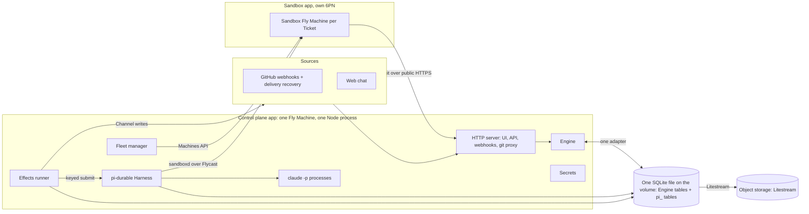
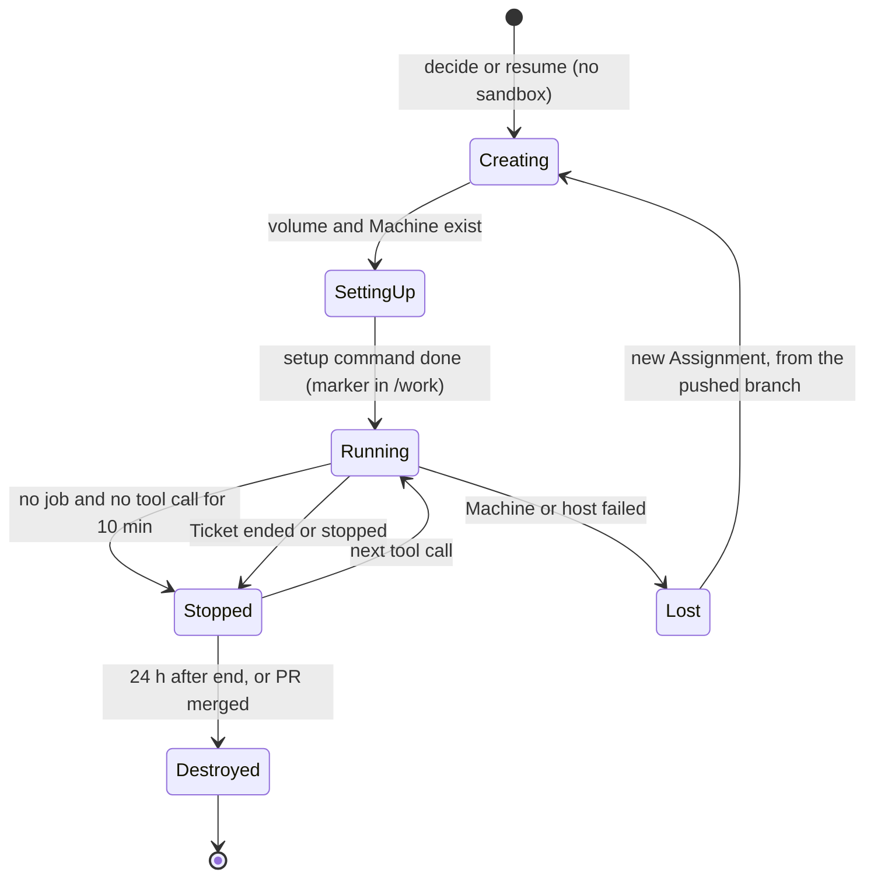

# Borant cloud control plane design

Date: 2026-11-03. Status: draft for Chris to review. Nothing is built, and no
cloud money is spent. This revision applies Chris's cuts and Astra's review of
commit d3f3ccb (conversation codex-312).

This document describes a new system, the Borant cloud control plane: one
TypeScript service in the cloud. It receives work from Sources and decides what
work to start. It runs every agent's durable loop with pi-durable, and it runs
tools in a Fly Machine per Ticket.

The new system runs in parallel with current Borant: the Rust hub, NATS
JetStream, the host daemons, and the Claude Code and omp sessions in tmux. The
two systems share no hub, state, credentials, hosts, or NATS. This work changes
nothing in current Borant and moves nothing off it (section 21).

Marks in this document:

- "(Decided)" means that Chris made the decision. The reason follows it.
  "(Decided on 2026-11-03)" marks the decisions of this revision. Chris wrote: "i
  accept the cuts. continue revising the spec".
- "(My call)" means that the designer made the decision. A builder can change
  a call with a good reason, but must record the change in this document.
- "(Chief default, for Chris to check)" means that the chief set a default
  until Chris answers. It is not Chris's decision.
- "(Recommendation)" means that the designer answers a question that Chris
  left open, and gives the reason. Chris can overrule it.

Section 24 lists every default and recommendation in one table, and the open
questions.

Inputs:

- The pi-durable spike: `~/Code/pi-durable-spike/REPORT.md` (2026-11-02),
  cited here as "spike Q1" to "spike Q9". Its scripts and raw output are in
  `src/` and `results/` of that folder.
- The superagent prototype: https://github.com/deepseek-ai/dsh-superagent-prototype
  (MIT), docs `001-domain.md` and `002-authorization.md`. It is a reference
  only. Borant copies no code from it.
- The approved chief mod v3 information design:
  https://claude.ai/artifact/XzyCdoGctUW5Ye7zQv3W3r and its four core specs
  (`2026-11-02-board-task-lines-design.md`, `2026-11-02-agent-activity-design.md`,
  `2026-11-02-person-changes-feed-design.md`, `2026-11-02-mod-actions-design.md`).
- The current design: `2026-10-24-borant-design.md`.
- The review page: https://claude.ai/artifact/KPQ3CGCqFGsbjaySSFUbTX, read on
  2026-11-03 (private to Chris). It has the diagrams. It predates this revision,
  so this document wins where they differ.

## 1. Intent and why

Chris runs about 20 coding agents across 10 projects in two collections (work
and personal). A chief of staff talks to him, orchestrators own projects, and
workers do tasks. Today these agents run as Claude Code and omp sessions in
tmux, on two Hetzner VPS hosts and on Chris's Mac, joined by a Rust hub over
NATS JetStream.

This week showed that the base does not hold:

- Hub takeovers started duplicate chiefs.
- Sessions lost their MCP connection to Borant and stopped receiving work.
- The Mac went to sleep and its chiefs stopped.
- Shared hosts ran out of memory, and the OS killed agents.
- State disagreed across NATS keys, leases, and WIP refs, and the system then
  acted on stale state.
- An orchestrator refused to trust an approval that the chief relayed from
  Chris, because nothing proved that Chris gave it.

Each failure comes from the same design: a long-lived interactive harness
process holds the agent loop, and Borant tries to keep that process alive, in
one place, and connected. The new design moves the agent loop into a durable
store that one service owns. A process crash then costs one tool call, not a
session.

The second reason is attention. Chris wants the system to take as little of
his attention as possible. In the first version, work starts from his own chat, and GitHub
feeds Tickets that already exist (section 21). The system decides which of it is work, asks him only when only
he can answer, and shows him one screen with what needs him.

The new system runs beside current Borant, not in place of it. Current Borant
does Chris's real work every day, and the new system is unproven. So a failure
of the new system must cost that work nothing. (Decided, order from Chris
through the chief)

## 2. Goals, non-goals, and anti-goals

### Goals

1. One TypeScript control-plane service runs the fleet manager, the Engine,
   the web UI, and the durable loop of every agent. (Decided)
2. No agent of the new system runs on Chris's Mac. A laptop that sleeps changes
   nothing. (Decided)
3. A crash of a process loses at most the tool calls that were running, and those
   return an `interrupted` or `uncertain` result. Every acknowledged Trigger, Input,
   report, and approval survives a process crash. A lost volume loses more, and
   section 25 states exactly what.
4. Work enters only through Sources. Only an Eval starts a Ticket, and every
   Ticket carries an immutable Mandate that says why the work is allowed.
   (Decided)
5. An approval reaches the worker from Chris directly, stamped with his login.
   No agent relays an approval. (Decided)
6. A loop (a Source, its Policy, and its prompts) is versioned, and every Decision
   stores its context snapshot from the first day. (Decided) The replay run and its
   page come later (section 18). (Decided on 2026-11-03)
7. One web screen shows the new system: what needs Chris, quiet work, changes
   since his last look, every project with tasks by name, the PRs closest to
   merge, and one-key actions. (Decided) The chief mod stays as it is for
   current Borant.
8. The new system runs in parallel with current Borant. It has a separate hub,
   state, credentials, and hosts, and no shared NATS. (Decided, order from
   Chris through the chief)
9. The first Profile is `personal`, and its first Project is `boopmark`.
   (Chief default, for Chris to check, on the Profile. My call on the Project,
   section 21.)

### Non-goals for this version

- High availability of the control plane, or sessions across several
  machines. One machine owns the sessions. (Decided)
- Logged-in browser access. A worker with a logged-in browser can act on a site
  with no call to `authorize` (section 16). (Decided on 2026-11-03)
- Generic Connections, Sources other than web chat and GitHub, and the replay run with its page. (Decided on 2026-11-03)
- Several people as users. The Policy holds an allowed list per Source, and
  only Chris is on it. (My call)
- Mapping one person's identities across Sources. As in the prototype, a
  person is Trigger metadata. (My call)
- Account pools and placement across hosts. One subscription per provider.
  (My call)
- Moving sessions between harnesses. pi-durable is the only harness.
  (Decided)
- A cutover. No Project, Profile, or agent moves off current Borant in this
  work. A move is a later, separate decision (section 21). (Decided, order
  from Chris through the chief)
- Retiring the Rust hub, NATS, the host daemons, or the Hetzner hosts. (Decided,
  order from Chris through the chief)
- The Roger work Projects. Roger work stays on Steve and Steve personal agents
  (section 22). (Chief default, for Chris to check)
- A link between the two systems: no shared board, no messages, no task import.
  (My call)

### Anti-goals

- A second source of truth. If the system can reach a state where two stores
  disagree and nothing reconciles them, the design failed. This week's stale
  state is the failure this design exists to remove.
- Approvals that a model can forge. If an agent can make a worker believe that
  Chris approved something, the design failed, even if the agent meant well.
- More attention, not less. If Chris must check the system to learn whether
  it is working, the design failed.
- A change to current Borant. If this work needs a change to the hub, the host
  daemons, NATS, the mod, or the hosts, the design failed.
- A framework. Every port, table, and command in this document exists for a
  named need. No plugin system, no generic workflow engine.

## 3. Constraints

| Constraint | Source |
|---|---|
| pi-durable 1.5.0 is experimental. The README says "The API changes without notice between releases." 18 releases in 6 weeks. | spike Q1 |
| One process owns a pi-durable storage. There is no cross-process locking. | spike Q2, README line 881 |
| pi-durable can share a SQLite file with host tables, under a table prefix. Its `Tx` object has no SQL method, so an Engine write is a separate transaction. | spike Q5 |
| pi-durable has no approval-waiting state. A `beforeTool` hook must decide at once. | spike Q3 |
| pi-durable observers live in memory. After a restart, the Engine must look again at what it tracks. | spike Q3 |
| A submit, a wait, or an abort starts the pi-durable scheduler, the same as `resume()`. | README line 127, `dist/harness/types.d.ts:812` |
| pi-claude-code runs `claude -p` on the machine of the Harness. It refuses to run when `ANTHROPIC_API_KEY`, `ANTHROPIC_AUTH_TOKEN`, or `ANTHROPIC_BASE_URL` is set. | spike Q8, `src/claude-cli.ts:414` |
| pi-claude-code is not on npm under `@earendil-works`. The npm package named `pi-claude-code` belongs to another author. Do not install it. | spike Q8 |
| Anthropic announced, then paused, a move of `claude -p` use to separate "Agent SDK credit" at API rates. | Chris |
| An app's Fly secrets reach every Machine of that app. Apps of one organization reach each other over 6PN by default. | https://docs.fly.io/apps/secrets, https://docs.fly.io/networking/private-networking |
| Node >= 22.19 (the SDK requirement). | spike, setup |
| Run focused tests only outside CI. | `AGENTS.md` |
| Runs in parallel with current Borant: separate hub, state, credentials, and hosts. No shared NATS. No change to the running system. No cutover in this work. | Chris, through the chief |
| No build, no infrastructure, and no cloud spend before Chris approves this document. | Chris, through the chief |
| The `borant` repo is public. This document holds no internal details of Roger's systems. | `gh repo view` on 2026-11-03 |

### Evidence from the pi-durable spike

The design rests on these results. The scripts and raw output are in
`~/Code/pi-durable-spike`.

| What the design needs | Result | Spike |
|---|---|---|
| A retry of an Input does not duplicate it | The same `requestId` returned the same submission and wrote nothing: `follow-up id=13 retry id=13 same=true`. The lookup is per conversation (`dist/harness/submissions.js:173`). | Q2 |
| The Engine can see delivery and run end | `observeCommits` reports `queued`, `placed`, `done`, tool start and end, and `pi.live`. Observers live in memory. | Q3 |
| One process can hold every session | 50 conversations: about 84 KB heap each when idle. 500: about 25 KB each, RSS 172 MB. The `claude -p` processes are the limit, not the sessions. | Q4 |
| The Engine and pi-durable can share one file | One file held `engine_tickets` next to the `pi_` tables, through one adapter. A raw Engine write is a separate transaction, so the crossings stay keyed. | Q5 |
| A control-plane crash does not repeat a sandbox job | The process was killed with `kill -9` 6 s into a 20 s job. The rerun reattached by task ID: `starts: 1, tookMs: 20002`. | Q6, Q9 |
| A tool with no idempotency key is not run twice | After the same kill, the model got an error result: `Tool sleep20 was interrupted and may have partially run`. | Q9 |
| A report is consumed once | The tool wrote the outbox entry, and the process killed itself before the result committed (exit status 137). After the restart, the outbox held one report, and the Engine consumed it once. | Q7 |
| Claude runs on the subscription, with Pi running the tools | One real Haiku turn took 2047 ms and called `report_ready`. List price $0.0022, billed to the Claude Max subscription. | Q8 |

The spike does not prove these points:

- It ran on the Mac. The Fly Machine was a stand-in, `src/fake-fly.ts`.
- The stand-in keeps its jobs in a memory `Map` and stayed alive in each test. So Q6
  proves a reattach after a control-plane crash. It proves nothing about a sandbox
  crash (section 15).
- Only one turn used a real model. All other runs used pi-ai's faux provider.
- No real turn ran with Codex or LunaRoute. Both only register.
- Nothing tested a `claude` credential on a headless Linux machine.
- Nothing tested a Litestream restore of the shared file, or long transcripts.

The builder proves these points before the first Project runs, except LunaRoute.
Section 21 lists them in order, and section 17 sets the model tests.

## 4. Approaches

### The decided approach

One persistent Fly Machine with a volume runs one Node process: the control
plane. The Engine tables sit beside the pi-durable tables in one SQLite file on
the volume. (Decided on 2026-11-03) Keyed crossings join the two sets of tables,
because a raw Engine write is a separate transaction (section 7). Tools run in one
Fly Machine per Ticket. (Decided) The whole system runs beside current Borant and
shares nothing with it. (Decided, order from Chris through the chief)

This reverses option B of the earlier draft, which kept the Engine in Fly Managed
Postgres. The price of the reversal is the backup-loss window in section 25.

### Rejected approaches

| Approach | What it offered | Why it lost |
|---|---|---|
| Keep the Rust hub and adapt it | No rewrite. The hub, tasks, and channels work today. | The failures come from its core idea: interactive sessions on hosts, kept alive by leases, moves, and checkpoints. Adapting it keeps that idea. A durable agent loop in Rust does not exist, and pi-durable is TypeScript. |
| Control plane on Cloudflare Durable Objects | pi-durable supports Durable Object storage. No machine to run. | pi-claude-code needs a real process to run `claude -p`. Workers cannot run a CLI. Tools still need Fly Machines, so the system spans two clouds for no gain. |
| NATS JetStream as the queue | Today's bus. Push delivery. | A second store next to the Engine records, with its own state and its own failures. This week's stale state came partly from it. The `effects` table puts the queue row and the state change in one transaction. |
| Engine state as pi-durable documents (option A) | Engine state commits atomically with the session (spike Q5). | Durable documents are JSON blobs with no SQL. The Engine needs queries for the board, Threads, Decisions, and the changes feed. |
| Engine in Fly Managed Postgres (option B) | Engine records survive a lost control-plane volume, and they stay apart from the host. | A second store with its own failure windows, a network path, and $39 a month, for one user with one Project. Reversed by Chris. (Decided on 2026-11-03) |
| Postgres for both, with our own pi-durable `Storage` (option C) | One database, one backup, one restore point. | We write and maintain a storage adapter for an SDK that changes every few days, and pass its conformance suite at each release. It gives no shared transaction for Engine tables, and one process still owns the store. |
| A local Mac runner | Fast local builds, local browser logins. | Laptop sleep stopped chiefs this week. Secrets on the laptop. Chris decided cloud only. |
| Attach the new system to current Borant's hub and NATS | One board and one task list across both systems. | It shares state and failures with the running system, and it needs changes to that system. Chris's order rules it out. |
| Cut over Project by Project as part of this work | One system sooner, and no double running. | It puts daily work on an unproven system. Chris's order rules it out. A move stays open as a later decision (section 21). |

## 5. Architecture

### Components



| Component | Job |
|---|---|
| HTTP server | Serves the web UI and its API, receives webhooks, checks their signatures, and ends the web chat. |
| Source adapters | Turn outside events into Triggers. Each keeps a read position for recovery. |
| Engine | Owns every domain rule: Triggers, Threads, Evals, Decisions, Tickets, Mandates, Assignments, Subscriptions, Channels, approvals, stages. |
| Effects runner | Takes effect rows and runs each effect after the commit that wrote it. It makes the keyed crossings of section 7. |
| Harness | pi-durable 1.5.0 behind our own `SessionPort`. One conversation per Ticket, one router conversation per Profile. |
| `claude -p` processes | Started by pi-claude-code for each Claude model request. They run on the control plane, not in sandboxes. |
| Fleet manager | Creates, starts, stops, and destroys sandbox Machines through the Fly Machines API. |
| Secrets | Holds credentials and injects them into one tool call at a time. Section 13. |
| Git proxy | Forwards git from sandboxes to GitHub with an App token, and refuses a push outside the Ticket's branch prefix. Section 11. |

The Node process is one deployable unit with one entry point. The Engine,
the effects runner, and the Harness are modules in that process. The Engine
must not import pi-durable. It talks to sessions only through the
`SessionPort` interface. (Decided on 2026-11-03, because pi-durable changes often
and the port keeps those changes in one adapter.)

Code lives in a new private repo, `willisrocks/borant-cloud`, as a pnpm
workspace. (Decided on 2026-11-03, because a directory in the `borant` repo runs
its CI and its releases, and a change to those is a change to current Borant.)

The `borant` repo's ports-and-adapters rule carries over in a smaller form. The Engine
calls outside systems only through three ports with neutral types:
`SessionPort` (pi-durable), `SandboxPort` (Fly Machines), and `ChannelPort` (one
adapter per Source kind). Vendor names appear only in adapters. SQLite is the
Engine's own database, not a port. The Engine holds no pi-durable types, but it
uses the same database adapter as pi-durable (section 7). Only `SessionPort` gets a
contract suite at first: the spike's crash tests. The exec plugin protocol and the
private-repo rule of the Rust system do not apply to the new repo. Its own
`AGENTS.md` says so. (My call, because a contract suite for each port is work that no
change needs yet.)

### Network and route access

Separate Fly apps are mandatory, because an app's secrets reach every Machine of that
app (https://docs.fly.io/apps/secrets). A sandbox in the control-plane app gets
the master key and the GitHub App key. (Astra's finding, confirmed. The rest of this
part is my call.)

Separate apps do not isolate the network. Apps of one organization reach each other
over 6PN by default (https://docs.fly.io/networking/private-networking). So each app
gets its own custom private network, set when the app is created, because an existing
app cannot move to another one (https://docs.fly.io/networking/custom-private-networks).

```bash
fly apps create borant-cloud-cp --network borant-cp
fly apps create borant-cloud-sandbox --network borant-sandbox
fly ips allocate-v6 --private --network borant-cp -a borant-cloud-sandbox
```

| Path | How | What protects it |
|---|---|---|
| Sandbox to control plane, over 6PN | No path. Fly does not forward packets between different 6PNs. | The two networks. |
| Sandbox to control plane, over the internet | Public HTTPS, the same as anyone. | The route table below. |
| Control plane to `sandboxd` | Flycast address of the sandbox app, allocated for the `borant-cp` network, with the `fly-force-instance-id` header for one Machine. | The `sandboxd` token of the Assignment. The sandbox app has no public address. A sandbox cannot use this address, because Flycast does not serve an app's own network. |
| Control plane to the Machines API | `https://api.machines.dev`, with a deploy token for the sandbox app only. | The token cannot touch the control-plane app. |
| Sandbox to another sandbox | One 6PN, so the network allows it. | `sandboxd` runs as root and each command runs as the user `worker`. An `ip6tables` owner rule drops traffic from `worker` to `fdaa::/16`, except DNS. |
| Sandbox to the Machines API | No token in the sandbox. A forum reply says that the `/.fly/api` socket needs no token for "privileged processes" (https://community.fly.io/t/suspend-machine-from-application-code/26406). This is not official documentation. | `worker` is not root. Stage 1 makes sure that `worker` cannot use the socket, because a start through it runs outside the fleet manager. |
| Sandbox to the internet | Open, for package registries and public pages. No egress filter (section 11). | Sandboxes hold only test values. |

Flycast requires `sandboxd` to listen on `0.0.0.0` with a `services` entry in the
Machine configuration. That entry sets autostart and autostop off, because only the
fleet manager starts a Machine. The docs do not say how the force header behaves
through Flycast or with a stopped Machine. Stage 1 tests this. If the test fails,
`sandboxd` makes an outbound long poll to a token route on the control plane.

The control plane has only these routes, and all of them are on its public address:

| Route | Who calls it | Check |
|---|---|---|
| `/webhooks/github` | GitHub | HMAC signature on the raw body, and the expected installation and repo |
| `/auth/*`, `/`, `/api/*` | Chris's browser | GitHub OAuth, the allowed list of user IDs, and a `SameSite=Strict` session cookie (section 12) |
| `/admin/*` | Chris's browser | The same login |
| `/git/*` | Git in a sandbox | The Assignment's git token, the Assignment's Project repo, and the ref check of section 11. A revoked token fails at once. |

`/metrics` has no public route. It listens on a second port with no `services` entry,
and Fly reads it through the `[metrics]` configuration. Stage 1 makes sure that this
works on a custom network. If it does not, the route takes a bearer token.

The Fly Machines do not join the Tailscale tailnet of current Borant.

### Separate from current Borant

| Part | Current Borant | New system |
|---|---|---|
| Hub | The Rust hub | The control plane. It never connects to the Rust hub. |
| State | NATS JetStream | One SQLite file. No NATS server, client, or subject. |
| Hosts | Two Hetzner hosts and the Mac, on the tailnet | Fly Machines in their own Fly apps and custom networks |
| Credentials | Its own | New values, none copied (section 13) |
| Code | Rust crates in `willisrocks/borant` | `willisrocks/borant-cloud`, no shared code |
| Person's view | The chief mod | The web screen (section 12) |
| Group of Projects | "collection" | "Profile" (Chief default, for Chris to check) |

The rules that follow from this table (Decided, order from Chris through the
chief, with the details as my call):

1. No code path joins the two systems at runtime. The control plane does not
   call the `borant` CLI, the Borant MCP tools, or the hub. Current Borant does
   not know that the new system exists.
2. The build changes no file in the `borant` or `borant-infra` repos, except
   this document.
3. Agents of current Borant can write the new code, as normal tasks in the new
   repo. That is use of a tool, not a runtime link.
4. Only two outside things touch both systems: a model subscription's usage
   limit, and a GitHub repo that both work on. Section 21 sets the rules for
   each.

## 6. Domain model

The terms below are the names in code, API, UI, and docs. They follow the
superagent prototype where the idea came from it. Concepts that the prototype
has and this design cut: Correlation (adds context only, and Thread snapshots
already carry context) and Executor as a separate concept (the Assignment
names the session and the sandbox directly).

| Term | Definition | Rules it keeps |
|---|---|---|
| Profile | A group of Projects with one router. The first and only Profile is `personal`. The word applies to the new system only. Current Borant keeps "collection". (Chief default, for Chris to check) | Each Profile has its own router session, Policy part, and Source instances. |
| Project | Configuration: a repo, a setup command, a sandbox size, secret bundles, models, and its Policy part. | Configuration, not state. Versioned with the Policy (section 11). |
| Source | A stream of outside events. A Source kind is code (GitHub, web chat). A Source instance is one configuration of a kind. | Holds its read position. Drops the comments of its own bot before they enter the domain. It keeps the bot's PR and check events, because an opened PR creates a Subscription. Says which Threads and Channel addresses an event belongs to. |
| Trigger | One immutable event from a Source, with the actor as the Source gives it, an actor kind (`person`, `bot`, or `ci`), and a `verified` flag. | ID = hash of Source instance ID and the Source's own event ID. A second insert is a no-op. `verified = true` only for an action in a logged-in web session (section 11). |
| Thread | Triggers in time order. The Source defines which Triggers form one Thread: a PR, an issue, a chat conversation, a Ticket's own chat. | At most one Eval runs on a Thread at a time. Triggers that arrive meanwhile wait for the next batch. |
| Subscription | A link between a Ticket and a Thread. | A Trigger from an allowed sender goes to every live subscribed Ticket as an Input, with no Eval. Allowed senders are the Source's allowed list and the CI and bot events that the Policy names. A Trigger from anyone else is recorded and does nothing else. A Trigger that a live Ticket took never goes to an Eval. A Trigger on a Thread whose Tickets all ended goes to an Eval. It restarts nothing by itself (section 29). |
| Eval | The judgment on a batch of Triggers on one Thread: a deterministic gate, then a model assessment with a schema. | Holds no state of its own. Its output is one Decision. |
| Decision | The stored result of one Eval: accept, ignore, or unavailable. | Stores the candidate, the context snapshot, the gate result, the prompt revision, the model, and the raw model output (section 18). |
| Candidate | What the Eval judges: the Trigger batch, plus a proposed brief when the router or an allowed bot proposed one. | Stored with its Decision. |
| Policy | Versioned rules as data: who can originate work through each Source, the gate rules, standing permissions, accept mode (live or observe), and model choices. | Every Decision and Mandate records the Policy version. A change goes to each live Ticket as a notice. It revokes a Mandate only when the new allowed list no longer holds the Mandate's sender (section 8, `publish_policy`). |
| Mandate | What an accept grants: strength (`explicit` or `inferred`), scope, Policy version, basis (the Trigger IDs and the exact text that asked), and sender. | Immutable. A wider scope needs a new Ticket. A revocation by `publish_policy` is a separate row. A stop is a state of the Ticket and does not change the Mandate. |
| Scope | The structured part of a Mandate that code enforces: Project, repo, branch prefix, allowed gated actions, and secret bundles. The brief is free text next to it. | `authorize` and secret injection read the structured fields. Code fills them from the Project's Policy part: the repo, the prefix `cloud/<ticket id>/`, and the gated actions. The assessor only picks which of the Project's secret bundles the work needs. `decide` rejects a bundle outside the Policy. So a model cannot widen a scope or leave out `merge_pr`. (My call) |
| Ticket | A unit of authorized work. | Only an Eval creates one. It holds its Mandate, Subscriptions, Channels, Inputs, Assignments, and stage. |
| Assignment | The binding of a Ticket to one sandbox, under the Ticket's one conversation. | A Ticket has one live Assignment at a time and can have several over its life. States: running, ended. Section 29. |
| Input | One message for a Ticket's session: the brief, a person's answer, a note, a CI result, a Policy notice. | Has a `requestId`, unique per conversation: the Trigger ID or the Engine's own key. Submitted to pi-durable once. |
| Report | A structured result from a session: `ready`, `blocked`, `ask_person`, `progress`, `done`. | Written by a report tool to an outbox document keyed by the tool task ID. The Engine consumes each one once. A stale report changes no stage (section 29). |
| Ask | A question from a worker to a person, with the full question, why now, the kind (`answer` or `approve`), and the options. | Stays open until a person answers or the worker withdraws it, or the Ticket stops. |
| Approval | A person's yes to an `approve` Ask, recorded from a `verified` Trigger. | Gated tools check for an Approval row. A model cannot create one. Section 27 binds it to one action on one revision. |
| Channel | The write side of a Thread: a GitHub comment, a PR review reply, a web chat message. | A Ticket holds a set of Channels. |
| Outbox message | One pending Channel write. | Fixed message ID, chosen before the first attempt. Delivered in order per conversation. |
| Engine ID | The ID of a Ticket, Assignment, sandbox, or outbox message. | A ULID, not a counter, because a restore rewinds counters and a repeated ID can match an old branch, volume, or GitHub marker. (My call) |
| Effect | One unit of work that runs after a commit: submit an Input, run an Eval, write a Channel, start a sandbox, and the others in section 8. | Written in the same transaction as the state change that needs it. Idempotent by its key. |
| Router | The chief of staff: a long-lived pi-durable conversation per Profile that talks with Chris. | Reads the board, adds notes, and proposes briefs. Grants nothing. Owns the Profile's chat Thread (section 8). |
| Sandbox | The Fly Machine where a Ticket's tools run. | One per live Assignment. `sandboxd` does not store injected values (section 13). |

### Ticket and router sessions

Each Ticket has one pi-durable conversation for its whole life. The worker in it can
start subagents with pi-durable child tasks. The subagents share the Ticket's
sandbox, and they have no report tools. There is no orchestrator tier: today's chief,
orchestrator, and worker chain becomes router and Ticket worker. (Decided)

Each Profile has one router conversation that lives as long as the Profile.
(My call, because a later Profile has its own Policy part and Source instances.)

## 7. Crossings between the Engine and pi-durable

The Engine tables and the pi-durable tables share one SQLite file. A raw Engine write
is still a separate transaction, because `Tx` has no SQL method (spike Q5). So a crash
can fall between an Engine commit and a pi-durable commit. These crossings stay keyed,
so that each side can retry until both agree. (Decided on 2026-11-03)

The Engine uses the same `openNodeSqliteDatabase` adapter as pi-durable, with
`SqliteStorage.open(db, { prefix: "pi_" })`. It never opens a second connection,
because the adapter's queue is what keeps the two sides apart. The Engine's commands
are short, because `node:sqlite` is synchronous and a slow query blocks every session
and the HTTP server. (My call)

### Engine to session: Inputs

1. An Engine command writes an `inputs` row (Ticket, `request_id`, content,
   `when_busy`) and a `submit_input` effect in one transaction.
2. The handler finds the Ticket's conversation, or creates it in one pi-durable
   commit with a document that maps the Ticket to it. So a retry finds the same
   conversation, and no orphan conversation exists.
3. The handler calls `SessionPort.submit(conversation, { requestId, content,
   whenBusy })`. pi-durable returns the existing submission when the `requestId` is
   known in that conversation, and writes nothing (spike Q2).
4. The handler marks the effect done and stores the submission ID.
5. The commit observer (`observeCommits`) sees the submission reach `placed`
   and sets `inputs.placed_at` (spike Q3).

`request_id` is the Trigger ID for Inputs that come from Triggers, and
`engine:<ticket>:<kind>:<n>` for the Engine's own Inputs (the brief, a Policy
notice). One Trigger can feed several Tickets, so the Input row is unique on Ticket
and `request_id`, and the effect key names the Ticket (section 8). `when_busy` is
`steer` for a person's answer and for the notice of a lost sandbox (section 29), and
`followUp` for everything else. A stop is not an
Input (section 26). (My call)

Every Input wakes the Ticket: pi-durable starts a run as soon as an idle conversation
receives one. Router notes and Policy notices are rare, so each one can cost a model
turn. Bot comments that are not reviews stop at `ingest`. They stay as Triggers on the
Thread and make no Input, and the worker reads the Thread when it needs them. (My call)

### Session to Engine: reports

1. A report tool (`report_ready`, `report_blocked`, `ask_person`,
   `report_progress`, `report_done`) writes its payload to the `Outbox`
   pi-durable document, keyed by `api.taskId`, with the run key of section 29. Every
   report tool except `report_progress` returns `control: { terminate: true }`,
   so the run ends without another model request (spike Q7). All report tools
   are `replay: "safe"`, because a rerun writes the same key.
2. The effects runner reads outbox entries when the commit observer sees the document
   change, and on a 10 s timer as a fallback.
3. For each entry, the Engine runs `consume_report` in one transaction. The
   `reports` table has a unique key on the outbox key, so a second insert does
   nothing.
4. After the Engine commit, the runner deletes the entry in one pi-durable commit.

### Activity

The commit observer also writes each session's last tool start, tool end,
and turn end into a `session_activity` row. These writes are best effort and
can be lost in a crash. The startup reconcile reads the live state from the
Harness and repairs them. Silent detection (section 10) reads this table.

### Run end

A run can end with no report: the model answers in text, the run fails, or
a replay-safe tool hits `restart_limit`. So run end is a durable command,
`run_ended`, found three ways (My call):

- The commit observer sees the run end in `pi.live`, or the submission reach
  `done` or `unanswered`.
- A sweep every 60 s asks `SessionPort` for the run state of every running
  Assignment.
- The startup reconcile.

`run_ended` is idempotent by the run key (section 29), so all three can fire for one
run.

### Crash windows

| Window | What is true after the crash | Recovery |
|---|---|---|
| After the Engine commit, before `submit` | Input row and effect exist. No submission. | The effect is still pending. The runner retries it after the restart. |
| After `submit` commits, before the effect is marked done | Submission exists. Effect still pending. | The retry submits with the same `requestId`. pi-durable returns the existing submission and writes nothing (spike Q2, Q9). |
| During a model call or a tool call | The session's task checkpoint is in the file. | Section 25. |
| After the report tool writes the outbox entry, before its tool result commits | Outbox entry exists. | The replay-safe tool runs again and writes the same key. One entry (spike Q7). |
| After `consume_report` commits, before the entry is deleted | Report row exists. Entry exists. | The runner reads the entry again. The insert hits the unique key and does nothing. The runner deletes the entry. |
| The commit observer missed events (it lives in memory) | `placed_at` and activity are stale. | The startup reconcile reads each stored submission ID. |

### Startup order

The reconcile finishes before anything starts the scheduler, because a submit, a wait,
or an abort starts it, the same as `resume()` (README line 127,
`dist/harness/types.d.ts:812`). So the reconcile writes only Engine rows, and it
submits nothing. (Astra's finding, confirmed.)

1. Take an exclusive lock file on the volume, because pi-durable has no cross-process
   locking (spike Q2). Open the database. Run migrations after a backup.
2. Return every `running` effect to `pending`, with its `attempt` increased. The old
   process is dead, so no other handler is alive.
3. For every Input with a submission ID that is not settled, read
   `harness.submission(id)` and repair `placed_at`.
4. Read the outbox documents and run `consume_report` for each entry. Deletion waits
   for the runner.
5. For every running Assignment whose conversation has no run in `pi.live`, run
   `run_ended` (section 8).
6. For every `eval_running` claim, keep the claim. Its `run_eval` effect is pending, and
   the rerun adopts it (section 8).
7. Call `harness.resume()`.
8. Start the effects runner, with `abort_session` effects first. Then accept HTTP
   traffic.

A Ticket that a person stopped can run for a moment between steps 7 and 8. It can do
nothing with that moment: its tokens are revoked, and `authorize` denies it (section 26).

The same code runs at every startup, so it runs often. The operator can run steps 2 to
6 from the admin page. Restoring a backup is a different path (section 25).

## 8. Engine commands and transactions

Every command is one transaction through the shared adapter. The adapter's queue runs
one transaction at a time, so the commands take no row locks. A command writes state
and effects together, and commits. Effects run after the commit. No command calls a
model or an outside API inside a transaction.

| Command | Writes | Effects |
|---|---|---|
| `ingest(sourceInstance, event)` | Trigger (`ON CONFLICT DO NOTHING`), Thread links, Source read position. A Subscription when the Trigger is a PR on a `cloud/<ticket id>/` branch of a live Ticket. On a Profile chat Thread: an Input for the router, and nothing else. On other Threads, if the sender is allowed: an Input for each live subscribed Ticket, and stage `working` for each. If the Thread has no live subscribed Ticket: `threads.eval_pending = true`. | `submit_input` per Input. `run_eval` for the Thread. |
| `claim_eval(thread, evalId)` | If no claim exists: an `evals` row with the batch of pending Trigger IDs and the Policy version, and `eval_running = evalId`. If the claim is this `evalId`: nothing, and the rerun adopts the stored batch. If another claim exists: nothing, and the effect ends. | none |
| `decide(evalId, gateResult, assessment)` | If the claim or the Policy version changed: nothing, and a new `run_eval`. Else the Decision. On accept: Ticket, Mandate, its own chat Thread, Subscriptions to that Thread and to each Thread of the batch except a Profile chat Thread, Channels, Assignment (running), brief Input, stage `working`. On accept with `resumes`: section 29. Clear `eval_running`. | `channel_write`: the acknowledgment of an accept, and for a router proposal the result of any Decision, written to the Profile's chat. `ensure_sandbox`. `submit_input`. `run_eval` again if Triggers arrived meanwhile. |
| `consume_report(entry)` | Report (unique outbox key). If the report is current (section 29): stage change, Ask, changes-feed event. If stale: an event only. | `channel_write` per Channel the report names. `stop_sandbox` after `done`. |
| `run_ended(assignment, runKey, outcome)` | Stage: kept if a report already set it, `blocked/failed` for a run failure or `restart_limit`, `idle` with a reason for a provider's usage limit (section 28), else `idle`. Idempotent: a second call for the same run does nothing. | `submit_input` with `run_after` at the reset time, for a usage limit only. The idle stop applies (section 28). |
| `answer(person, ask, text)` | Through `ingest` on the Ticket's chat Thread, as a `verified` Trigger. | `submit_input` with `whenBusy: "steer"`. |
| `approve(person, ask, revision)` | Trigger, then an Approval row (section 27). | `submit_input`. |
| `withdraw(person, approval)` | Approval `withdrawn_at`, if not consumed. | none |
| `stop(person, ticket)` | Section 26. | `abort_session`. `stop_sandbox`. |
| `resume(person, ticket, text)` | Section 29. | `ensure_sandbox`. `submit_input`. |
| `close(person, ticket)` | Section 29. | `abort_session`. `stop_sandbox`. |
| `sandbox_lost(assignment)` | Section 29. | `ensure_sandbox`. `submit_input`. |
| `note(router, ticket, text)` | An Input with `actor = router`, `verified = false`. | `submit_input`. |
| `propose(router, fromTrigger, project, brief)` | A candidate on the Thread of `fromTrigger`, and `eval_pending = true`. Refused if `fromTrigger` is older than 1 hour. | `run_eval`. |
| `publish_policy(person, commitSha)` | New Policy version, from a logged-in session (section 11). For each live Ticket: if the new allowed list no longer holds the Mandate's sender, revoke the Mandate and stop the Ticket (section 26). Else, if a rule it used changed, a notice Input. | `submit_input` per notice. `abort_session` and `stop_sandbox` per stop. `channel_write` for each revocation. |
| `mark_seen(person, upToEventId)` | Seen position. | none |

### Eval

An Eval runs in two steps between `claim_eval` and `decide`:

1. Gate. Deterministic code reads the Trigger batch and the Policy. It
   answers: is the actor on the Source's allowed list, what is the actor kind, is
   the Trigger `verified`, is the Source in observe mode, and which strength can this
   sender grant. A Trigger from an actor who is not allowed ends here with `ignore`.
   Only a `verified` Trigger can grant `explicit`. A Source event with Chris's account
   ID can grant at most `inferred` (section 11). A bot or CI Trigger can lead only to an
   `inferred` accept, and only when a Policy rule names that event, for example "CI
   failed on a PR of an ended Ticket in this Project". (My call)
2. Assessment. One model call with no chat history. Its input is the stored
   context snapshot: the Trigger batch, the last 50 Triggers of the Thread,
   every Ticket on the Thread with its stage (ended ones too), the Project
   list, and the candidate. Its output follows a JSON schema: decision,
   project, brief, scope, strength, resumes, reasons. (Decided)

The assessment calls pi-ai directly, not through a pi-durable conversation,
because an Eval holds no state and runs again in full after a crash. (My call)

A crash after `claim_eval` leaves the claim in place. The `run_eval` effect returns to
`pending`, and its key holds the `evalId`, so the rerun adopts the claim and runs the
stored batch again. A Thread can stay claimed only while that effect is alive. If the
effect goes `dead`, the admin page shows it, and the operator's retry clears the claim
and returns the batch to pending. (My call)

If the assessment fails or times out after 3 attempts, the Decision is
`unavailable`, and the Triggers go back to pending with a 10 minute delay.
(My call)

### Why subscribed Triggers skip the Eval

Two paths leave a Thread. The Eval path is the only way to start work. An accept
creates the Ticket, its Mandate, and a Subscription to the Thread. After that,
later Triggers on that Thread go straight to the Ticket's session as Inputs.
They start no new work and add no authority.

For example, Chris asks for a fix. The Eval accepts it, and the worker opens PR
#50. The branch name holds the Ticket ID, so `ingest` subscribes the Ticket to
the Thread of that PR. Later CI results, review comments, and Chris's replies on #50
go to that worker as Inputs. Each Eval costs a model call and adds delay. On a
subscribed Thread, an Eval protects nothing, because the Trigger asks for no new
authority. (My call)

So a Subscription has two origins: the accept itself, and a PR whose head branch
is `cloud/<ticket id>/...`. No other path creates one. (My call)

The router path goes through the Eval because a proposal asks for a new Ticket.
A new Ticket means new authority and new spend. The router also reads untrusted
text, such as issue bodies and PR comments, and a prompt injection can make it
propose work that Chris never asked for. So the Eval guards the start of work,
not each event inside approved work. (Decided)

The sender filter in `ingest` stops a stranger's comment in code, which matters
because `boopmark` is a public repo. The remaining risk is untrusted text that
the worker reads: a PR diff, an issue body, or the output of a tool. The worker
prompt marks that text as untrusted data, and section 11 sets what holds if the
text takes over the worker. (My call)

### Router and the web chat

Chris's chief chat is a Source. Each message is a `verified` Trigger with
`actor = <logged-in person>`, on the Profile's chat Thread. The router conversation is
subscribed to that Thread and receives each message as an Input. It answers in the
chat. (Decided)

The router does not create work. When Chris asks for work, the router calls
`propose` with the ID of his Trigger and a clear brief. The Eval then judges
the candidate. The gate takes the strength from Chris's Trigger, not from the
router, and the assessment checks that the brief stays inside what his text
asked for. The Mandate's basis stores his exact text. (My call, because the
router has the conversation context to write a good brief, and this keeps the
router unable to grant anything.)

GitHub Triggers go to the Eval directly. The router gets them as no Input. It has these
tools: read the board, read a Ticket with its Thread as untrusted data, `note`, and
`propose`. It has no sandbox, no GitHub write, and no secret. (My call)

The router runs only when Chris writes in the chat or presses `a`. It does not wake on a new
Ask or a failed Ticket, and it cannot answer an Ask, so each Ask reaches him directly. The
worker prompt limits Asks to what only he can answer. A wake costs a model turn at a limit of
2, and the first Project is small enough to measure first. Stage 4 counts the Asks, and a wake
path is a later decision. (My call)

On a Profile chat Thread, the batch of an Eval is the proposal's `fromTrigger` and nothing
else. One message can back several proposals within the hour, so "do A and B" can give two
Tickets. Each Decision stores the exact text, and the assessment checks that the brief
stays inside it. A hijacked router can repeat a recent request, but it cannot use an old
one. Each result goes to the chat, so an `ignore` or an `unavailable` does not stay silent.
(My call)

The Profile's chat Thread belongs to the router alone. `ingest` gives each message
to the router conversation and never sets `eval_pending` there, so only `propose`
starts an Eval from chat. An accepted Ticket does not subscribe to this Thread. It
gets its own chat Thread, and Chris answers a Ticket there, from the Ticket detail
or with `r`. (My call)

### Effects and the queue

The `effects` table is the only durable queue. (Decided)

| Column | Meaning |
|---|---|
| `id` | Row ID |
| `kind` | `submit_input`, `run_eval`, `channel_write`, `ensure_sandbox`, `stop_sandbox`, `destroy_sandbox`, `abort_session`, `recover_source`, `notify` |
| `ticket_id` | The Ticket, when the effect has one. A stop cancels by this column (section 26). |
| `key` | Unique idempotency key. It names the Ticket or conversation where one exists: `submit_input:<ticket id>:<request_id>`, `ensure_sandbox:<assignment id>`, `run_eval:<eval id>`. |
| `payload` | JSON |
| `state` | `pending`, `running`, `done`, `dead`, `cancelled` |
| `attempt`, `run_after`, `last_error` | Retry state |

The runner takes rows with `WHERE state = 'pending' AND run_after <= now ORDER BY id`.
An in-process event wakes it after each commit, and a 5 s poll is the fallback. A
failure sets `run_after` with exponential backoff from 5 s to 10 minutes. After 20
attempts, the effect is `dead` and appears on the admin page. (My call)

One process owns the file, so a handler needs no timed lease. The fence works like
this (My call, and it replaces the 5-minute lease of the earlier draft):

- Each kind has a timeout. At the timeout, the runner aborts the handler's signal, and
  the row returns to `pending` only after the handler settles.
- If a handler does not settle within 1 minute after the abort, the process exits. So
  two live handlers for one key cannot exist, and a restart is the tested recovery path.
- A handler finishes with `UPDATE effects SET state = 'done' WHERE id = ? AND attempt =
  ? AND state = 'running'`. A row that a stop cancelled stays cancelled.

Each handler must still be idempotent by `key`, because a crash after the work and
before the `done` commit runs it again.

### GitHub webhook recovery

GitHub does not redeliver a failed webhook by itself
(https://docs.github.com/en/webhooks/using-webhooks/handling-failed-webhook-deliveries).
So a webhook that cannot commit its Trigger returns 503, and a `recover_source` effect
reads the App's delivery log at startup and every 15 minutes. A local spool file stays
cut, because this path covers the same gap. (My call)

| Part | Rule |
|---|---|
| API | `GET /app/hook/deliveries` lists deliveries, with `per_page` and `cursor`, and a JWT of the App. `GET /app/hook/deliveries/{delivery_id}` returns `request.payload` (https://docs.github.com/en/rest/apps/webhooks). |
| No redelivery | The handler ingests the payload it reads. It does not call the `attempts` endpoint, because the API call is already authenticated, and the webhook path adds nothing. |
| Retention | GitHub lists deliveries of the past 3 days (https://docs.github.com/en/webhooks/testing-and-troubleshooting-webhooks/viewing-webhook-deliveries). |
| Cursor | The read position is the `delivered_at` of the newest delivery in the last complete walk. A walk goes from the newest delivery to the read position minus 15 minutes. The position advances only when the whole walk commits. The handler reads every status, not only failures, because a restored file (section 25) lost deliveries that returned 2xx. |
| Identity | Event ID = `guid`, which is `X-GitHub-Delivery` on the webhook path. Actor = `sender.id`. Actor kind = `ci` for `check_run`, `check_suite`, `status`, and `workflow_run` events, else `bot` when `sender.type` is `Bot`, else `person`. Trigger kind = `event` and `action`. The handler drops a delivery whose `installation_id` or `repository_id` is not the Source instance's. Stage 1 makes sure that a redelivery keeps its `guid`, because the docs do not say. |
| Gap | If the read position is older than 3 days, the handler cannot prove that it has every event. It writes a `source_gap` event, raises a "needs you" item, and sets the read position to now. A read of the current PR state does not recover the events in between, so the item says which time range is lost. |

## 9. Delivery guarantees

| Path | Guarantee | How |
|---|---|---|
| Outside event to Trigger | One Trigger per event, within the 3-day delivery log | At-least-once intake. Trigger ID is a hash of Source instance and event ID. Section 8 sets the recovery. |
| Trigger to Eval | Each Trigger reaches one final Decision. An `unavailable` Decision returns its batch for later. A chat message can back several proposals (section 8). | `claim_eval` stores the batch. A discarded Eval returns its batch. |
| Trigger to a Ticket's session | Exactly once in the transcript of each subscribed Ticket | `requestId` = Trigger ID, per conversation (spike Q2). |
| Report to Engine | Exactly once | Outbox key = tool task ID, unique key in `reports` (spike Q7). |
| Sandbox job | Started at most once per Assignment and task ID. After a crash: reattach, the stored result, or `uncertain`. | The job protocol of section 15. |
| Other tools | An `interrupted` result after a crash. | The pi-durable default (spike Q9). |
| Engine to outside Channel | Effectively once, in order per conversation | At-least-once attempts. Before a retry after an unknown result, the handler looks for the message ID, a hidden `<!-- borant:<id> -->` marker in GitHub comments. The next message in a conversation waits until the one before it is `done`. |
| Effects | At least once | Idempotent handlers by `key`. |

These guarantees hold across a process crash. Section 25 states what a lost volume
breaks.

## 10. Ticket stages and the board

A Ticket's stage is derived by the Engine and stored on the Ticket for the
board query. (Decided)

| Stage | Means | Set by |
|---|---|---|
| `person/answer` | The worker asked a question and waits. | `ask_person` with kind `answer` |
| `person/review` | A result waits for Chris: an approval, or a PR he must review. | `ask_person` with kind `approve`, or `report_ready` |
| `blocked/failed` | The worker cannot continue, or the session or sandbox failed. | `report_blocked`, `run_ended` with a failure, a dead effect, a lost sandbox |
| `working` | A run is active, or an Input is on its way to start one. | `decide` accept, `ingest`, `resume` |
| `idle` | Open, no run, nothing waits on a person: for example a PR waiting for CI. | `run_ended` with no report that needs a person |

`ended` and `stopped` are Ticket states, not board stages. An ended Ticket
leaves the board and shows in "changes".

Two views read a `working` Ticket. Neither is a stage:

- Silent: no tool call in 30 minutes, from `session_activity`. This follows the agent
  activity spec. A Ticket that waits for a slot is not silent.
- Waiting: the Ticket waits for a slot, with the time (section 28).

The "Waiting" area of the screen also shows `idle` Tickets that a provider's usage limit
holds, with the reset time.

"Offline" from the mod v3 design becomes a `blocked/failed` Ticket with the
reason "sandbox lost" or "session failed". (My call)

### Board query

One query returns the whole board: every open Ticket with its Project,
stage, title, who (the session name), since when, its open Ask, its PR state,
and the last change. This replaces the "board task lines" read of the mod v3
specs. The changes feed is the `events` table (section 19) after the person's
seen position.

## 11. Authorization and Mandates

1. Work starts only from an accept Decision. The Mandate records the
   strength, scope, Policy version, basis, and sender. (Decided)
2. `explicit` strength needs a `verified` Trigger from a person on the Source's
   allowed list, whose text asks for the work. `inferred` covers work the assessment
   derived, for example "CI on my PR failed, fix it" from a CI failure on a PR that an
   explicit Ticket opened. (Decided, with `verified` as my call.)
3. Approvals never travel through an agent. Chris's answer and his approval
   are `verified` Triggers from the web chat Source with his login as actor, on the
   Ticket's own Thread. The worker reads them as Inputs. (Decided on 2026-11-03)
4. Gated tools check the Engine, not the transcript. A tool that needs
   approval (for example `merge_pr`, `deploy`, `spend`) calls
   `engine.authorize(ticket, action, params)`. It returns `allowed` only when the
   Ticket is live, the Mandate is not revoked, the action is in the Mandate's scope,
   and a standing permission in the current Policy version covers the action, or a
   usable Approval exists (section 27). Otherwise the tool returns "needs approval"
   to the model, and the model raises an `approve` Ask. The current version applies,
   so that removing a standing permission takes effect at once. (My call on the
   mechanism)
5. `authorize` fails closed. If it cannot read its state, or the control plane is in
   restore mode (section 25), the tool does no write and returns "authorization
   unavailable". `authorize` keeps no cache. (My call)
6. The router can add notes. A note is an Input with `verified = false`. It
   grants nothing, and `authorize` never reads notes. (Decided)
7. Standing permissions are Policy data. (Decided) The first Project has none. Opening a
   PR and commenting on the Ticket's own PR are not gated, because the tools stay inside
   the Ticket's repo and Threads. (My call)
8. `inferred` limits a Ticket in two ways. A standing permission applies to it only if the
   Policy says so. It receives a secret bundle only if the Policy lists that bundle for
   inferred work. (My call)
9. On the first Project, no standing permission covers `merge_pr`, and the Policy
   grants no `deploy` or `spend`. `report_ready` names the PR and opens an
   `approve` Ask for `merge_pr`. Chris approves with `y`, which writes the Approval
   row and wakes the worker, and the worker calls `merge_pr`. If a merge runs a
   release workflow, the Ask says so. (My call)

This removes this week's relay problem: no worker needs to trust what the
router says Chris said.

### Source events that carry Chris's ID

`verified` is true only for an action in a logged-in web session. A Source event that
carries Chris's account ID does not prove that Chris acted, because any tool with his
login can cause it. For example, an agent of current Borant can comment on `boopmark`
with a login of his. So such an event is treated as possibly agent-caused:

- It can be an Input to a live subscribed Ticket. It adds no authority.
- At the Eval gate, it can grant at most `inferred`, also on work intake.
- It cannot create an Approval. A GitHub review is not an Approval, for the same reason.
- It cannot restart an ended Ticket by itself (section 29).

The first build holds no credential that acts as Chris, because Connections are out.
The rule stays, because the cause can be outside this system. (My call)

### What holds against a hijacked worker

A worker reads untrusted text, and it has `bash` with internet access. A prompt
injection can take it over. So the Mandate scope and the Approval rule must hold
when the model is hostile, not only when it means well. (My call, because the
anti-goal on forged approvals requires it)

1. No GitHub write credential enters a sandbox. Git in the sandbox reaches GitHub
   through the git proxy route on the control plane, with the Assignment's token.
   The proxy reads the ref updates of each push and refuses any ref outside
   `cloud/<ticket id>/`. It forwards the rest with an App token.
2. Other GitHub writes (open a PR, comment, merge) are tools that run in the
   control plane. `merge_pr` goes through `authorize`. So a hijacked worker cannot
   merge or push to a branch of current Borant.
3. The sender filter in `ingest` (section 8) keeps strangers' comments out of the
   session.
4. The network and route rules of section 5 hold if the worker is root-free. Commands
   run as `worker`, so they cannot read `sandboxd`'s files or use the root-only socket.
5. CI runs what the worker pushed, so the repo's Actions settings are part of this
   boundary (section 21). The App has no `workflows` permission, so a push that changes a
   workflow file fails. But a changed test script runs in CI with that job's token.
6. A secret bundle is the part that stays exposed. A value in `bash` can leave
   through the open internet. So a bundle holds only disposable test values, and
   no production secret goes into one. The first build has no egress filter,
   because workers need package registries and public pages. This is an accepted
   risk.

### Policy as data

Policy, Project configuration, and prompts live as YAML and Markdown files in
a private config repo, `willisrocks/borant-config`. The version is the commit SHA. (My call,
because git gives versions, diffs, review, and rollback with no new code.)

A push does not publish. A push can come from anything that holds Chris's login, and a
standing permission can replace an Approval. So Chris presses Publish on the admin page, which
shows the diff from the current version, and the page sends `publish_policy` with that SHA.
It is a `verified` action, and it needs no webhook. The control plane reads the repo with a
read-only deploy key. The App is not installed there. (My call)

The same reasoning covers the code. Agents of current Borant can write
`willisrocks/borant-cloud` through PRs, but only Chris holds the deploy tokens of the two
production apps, and he runs `fly deploy`. Build tests use separate test apps with their own
tokens. (My call)

## 12. Web UI

The web UI is the native chief-of-staff screen of the new system. It reuses the
approved mod v3 information design. (Decided) The Claude Code mod stays as it
is for current Borant. The screen is a web page, so the terminal limits of mod v3 (one chord, digits at the prompt,
band height) do not apply. The keys keep the same meaning.

Login: GitHub OAuth, with an allowed list of GitHub user IDs in the Policy.
The session cookie is `HttpOnly`, `Secure`, `SameSite=Strict`. (My call)

### The chief-of-staff screen

| Area | Shows |
|---|---|
| Needs you | Each open Ask and each `person/review` and `blocked/failed` Ticket: the full question, why now, who asked, the Project, how long it waits, the router's note if any. An `approve` Ask shows the exact revision (section 27). Order: decide, approve, answer, unblock, then age. System items also show here: a lost source range, a login to repeat, a token near its end, backup lag, a detected charge, and a Ticket idle for 7 days. |
| Silent and failed | Working Tickets with no tool call in 30 minutes, with the last tool call shown. Failed sessions and lost sandboxes. |
| Waiting | Tickets that wait for a slot or a provider limit (section 28). |
| Changes since your last look | New Tickets, done Tickets, merged and approved PRs, releases, answered Asks, Policy versions. "Mark seen" sets the seen position. Nothing else does. |
| Projects | Every Project with its Tickets by name: who works on each, for how long, its stage, what it waits on. Idle Projects on one line. |
| PRs closest to merge | Open PRs from Tickets, ordered by how close to merge: ready to merge, approved, review requested, CI running, CI failed. |
| Chat | The router chat for the Profile, at the side. |

| Key | Action |
|---|---|
| `j` `k` or arrows | Move the selection. The detail follows. |
| `1` to `5` | Jump to needs you, silent, PRs, changes, projects. |
| `r` | Answer the selected Ask. A text field opens. Enter sends, Esc keeps the draft. |
| `y` | Approve. A second `y` confirms when the Ask names money or a deploy. `n` cancels. |
| `s` | Stop the selected Ticket. A second `s` confirms. |
| `a` | Ask the router about the selected item. |
| `c` | Close the selected Ticket. A second `c` confirms. |
| `o` | Open the PR. |
| `g` | Go to the Ticket detail. |
| `x` | Mark the listed changes seen. |
| `/` | Focus the chat. |

### Phone

The page works at phone width, and each key action also has a button. So Chris can answer,
approve, or stop from a push notification. An approval shows the same SHA and diff link there.
(My call, because a push that he cannot act on delays each Ask until he is at his laptop.)

### Notifications

Chris must not have to look at the screen to learn that something needs him. The
control plane sends a Web Push to his browser for each new Ask and each Ticket that
enters `blocked/failed`. A `notify` effect carries it, keyed by the Ask or the
stage change, so a retry sends nothing twice. Several within 5 minutes collapse to
one. Web Push needs no outside account. On an iPhone, it needs the page on the home
screen. The dead man's switch (section 19) stays outside, because a dead control
plane cannot push. (My call, and another channel is one adapter.)

### Ticket detail

The Mandate (strength, scope, basis with Chris's exact words, Policy
version), the stage, the open Ask with the answer box, usable and used Approvals with
a withdraw action, the Trigger history of every subscribed Thread with the Decisions
on them, the live session transcript (`ConversationTranscript` watch), the sandbox
state, the Channels, and the usage and list-price cost of the session. An ended,
stopped, `blocked/failed`, or `idle` Ticket has a Resume action (section 29).

### Admin

Dead effects, the reconcile button, restore mode (section 25), crossing lag (oldest
pending Input and oldest unconsumed report), backup lag, the count of `claude`
processes, slots in use with the setting, running sandboxes, stored Decisions with filters, and
the Decisions of observe mode ("would accept").

## 13. Secrets

Secrets live in the control plane and are injected only into the tool call
that needs them. (Decided) Every value is new to this system. The control plane
holds no credential that current Borant uses. (Decided, order from Chris through
the chief)

| Secret | Where | Used by |
|---|---|---|
| Master key, GitHub App private key, GitHub OAuth client, Litestream object-storage key, Fly deploy token for the sandbox app | Fly secrets on the control-plane app. The sandbox app has no Fly secrets (section 5). | The control plane only |
| Claude credential | `CLAUDE_CODE_OAUTH_TOKEN`, a one-year token from `claude setup-token`, as a Fly secret on the control-plane app (section 17) | pi-claude-code |
| Codex OAuth, LunaRoute key, Project secret bundles (for example `boopmark-staging`) | `secrets` table in the SQLite file, AES-256-GCM under the master key | The control plane, and injected tool calls |
| GitHub App tokens | Minted per use as installation tokens, scoped to the Project repo, valid for 1 hour. Never in a sandbox. | The git proxy and the GitHub tools of the control plane |
| Assignment tokens | Two random values per Assignment. The `sandboxd` token opens `sandboxd`, stays in a root-only file on the Machine, and is stored encrypted in the `secrets` table, because the control plane presents it after a restart. The git token opens only the `/git/*` route, and `worker` can read it. The control plane stores its hash. Section 26 deletes both. | The control plane, `sandboxd`, and the git credential helper in the sandbox |
| Config repo deploy key | Read-only. A Fly secret. | Reading the Policy (section 11) |

Rules:

1. A Project's configuration names the secret bundles its Tickets can use.
   The Mandate scope can narrow the list.
2. The control plane sends a bundle's values as environment variables of one
   `exec` request to `sandboxd`.
3. `sandboxd` enforces only this: it does not write the values itself, it keeps them
   only in the memory of the job, and it replaces each exact value with
   `[secret:<name>]` in output before it stores the output in `/work/.jobs`. The
   control plane does the same replacement before output enters the transcript.
4. No code can enforce more than that. A command can write its environment to the
   persistent volume, or encode a value in its output. Exact-string replacement misses
   both. This is an accepted risk, so a bundle holds only disposable test values.
   (Astra's finding, confirmed.)
5. The control plane gets its own Codex and LunaRoute logins. It does not
   reuse Chris's `~/.pi/agent/auth.json`, because a refresh rotates the token
   and logs out his CLI (spike Q8).
6. Chris creates a new token or key for each provider and enters it once,
   through the admin page or `fly secrets set`. No value is copied from a host of
   current Borant or from the 1Password items that it uses, because a rotation of a
   shared value breaks the other system. If a provider allows only one key, the
   builder lists it for Chris. (My call)
7. The control plane does not call 1Password at runtime. Chris keeps a copy of
   the master key in a new 1Password item, because a lost master key loses the
   `secrets` table. (My call)

## 14. Tools and Sources in the first version

Sources and tools do different jobs:

- A Source brings events in and can start work.
- A Channel writes back to the Thread that started the work.
- A tool is what a worker uses during work.

The first version has the web chat and GitHub Sources. Its tools are the
sandbox tools of section 15, the report tools, and the GitHub tools of the control
plane (open a PR, comment, read a PR, `merge_pr`). (Decided on 2026-11-03)

### Who acts on GitHub

Agents act on GitHub as a GitHub App, not as Chris. (Decided on 2026-11-03) Chris
installs the App on his own account, on the `boopmark` repo only. The reasons:

- GitHub does not let an author approve their own PR. A worker with Chris's token
  opens PRs in his name, so he cannot approve them, and the review stage of the
  board stops working.
- An App gives tokens that last 1 hour and cover one repo (section 13). A token of
  Chris's covers every repo that he can reach.
- An App is a separate credential, so it meets the parallel rule. Its bot name also
  shows which system wrote a PR when both systems work on one repo.

The cost is that commits and PRs show the bot, and one more private key lives in
Fly secrets.

The App has these repository permissions and no others: Contents write, Pull requests write,
Issues write, Checks read, Commit statuses read, Actions read, and Metadata read. It has no
Workflows permission (https://docs.github.com/en/rest/authentication/permissions-required-for-github-apps),
no Administration, and no Secrets. (My call)

### Deferred, with the rules that stay

Cron, Linear, Slack, and generic Connections (remote MCP servers that act as Chris)
are out of the first version. (Decided on 2026-11-03) When one returns, these rules
apply, and each return is its own change:

- A new Source starts in observe mode, and it rejects most events in code before any
  model call.
- Linear has no webhook for one user's events. An agent app that receives assignments
  and mentions is the Source that starts work.
- A Connection's client and token stay in the control plane. A sandbox never holds
  them. Each MCP tool is a durable tool. A write tool keeps the default replay policy
  and goes through `authorize`. Workers do not run MCP servers through `claude -p`,
  because those calls bypass pi-durable and `authorize`.
- Stored Decisions lose nothing in the meantime, because the Eval is the same.

## 15. Sandboxes

One Fly Machine per Ticket runs its tools: bash, git, builds, and headless
Chrome for public pages. (Decided) The agent loop stays in the control
plane. (Decided)

### Image and daemon

- One image, `borant-sandbox`, with git, Node, the toolchains of the
  Projects, Chromium for Playwright, and `sandboxd`. Projects that need more
  install it in their setup command. (My call)
- `sandboxd` is a small TypeScript HTTP daemon. It runs as root, and it runs each
  command as the user `worker`. Each request carries the `sandboxd` token.
  (My call, one protocol that we control, instead of pi-env's SSH daemon plus SSH keys.)
- Each sandbox has a 10 GB Fly volume at `/work` for the clone, build caches, and job
  records, so that the work survives a stop and a restart. (My call)
- Size comes from the Project. Default: `shared-cpu-2x`, 4 GB. A Project that needs
  more sets its own size. (My call)
- The Machine's restart policy is `no`, so only the fleet manager starts it. (My call)

### The job protocol

No sandbox tool gets a blanket `replay: "safe"`. `bash`, `write`, and `edit` have side
effects, and after a crash nothing can know in general whether a command finished its
effect. A rerun of these tools only attaches or reports. It never runs a job again.
That rule is what makes `replay: "safe"` true for them. (Astra's finding, confirmed. The
protocol is my call.)

`read` has no side effect, so it needs no job.

A tool call for `bash`, `write`, or `edit` does this:

1. Read the durable marker: `api.memo("job_sent", context)`.
2. If there is no marker, commit it with `api.memo("job_sent", true, context)`, then
   send `POST /jobs/<assignment id>/<task id>` with the command.
3. If there is a marker, this is a rerun. Send `GET /jobs/<assignment id>/<task id>` only.
4. Poll the same `GET` until the job ends, with short requests, because the path
   goes through Fly Proxy.

`api.memo` is in the public types (`dist/harness/types.d.ts:227`), and pi-durable uses it
the same way (`dist/harness/tool.js:367`). The README does not describe it, so the
contract suite tests it.

The key holds the Assignment ID because a task ID alone can repeat. pi-durable takes its IDs
from a counter in the file (`dist/storage/sqlite/migrations.js:10`). A restore rewinds that
counter, but a sandbox volume keeps its records, so a new call can get an old task ID. Every
Ticket gets a new Assignment after a restore (section 25). A plain crash keeps the same
Assignment, so reattach still works. (My call)

`sandboxd` writes a record to `/work/.jobs/<assignment id>/<task id>` and calls `fsync` before it
starts the command, and again when the command ends. The answers to `GET`:

| Record | What it means | The tool result |
|---|---|---|
| Ended | The job finished. | The stored output and the exit code. |
| Started, process alive | The control plane crashed, and the job runs on (spike Q6). | Attach, and continue to poll. |
| Started, process gone | `sandboxd` restarted, so the Machine restarted during the job. | `uncertain`. |
| No record, and the marker exists | The POST did not arrive, or the volume is new. | `uncertain`. |

`uncertain` is an error result that says: "This command may or may not have finished.
Read the current state before you repeat it." The worker prompt says the same. The tool
does not guess, and the model decides. The same rule covers `write` and `edit`, because
a crash can fall between the file change and the end record. (My call)

The two earlier failure cases fall under this table:

- Retention. `sandboxd` keeps job records as long as the volume. It trims output
  bodies after 24 hours and keeps the exit code. So a rerun after 24 hours returns the
  exit code and "output trimmed", and never runs the command again.
- A lost sandbox. The new volume has no records, so each rerun returns `uncertain`.

A job has a time limit, 2 hours by default, set per Project. At the limit, `sandboxd`
kills the process group and ends the job with an error. Without this, a hung command
keeps its Machine running, because the idle stop must not stop a running command
(section 28). (My call)

### Lifecycle



1. `ensure_sandbox` creates the volume and the Machine if the Assignment has none, or
   starts the stopped Machine.
2. The setup command (clone, install) runs once. A marker file in `/work`
   records its success, so a rerun skips it.
3. A tool call to a stopped sandbox starts it first. The fleet manager waits
   for `sandboxd` health, then the call goes through. The fleet manager refuses when
   the Assignment is not running, so a stopped Ticket cannot start it (section 26).
4. The idle stop is in section 28.
5. If the Machine is lost, section 29 applies.
6. When the Ticket ends, the Machine stops. After 24 hours, or when its PR
   merges, the fleet manager destroys the Machine and the volume. A Ticket that
   a person resumes in that time gets the same sandbox.

### Machine-create retry

The sandbox ID is an Engine row, written with the Assignment that first needs it. An
Assignment that adopts a sandbox keeps that ID (section 29). The Machine or the volume can
exist before its ID commits, so `ensure_sandbox` looks before it creates. Fly requires the volume to exist first, on the same host as its
Machine (https://docs.fly.io/machines/api/machines-resource/). (My call)

1. List volumes of the sandbox app, and look for the name `work_<sandbox id>`. Reuse
   a match. Otherwise create it, then commit its ID.
2. List Machines with `GET /v1/apps/<app>/machines?metadata.sandbox=<id>`. Reuse a
   match. Otherwise create it with that metadata and the name `s<sandbox id>`, then
   commit its ID.
3. If the create call returns a conflict, go back to step 2.

The docs call a Machine name unique, but they do not say what a duplicate returns. Stage
1 tests this. An hourly sweep lists Machines and volumes of the sandbox app, and
compares them with the `sandboxes` table. It destroys a stopped Machine or a volume with
no live Assignment, after 24 hours. It stops a started Machine with no row at once.

## 16. Logged-in browser access (later option)

Logged-in browser access is out of the first version, and its cost is out of the
estimate. (Decided on 2026-11-03) Workers still use Chromium in the sandbox for public
pages. (Decided) Chris keeps Google logins out of this system.

This note keeps the later option open. It settles nothing, and it builds nothing.
Browserbase persistent Contexts with a live view were the earlier choice. Before
anything returns, a design must answer:

- Authority. A worker with CDP access to a logged-in browser can act on the site with
  no call to `authorize`. A GitHub login can merge, and another login can send messages.
  So unrestricted browser authority and per-action approvals cannot both hold. The
  login that the control plane itself uses must never be in such a browser.
- Context use. Browserbase says: "Avoid having multiple sessions using the same Context
  at once. Sites may force a log out." It also says to "wait a few seconds before reusing
  the Context" after a close
  (https://docs.browserbase.com/platform/browser/core-features/contexts). So a lease must
  outlast the close, and it needs recovery after a control-plane crash.

## 17. Models and providers

| Provider | How | State |
|---|---|---|
| Claude | pi-claude-code `createClaudeCodeProvider()`, which runs `claude -p` on the control plane with a subscription token. Install it from the `earendil-works/pi-claude-code` git repo at a pinned commit, not from npm. Call `models.getAvailable("claude-code")` at startup (spike Q8). | One real Haiku turn ran in the spike, with a login on the Mac. |
| Codex | pi-ai `openaiProvider()` "Sign in with ChatGPT" OAuth, with a `CredentialStore` on the `secrets` table. | Registered, no real turn yet. |
| LunaRoute | A provider of about 20 lines with `createProvider()` and `openAIResponsesApi()` (spike Q8). | Registered, no real turn yet. |

(Decided)

Model choice per role is Policy data: the router, the assessor, the worker
per Project, and summaries. The configuration names a provider and a model
alias. The control plane resolves the alias from discovery at startup. (My
call)

Every session records usage and list-price cost (pi-durable reports both).
The Ticket detail and a monthly total show it. This number is also the
estimate of what Claude work costs if Anthropic moves `claude -p` to API
rates.

### The Claude credential and its test

The credential is `CLAUDE_CODE_OAUTH_TOKEN`, from `claude setup-token`: a one-year
token that "can only make model requests", documented for "CI pipelines, scripts, or
other environments where interactive browser login isn't available"
(https://code.claude.com/docs/en/authentication). It lives in a Fly secret. (My call,
because a token in a Fly secret needs no CLI state on the volume.)

pi-claude-code refuses `ANTHROPIC_AUTH_TOKEN`, and this is a different variable
(`src/claude-cli.ts:414`). Bare mode does not read this token, and pi-claude-code does
not pass `--bare` today (`src/claude-cli.ts:781`).

The first task of the build tests this credential, before any other work, on the account
that Chris picks (section 24):

1. One real turn from a Fly Machine through pi-claude-code.
2. Whether a new token leaves the other logins of that account alone. The docs do not
   say. A logout stops the agents of current Borant, if the account is shared.
3. The memory of one `claude -p` process (section 28).

A second turn after 24 hours is not a test of refresh, because this token does not
refresh daily. The control plane records the token's date, and a "needs you" item
appears 30 days before the year ends. If the test fails, the recommendation below
applies.

### The Codex test

Codex is the fallback, so this is a test and not an assumption. The cited OpenAI guide
does not establish this path (https://learn.chatgpt.com/docs/auth/ci-cd-auth). It
describes Codex-managed `auth.json` refresh, it says that the workflow does not apply to
"generic OAuth clients outside Codex", and it says "Do not use this workflow for public
or open-source repositories." This design uses pi-ai's own OAuth client, and `boopmark` is
public (`gh repo view` on 2026-11-03). That does not prove that the path is forbidden or
broken. It proves only that the guide does not cover it. (Astra's finding, confirmed.)

Chris's decision on the terms (section 23) stands. The builder runs this test before the
first Project runs, and one turn is not enough:

1. One real turn with pi-ai's OAuth, from the control plane.
2. Two concurrent requests across a token refresh.
3. The rotated token persists across a restart.
4. A start with an old token, as after a restore (section 25). The result can be a
   login item, and this is acceptable.

If this test fails, Codex is not a fallback, and the build records that. LunaRoute gets
one real turn before a Policy role names it.

### If `claude -p` fails or changes billing

(Recommendation) If the Codex test passes, move every role to Codex with one Policy
commit, and hold no Anthropic API key. If the Codex test fails, the build stops at that
event, and an Anthropic API key with a monthly cap is Chris's decision. Two events lead
here:

- `claude -p` cannot run headless on Fly. Then no role has Claude on the
  subscription. The router and the assessor use the same provider as the workers,
  so a split that keeps Claude for them needs an API key.
- Anthropic moves `claude -p` to API rates. This is the billing guard below.

The reasons:

- The ChatGPT subscription is already paid, and model choice per role is Policy
  data, so the move is one commit in the config repo.
- An API key at list price needs a spend cap and Chris's approval of that spend.
- pi-claude-code refuses to run when `ANTHROPIC_API_KEY` is set (spike Q8), so a key
  in the environment closes the subscription path.

### The billing guard

Two controls exist, and they do different jobs. (Astra's finding, confirmed.)

| Control | What it does | What it does not do |
|---|---|---|
| The provider's account setting | Chris keeps usage credits off for this account, if the plan lets him. Only this control can prevent a charge. The build records the setting at stage 1. | It depends on Anthropic's billing behavior. Nobody tested it. |
| The reaction in pi-claude-code | After a response, it reads `isUsingOverage`. If that is true, and `PI_CLAUDE_CODE_ALLOW_USAGE_CREDITS` is not set, it fails the turn. The builder does not set the variable. | It cannot prevent the charge it detects. The source says: "The response is already charged at this point" (`src/claude-cli.ts:1005`). Requests in flight also complete. |

So a bill can arrive: at most the responses that were in flight when the first charge
showed. After a detected charge,
the control plane holds all Claude requests, and each affected Ticket goes to `blocked/failed`.
A "needs you" item shows the measured list-price cost, and Chris decides.

## 18. Decisions and later replay

A loop is a Source, its Policy part, and its prompts, all versioned in the
config repo. (Decided)

Each Decision stores (Decided):

- The candidate: the Trigger batch and any proposed brief
- The context snapshot that the assessment read, as JSON
- The gate result
- The prompt revision: config commit SHA and prompt path
- The model: provider, model ID, settings
- The raw model output and the parsed result, latency, and usage

The assessor is a separate model call with no chat history. The prototype's
assessor lived in a long chat and read context live, so a replay cannot show
it the same input. Here the snapshot is the input, so a later replay is honest.
(Decided)

The replay run, its `replay_decisions` table, its labels and scores, and the Loops page
are deferred. Storing the snapshots now keeps that option at no extra design cost. The
admin page lists stored Decisions with filters. (Decided on 2026-11-03)

### Observe mode

A Source instance or a single rule can be in observe mode. Its Evals run and
store "would accept" Decisions, but create no Ticket. A GitHub Source instance or a later
Source starts in observe mode. The web chat is live from the start. (Decided for the mode, my
call for the start state.)

## 19. Observability and audit

- Logs: structured JSON lines to Fly's log stream, with Ticket, Thread,
  Trigger, and effect IDs on each line. Never secret values.
- Metrics: a `/metrics` endpoint for Fly's managed Prometheus (section 5). Effects
  pending and dead, Eval latency, crossing lag, backup lag, slots in use and Tickets
  waiting, provider limit hits, sessions, `claude` processes, sandbox count
  by state.
- Events: an append-only `events` table for every domain change (Trigger
  received, Decision, Ticket stage change, Ask, Approval, Channel write,
  Policy version, sandbox state, stop, restore). The changes feed and the audit view
  read it.
- Audit: Triggers, Decisions, Mandates, Approvals, and `events` are never
  updated or deleted, except that an Approval gets its use and withdrawal times.
  Transcripts stay in the file for the life of the Ticket plus 90 days. These records
  depend on Litestream alone. (My call)
- Dead man's switch: the control plane pings an outside check every 5
  minutes. If the pings stop, the check sends Chris a push notification, so a
  dead control plane does not stay silent. (My call)

## 20. Estimated cost per month

Nothing here is spent yet. The designer read each list price on 2026-11-03. A month is
30 days. This section uses Chris's decisions: SQLite, no Postgres, and no logged-in browser.

| Item | List price | Source |
|---|---|---|
| Fly `shared-cpu-2x`, 2 GB | $13.39 a month | https://docs.fly.io/about/pricing |
| Fly extra RAM | $6.00 per GB a month | same |
| Fly volume, stopped rootfs | $0.15 per GB a month | same |
| Fly outbound transfer, North America and Europe | $0.02 per GB | same |
| Cloudflare R2 storage, first 10 GB | $0 | https://developers.cloudflare.com/r2/pricing/ |
| Cloudflare R2 write requests | $4.50 per million, first million free each month | same |

`shared-cpu-2x` with 4 GB costs $25.39 a month, or $0.0353 per hour. `shared-cpu-4x` with
8 GB costs $51 a month. The stopped rootfs assumes an image of 2 GB per Machine. Models
stay at $0 more on a subscription that Chris already pays for (section 24).

| Line | First Project | Busy |
|---|---|---|
| What it assumes | `boopmark`, 1 sandbox for 6 hours a day (180 hours), 3 volumes alive | Today's load: 4 sandboxes for 10 hours a day (1200 hours), 15 volumes alive |
| Control plane, 8 GB (section 28) | $51.00 | $51.00 |
| Control-plane volume, 5 GB | $0.75 | $0.75 |
| Sandbox compute, 4 GB | $6.35 | $42.32 |
| Sandbox volumes, 10 GB each | $4.50 | $22.50 |
| Stopped rootfs | $0.90 | $4.50 |
| Litestream object storage | $1.00 | $1.00 |
| Outbound transfer, 10 GB and 50 GB | $0.20 | $1.00 |
| Total | $65 | $123 |

So the bill for the first Project is about $65 a month at 6 slots. Six slots always full of
running sandboxes add at most $152 a month of sandbox compute. Outbound transfer and volumes
have no limit.

The object storage line is an estimate. Litestream writes at most once a second, and only
when the file changed. That is at most 648,000 writes a month at the first load, inside
the free million, and at most about 2.6 million at all hours, or about $7. These counts
leave out Litestream's compaction writes. Litestream's docs warn about this cost
(https://litestream.io/reference/config/). Stage 4 measures it. A longer `sync-interval`
costs less and widens the backup-loss window.

The sandbox hours are the weakest number, and the first two weeks of metrics give the real
one.

This replaces the estimates of the earlier drafts ($110 for the design with Postgres and
Browserbase, and $27 to $39 for the SQLite option). Postgres cost $39, and Browserbase cost
$20. The 8 GB control plane adds $26 to the 4 GB one, for 6 slots.

What this estimate leaves out:

- Savings. Current Borant keeps running, so its bill does not change.
- The test apps of the build, up to $25 a month while it runs (section 21).
- A separate Claude account (section 24). It adds that plan's price: Max is $100 a month, and
  Ultra is $200 (https://claude.com/pricing, read on 2026-11-03).
- Model cost at API rates, if Anthropic moves `claude -p` (section 17).
- A charge that the billing guard detects after the fact (section 17).

## 21. Running beside current Borant

This work ends with the control plane running one Profile and one Project beside
current Borant. Nothing moves. (Decided, order from Chris through the chief)

### Build stages

1. Prove the outside unknowns, with small throwaway scripts on test apps. Each one can change
   the design, and a failure stops the build until Chris hears about it:
   - The Claude test on the account from section 24: one real turn from a Fly Machine, other
     logins intact, and the memory of one `claude -p` process (section 17). Record the
     usage-credit setting of the account (section 17).
   - The Codex test (section 17).
   - The network: Flycast between the two custom networks, the force header on a running and
     a stopped Machine, `worker` cannot reach another sandbox or use `/.fly/api`, `/metrics`
     on a custom network, and a duplicate Machine name (sections 5 and 15).
   - A Litestream restore of a file that pi-durable wrote, after a normal close and after a
     crash (section 25).
   - A GitHub redelivery keeps its `guid` (section 8).
   - A long transcript: a session with 5000 entries, its reopen time, and its heap.
2. Build the core: the Engine, the crossings, effects, the Harness, sandboxes, the limits, the
   git proxy, the web chat and GitHub Sources, Evals with stored Decisions, the chief-of-staff
   screen, Ticket detail, notifications, and the admin page. The real code must then pass the
   proofs that need it. A failure here is a bug to fix:
   - Process kills inside each crash window of section 7, and the startup order.
   - A real `sandboxd` restart during a job, and a replaced volume, through the job protocol
     (section 15). The `api.memo` contract.
   - Restore mode (section 25).
3. Change the `boopmark` settings below, if Chris agrees (section 24). Make sure that a PR job
   on a `cloud/` branch has a read-only token. Then run the first Project, `boopmark`, in the
   `personal` Profile. Chris starts Tickets from the web chat only.
4. Measure for two weeks: lost Triggers, duplicate Tickets, reconcile repairs, cost, sandbox
   hours, waits for a slot, and how often a usage limit stops a run.

The deferred features of section 2 are not a stage. Each one is its own decision after stage
4. (Decided on 2026-11-03 for the deferral. My call on the order.)

The first Profile is `personal`, because Roger work stays on Steve and Steve
personal agents (section 22). (Chief default, for Chris to check)

The first Project is `boopmark`. (My call) It is the only Project in the personal
collection that is not current Borant's own code. `borant` and `borant-infra` stay
off the new system, because a change to them can change the running system.

### Who holds what during the build

Agents of current Borant can write the code (section 5), so they must hold nothing that
production uses. (My call)

- Stages 1 and 2 use test apps, a test GitHub App, and a test repo, all new. They do not touch
  `boopmark`. Agents can hold the test Fly and GitHub tokens, and they must destroy Machines
  after each test.
- Chris creates the Claude token and sets it with `fly secrets set` on a test app, and he
  completes the Codex login. So those two steps need him, and the agents never read the
  values. The rest runs unattended.
- Approval of this document allows up to $25 a month for test apps. Nothing else is spent
  before stage 3.
- Chris creates the production apps, their tokens, and the App on `boopmark` at stage 3.

### One repo, two systems

`boopmark` stays a Project on current Borant too. The rules (My call):

1. Chris starts each piece of work on one system. Neither system reads the other's
   tasks.
2. A Ticket pushes only to its `cloud/<ticket id>/` branches. The git proxy enforces
   this (section 11).
3. The GitHub Source stays in observe mode for `boopmark`. Its Evals store "would
   accept" and create no Ticket, so a comment on a PR of current Borant cannot
   start a duplicate Ticket. Subscribed Threads still deliver Inputs, because
   observe mode applies only to Evals. Observe-mode Evals use the cheapest model in the Policy. The build
   includes the live path, tested with a faux provider. Chris ends observe mode with
   a Policy commit after stage 4. Nothing ends it by itself.
4. Both systems merge through GitHub PRs, so GitHub handles conflicts between their
   branches. The `main` ruleset requires a PR, 0 approvals, and squash merges, and it
   requires no status checks (`gh api`, 2026-11-03). So `y` on the screen is the only
   approval that a Ticket's merge needs, and `merge_pr` checks CI itself (section 27).
   Chris can still review on GitHub. That review grants nothing.

### What `boopmark` must change first

A Ticket's worker pushes to a branch inside the repo, not to a fork, so CI on its PR has more
power than CI on a stranger's PR. If a repo's PR job holds a write token, or its deploy
environment has no protection, a hijacked worker can push a changed test script and open a PR.
CI then runs that script, and it can go around the git proxy and `authorize`. An event from
this token starts no new run, but `workflow_dispatch` is an exception
(https://docs.github.com/en/actions/concepts/security/github_token). The settings of
`boopmark` need changes to close this (read with `gh api` on 2026-11-03). This public document
does not list their current values. Nobody tested the path. (Found by the builder check. My
call on the fix.)

The fix is three settings, and it is the smallest one:

1. Set the default workflow permission to read. Of the four workflows, only `ci.yml` declares
   no `permissions`, and it needs no write.
2. Give the `production` environment a required reviewer, Chris.
3. Limit the `production` environment to the `main` branch.

These change a repo that current Borant also works on, so they need Chris's yes (section 24).
They change no workflow file, but a release of `boopmark` then waits for his review.

### Shared Claude usage limit

Subscription usage limits apply to all processes of one account together (spike
Q8). If both systems use one account, the new system's work uses the limit that current
Borant needs. The slot limit slows this, but it does not isolate the two. A shared
account breaks the rule that the new system costs current Borant nothing. Only a
separate account keeps that rule. Section 24 asks Chris to pick.

### How a Profile moves later

A move is a later, separate decision for Chris. This document does not schedule
it, and no part of this work prepares it. What that decision needs:

- The evidence: the measurements of the build stages above.
- The mapping: collection `personal` becomes Profile `personal`.
- The order: Project by Project, with `borant` and `borant-infra` last, because
  current Borant builds the new system.
- The steps for a Project: the orchestrator of current Borant takes no new tasks.
  An import reads its open tasks and lists them in the UI. Each task that Chris
  approves becomes a Ticket with an `explicit` Mandate whose basis is "import of
  Borant task <id>, approved by Chris". Running workers finish where they are.

Retiring the Rust hub, NATS, the host daemons, and the Hetzner hosts is a further
decision after that. Moving Roger work is a separate decision again. It needs an
answer on data rules and Roger's approval (section 22).

## 22. Compared with Steve and Steve personal agents

Steve is Roger's team bot, and the team hands it Linear issues. Steve personal
agents are one app per employee: a chief of staff and specialists that act as that
employee. Both are Roger's private code, read on 2026-10-30. Most of their docs say
that no reviewer checked them.

The `borant` repo is public, so this table stays at the level of design choices.
The version with platform names is on the private review page. (My call)

| Area | Steve | Personal agents | This design |
|---|---|---|---|
| Hosting and pay | Roger's cloud account. Models at API rates on Roger's budget. | One service and database per owner, on Roger's account and budget. | Chris's Fly account. His subscriptions. |
| Loop | A workflow engine with step replay on Postgres. At least once. | Same | pi-durable sessions and Engine tables in one SQLite file, with keyed crossings. |
| External writes | A two-phase ledger, so that a replay cannot repeat a write. | Same platform | `effects` table, written in the command's transaction, idempotent by key. The same idea. |
| Intake | Linear agent app with a catch-up sweep, Slack, GitHub, cron. | Slack DMs, MCP, schedules, calls from Steve. | Web chat, and GitHub webhooks with delivery-log recovery. |
| What starts work | A code eligibility check with reason codes, then a classifier. | No gate. A message or a schedule starts a turn. | Eval: a code gate, then a model assessment on a stored snapshot. |
| Sandbox | A microVM per session. | Per agent: in-process bash, or a microVM. | A Fly Machine per Ticket. |
| Identity | A bot everywhere. | The employee. A gateway holds each person's OAuth grants, and the app never sees vendor tokens. | A GitHub App. Nothing acts as Chris in the first version. |
| Tools | Hosted MCP as the app, on an allowlist. | Many connectors through the gateway, with a per-tool allowlist. | Sandbox tools, report tools, and GitHub tools in the control plane. |
| Approvals | A Slack card when a person watches, denied when nobody does. | Allow, ask, or deny per agent, with per-tool overrides. Deletes always ask. | `authorize` against the Mandate, standing permissions, and Approval rows from Chris's login, bound to a head SHA. |
| Browser logins | Chromium in the image. No login handling found. | Same | Chromium for public pages. No logins. |
| UI | Slack cards, Linear sessions, MCP, CLI. | Slack DMs, MCP, and a web app. | One web screen from mod v3, plus chat. |

### What this design takes from Steve

We take ideas only. Steve is Roger's code, so none of it enters the new repo.
(Decided, the same rule as for the superagent prototype)

- Gate reasons. Every gate rejection records a reason code, so that the board and
  a later replay can show why. (My call)
- No model check on each shell command. That check asked too often in Steve. The
  Mandate scope and the sandbox limits do this job here. (My call)

For later, when a deferred part returns (My call):

- Linear. The Source answers each agent session at once and runs a 60 s catch-up sweep,
  because a webhook can miss a re-delegation.
- Connection policy. Allow, ask, or deny per Connection for reads and writes, with
  per-tool overrides, and deletes always ask.

### What it means for Roger work

Personal agents already do most of what a work Profile needs. They act as Chris in
Roger's tools, with tokens in a gateway, on Roger's account and budget. A work
Profile on the new system puts Roger data and tokens in a personal Fly account, and
healthcare data rules can reach the sandboxes. So Roger work stays
on Steve and Steve personal agents. (Chief default, for Chris to check)

## 23. Risks

| Risk | Effect | Mitigation |
|---|---|---|
| pi-durable changes its API often (18 releases in 6 weeks) | An upgrade breaks the control plane. An upgrade also migrates the file that holds the Engine's records. | Pin exact versions. Keep it behind `SessionPort`. Promote the spike's crash tests (Q2, Q6, Q7, Q9) to a contract suite that each upgrade must pass. Back up the file before each migration. Upgrade on purpose. |
| A lost control-plane volume | A Fly volume lives on one host. Records after the last sync are gone, and every live Ticket stops for review. | Accepted by Chris. Section 25 sets the window, the alert on backup lag, and restore mode. Stage 1 proves the restore. |
| Audit records depend on Litestream alone | A failed replica with a lost volume loses the audit log. | The backup-lag alert, and one restore test. No second store. |
| Litestream and pi-durable's WAL checkpoints | A broken replica, or a full snapshot at each checkpoint. | `walAutoCheckpointPages: 0`, and the restore test of stage 1 (section 25). |
| One process owns one file | A slow Engine query blocks every session and the HTTP server, because `node:sqlite` is synchronous. The Engine cannot move to another Machine without a move to Postgres. | Short commands. Accepted for one user. |
| Anthropic moves `claude -p` use to API rates | Claude work costs list price. | Measure list-price cost per session from day one. The billing guard and the Codex test (section 17). |
| The Claude credential does not work on Fly | No Claude model in the control plane. | The first build task proves it (section 17). If it fails, the recommendation in section 17 applies. |
| The Codex path fails its test | No fallback for Claude. | The test runs before the first Project, and Chris hears the result (section 17). |
| One machine owns all sessions | A Fly host failure stops all agents. | The dead man's switch, and section 25. |
| Crossing bugs | A lost or doubled Input or report. | Every crossing is keyed. The reconcile runs at every startup. Crossing lag is a metric. Tests kill the process inside each window of section 7. |
| `claude` processes on one Machine | Memory pressure. A kill of Node stops every session for a moment. | Section 28 sets the slots, and `oom_score_adj` makes the kernel kill `claude` first. The Machine can grow with one command. |
| A wait for a slot | With all slots taken, a new Ticket or an answer to a Ticket with no slot waits. | The "Waiting" area of the screen. Chris can raise the setting or stop a Ticket (section 28). |
| A worker starts a Machine through `/.fly/api` | A Machine outside the fleet manager, and the bill rises. The only source is a forum reply. | Stage 1 tests it. The fleet manager stops a started Machine with no row (section 15). |
| A lost sandbox | Unpushed work is gone. | The worker pushes after each step. Nothing enforces this (section 25). |
| A shared Claude account | Current Borant's agents slow down, or a new login logs them out. | A separate account removes this. Section 24 asks. |
| Both systems work on one repo | Duplicate work and branch conflicts. | The rules in section 21. |
| Two screens during the parallel run | More attention from Chris, which is an anti-goal. | Accepted while the new system has one Project. The measurements in section 21 feed the later decision. |
| Subscription terms for use on a server | A provider can refuse headless use of `claude -p` or of ChatGPT OAuth. | Chris decided that the terms are fine for this use. A provider can still change its terms. The check below this table sets build constraints. |
| A hijacked worker | It can leak a value from a secret bundle. It can use its internet access. Through CI, it can go around the git proxy unless the repo's settings are right. | Bundles hold only disposable test values. The git proxy, the App's permissions, and the `boopmark` settings of section 21. |
| A deploy or a Policy publish by an agent | An agent removes a check, or grants itself a standing permission. | Only Chris publishes Policy and holds production deploy tokens (section 11). |

### Subscription terms check

This is chief-personal's read of public docs on 2026-11-03. It is not legal advice,
and it is partly inference. Chris read it and decided on 2026-11-03: "terms are fine
for what I'm doing." (Decided)

Claude:

- `claude setup-token` is documented for "CI pipelines, scripts". The docs and the
  GitHub Actions page support subscription use.
- Plan limits "assume ordinary, individual usage". The docs do not define this, and
  enforcement can come without notice.
- Credentials must not be routed for other users.
- Sources: https://code.claude.com/docs/en/authentication and
  https://code.claude.com/docs/en/legal-and-compliance.

Codex:

- API keys are the stated default for automation.
- ChatGPT login is allowed on trusted private infrastructure.
- The cited guide does not cover pi-ai's OAuth client (section 17).
- Source: https://learn.chatgpt.com/docs/auth/ci-cd-auth.

Build constraints that follow from this read:

1. The system stays single-user. Nobody else submits work, because other users move
   it toward the prohibited "on behalf of users" case.
2. Each machine has one Codex login. Do not share or copy an `auth.json` across
   concurrent machines.
3. Pin and test the `claude -p` auth path. The docs say that `--bare` ignores OAuth
   and will become the `-p` default in a future release.
4. Test whether a new login or "log out of all" revokes a setup-token on other
   machines. The docs do not say.

## 24. Defaults and open questions

None of these is Chris's decision yet. The document uses each one until Chris answers.

| Topic | Value | Mark | Section |
|---|---|---|---|
| Roger work | Stays on Steve and Steve personal agents. The first Profile is `personal`. | Chief default, for Chris to check | 21, 22 |
| Naming | "Profile" applies to the new system only. Current Borant keeps "collection". | Chief default, for Chris to check | 5, 6 |
| `claude -p` fallback | Every role moves to Codex if the Codex test passes. No Anthropic API key. | Recommendation | 17 |
| Router wake | The router runs only when Chris asks. It does not screen Asks in the first version. | Recommendation | 8 |

### Open questions for Chris

1. Which Claude account does the new system use, and which ChatGPT account does the Codex
   fallback use? The first build task runs a real `claude` turn on the Claude account from a
   Fly Machine, and all Claude work then counts against that account's usage limit.

   - A shared account breaks the rule that the new system costs current Borant nothing. Its
     work uses the limit of current Borant's agents, and the slot limit only slows
     that. A new token can also log those agents out, and nothing tests that yet.
   - A separate Claude account keeps the rule, and it adds that plan's price: $100 a month
     for Max, or $200 for Ultra, unless he already pays for a second account.
   - The same limit rule applies to ChatGPT. If current Borant or his CLI use that
     subscription, a move of every role to Codex moves the shared-limit problem there.

   (Recommendation) A separate Claude account, because the parallel rule is Chris's order.
   That makes the first-Project bill about $165 a month with Max. The fallback can stay on his
   ChatGPT subscription, because it is rare and he hears when it starts. If he picks a shared
   Claude account, the build accepts the interference. The first token is then created at a
   time that he picks, so that he can watch current Borant.

2. Can the build change three repo settings of `boopmark` before the first Ticket (section
   21)? Without them, the approval rule does not hold against a hijacked worker. With them, a
   release of `boopmark` waits for his review of the `production` environment, also for work
   from current Borant. The other choice is a different first
   Project, which has the same check to pass.

   (Recommendation) Change the settings.

Closed: the subscription terms (section 23), and the five cuts of section 2.

## 25. Contract: recovery and acceptable data loss

This section states what each failure loses, what stops, and who acts. One SQLite file
holds the Engine and the sessions, so the two cannot disagree after a restore. The
outside world can still disagree with the file, because a merge or a push does not
rewind. (Astra's finding, confirmed. The contract is my call, inside Chris's decision to
use SQLite.)

| Failure | What survives | What is lost | Recovery |
|---|---|---|---|
| The control-plane process crashes | Every committed record. SQLite transactions "are durable across application crashes regardless of the synchronous setting" (https://www.sqlite.org/pragma.html). | The tool calls that were running. Each returns `interrupted` or `uncertain` (section 15). A model request in flight counts as a failed attempt under `settings.retry`. | Automatic: the startup order of section 7. |
| The control-plane Machine or its OS crashes, and the volume survives | The file is consistent. | The newest commits can roll back, because the adapter sets `synchronous = NORMAL` and SQLite says that such a commit "might roll back following a power loss or system crash". An acknowledged answer can vanish. | Automatic, the same startup order. Effects and reports that rolled back run again by key. Chris repeats a lost answer, and the screen shows that the Ask is still open. |
| The control-plane volume is lost or corrupt | The Litestream replica in object storage. | Each record after the last sync (the backup-loss window below). | Restore mode below. Chris acts. |
| A sandbox Machine restarts | The volume: the clone, unpushed work, and job records. | The commands that were running. Each returns `uncertain`. | Automatic. |
| A sandbox is lost | The conversation, and the branch as last pushed. | Every unpushed commit and file, and the job records. | Section 29. |
| Object storage is unreachable | The control plane keeps running. | Nothing yet, but the backup-loss window grows until storage returns. | Backup lag is a metric. Over 5 minutes, a "needs you" item appears. |

### The backup-loss window

Litestream runs as a second process on the control-plane Machine, with the default
`sync-interval` of 1 s (https://litestream.io/reference/config/). So the window is
normally 1 s plus the upload time. It has no upper limit while object storage is
unreachable. The default snapshot retention is 24 hours, so a restore can go back
about one day and no further. (Decided on 2026-11-03 for the risk. The numbers are my
call.)

| Record lost in the window | What happens |
|---|---|
| A GitHub event | `recover_source` reads it again from the delivery log, if the event is less than 3 days old (section 8). |
| A web chat message, an answer, or an Approval | Lost for good. Chris repeats it. A restored Ask shows as open. |
| A Ticket, Mandate, or Decision | Lost for good, and the audit log loses it too. Its branch and PR remain on GitHub, and the recovery report lists them. |
| A report, a transcript entry, or a tool result | Lost for good. The worker of that Ticket does not remember the work, but the repo holds what it pushed. |
| A rotated Codex token | The restored token can fail. A login item appears (section 17). |

`litestream` needs one setting from the adapter. Litestream recommends "autocheckpointing
disabled" (https://litestream.io/tips/), so the control plane opens the file with
`walAutoCheckpointPages: 0`. The adapter also runs `wal_checkpoint(TRUNCATE)` when it
closes. The Litestream docs say that a checkpoint from the application can force a new
full snapshot. Stage 1 runs a restore after a normal close and after a crash.

### Restore mode

A restored file is older than the world. The Harness holds tool results and task
identities from before the restore point, so a rerun of a task can repeat work that
already happened. So nothing resumes by itself after a restore.

1. The operator starts a new Machine with an empty volume, runs `litestream restore`,
   and starts the control plane with the restore flag.
2. In one transaction, the control plane revokes every Assignment token and writes the
   `restore` event. `authorize` returns "authorization unavailable" (section 11).
3. The control plane does not call `harness.resume()`, and it starts no effect runner.
   Webhooks return 503, so the delivery log holds them for step 6. Only the login, the
   admin page, and the read routes work.
4. The fleet manager stops every running sandbox.
5. The control plane writes a recovery report on the admin page. It reads GitHub for
   the `cloud/` branches, the PRs and merges of those branches, and the comments of the
   App since the restore point. It reads Fly for Machines and volumes. It lists each
   item that the file does not know, and each Ticket whose file state differs from
   GitHub, for example a Ticket that waits for an approval on a PR that is already
   merged.
6. Chris presses "leave restore mode". One transaction stops every live Ticket through
   the path of section 26, which also withdraws every unused Approval. The control plane
   then follows the startup order of section 7, with `abort_session` first. A
   `recover_source` effect walks the delivery log. Evals run on what it recovers.
7. Chris resumes each Ticket that must continue (section 29), and the Input tells the
   worker the restore time. He closes the others.

The report is for a person, because no code can decide what a merged PR means for a Ticket
with a lost memory. This is one person and one Project, so the cost is a short review
after a rare event. (My call)

### Goal 3 and unpushed work

Goal 3 covers a process crash. It does not cover a lost sandbox. The conversation can
hold many completed tool calls whose files no longer exist. So the worker prompt says
to commit and push to the Ticket's branch after each working step, and the
replacement Input tells the worker what is gone (section 29). That reduces the loss, but
nothing enforces it. A push also costs little: the branch is the worker's own. (Astra's
finding, confirmed.)

## 26. Contract: cancellation and revocation

A stop is not a message. It removes authority first, in one Engine commit, and then
ends the work. A stop needs no model request and takes no slot. (Astra's
finding, confirmed against the README, line 714, and `dist/harness/types.d.ts:793`.)

### What `stop(person, ticket)` commits

The command comes only from a logged-in web session. One transaction does all of this:

- The Ticket's state becomes `stopped`, and the Assignment ends with the reason `stopped`.
- Both Assignment tokens are deleted. The `/git/*` route and the fleet manager refuse the
  Assignment from this commit on.
- Pending effects with this `ticket_id` become `cancelled`, including outbox messages
  that no attempt started. The kinds `abort_session`, `stop_sandbox`, `destroy_sandbox`,
  and `notify` stay.
- Running effects with this `ticket_id` become `cancelled`, and their abort signals fire
  after the commit.
- Unused Approvals of the Ticket get `withdrawn_at`. Open Asks close.
- It writes the effects `abort_session` and `stop_sandbox`, and a `stopped` event.

### What runs after the commit

1. `abort_session` waits until the running handlers of this Ticket settle, so that a
   late `submit_input` cannot land after the abort. The timeout of section 8 bounds the
   wait.
2. It calls `root.abort(context, { background: true })`. pi-durable withdraws queued
   inputs and aborts every task of the conversation, also tasks that a plain abort leaves
   running because of a background flag. A subagent is a conversation that a tool task owns,
   so aborting the tool task aborts it, bottom-up (README, line 752).
3. Each aborted model request closes its stream. A model request that already reached the
   provider can still bill.
4. `stop_sandbox` stops the Machine even if a command runs, because a person asked for
   this. That kills the command. The volume stays for 24 hours (section 15).

### Who enforces a stop

| Path | Refused by | When |
|---|---|---|
| A gated tool | `authorize`, which requires a live Ticket and an unrevoked Mandate | At the commit |
| A control-plane write tool (open a PR, comment) | The tool itself. It reads the Assignment state before it calls GitHub. | At the commit |
| Git from the sandbox | The `/git/*` route | At the commit |
| A sandbox tool that wants to start the Machine | The fleet manager | At the commit |
| A command that already runs | The Machine stop | When `stop_sandbox` succeeds |

A stop survives a crash at any point, because the commit holds the state and the
effects, and the startup order runs `abort_session` first. Between `harness.resume()`
and that effect, a stopped Ticket can run for a moment, but the table shows that it
cannot write anything. If the Fly API fails, `stop_sandbox` retries, and the Machine keeps
running. A dead effect shows on the admin page. The command
can still reach the open internet until then. It holds only test values (section 13).

The screen shows "stopping" until the conversation is idle and the Machine is stopped.

### What a stop does not undo

Commits that the worker pushed, PRs that it opened, comments that it posted, and merges
stay. An outbox message that already went out stays. The Ticket detail lists them.

### Other revocations

- `publish_policy` revokes a Mandate when the new allowed list no longer holds its
  sender. It runs the same commit and effects, with the Assignment reason `revoked`. A
  revoked Ticket cannot resume. New work needs a new Ticket.
- Restore mode runs the same commit for every live Ticket (section 25).
- Removing a standing permission takes effect at once, because `authorize` reads the
  current Policy version (section 11). It needs no stop.

## 27. Contract: approval binding

An Approval allows one action on one revision. A later change to that revision needs a
new Approval. On the first Project, the only gated action is `merge_pr`, so this section
uses it as the case. (Astra's finding, confirmed. The contract is my call.)

### The binding

`report_ready` and `ask_person` with kind `approve` run in the control plane. For a
`merge_pr` Ask, the tool reads the PR's head SHA from GitHub with an App token. The worker
does not supply it. The Ask stores the action, the repo, the PR number, and that SHA.

The screen shows those values with a link to the diff at that SHA. `y` sends
`approve(person, ask, revision)` with the SHA that the page showed. The Engine refuses it
if the SHA differs from the Ask's, and the page reloads. Otherwise, the Engine writes a
`verified` Trigger and an Approval row:

| Column | Meaning |
|---|---|
| `ticket_id`, `ask_id`, `trigger_id` | Where it comes from |
| `action`, `repo`, `pr`, `revision` | What it allows |
| `approved_by` | The GitHub user ID of the login |
| `created_at`, `expires_at` | 24 hours apart |
| `used_at`, `withdrawn_at` | Empty until that happens |

### How `merge_pr` uses it

1. The tool reads the current head SHA from GitHub. It does not take the SHA from the model.
2. It calls `authorize(ticket, "merge_pr", { repo, pr, revision })`. A usable Approval
   must match all fields.
3. It calls `PUT /repos/{owner}/{repo}/pulls/{pull_number}/merge` with `sha` set to the
   approved revision. GitHub returns 409 if the head changed after step 1, and 405 if
   the merge cannot be performed (https://docs.github.com/en/rest/pulls/pulls). So a push
   between steps 1 and 3 cannot merge unreviewed code.
4. On success, it sets `used_at` and records the merge SHA in the `events` table.

The call uses `merge_method: squash`, because the `boopmark` ruleset allows only that. The
ruleset requires no status checks, so `merge_pr` reads the check runs at the approved SHA
and refuses while one failed or runs. The Ask shows the same state. The approved SHA fixes
the head. It does not fix the base branch, so a base that moved can change the merge result.
A first Project with one person accepts this. (My call)

### The cases

| Case | Rule |
|---|---|
| Reuse | One success uses the Approval. A later `merge_pr` on another revision needs a new one. |
| A failed attempt | A 405 or a network error keeps the Approval usable, because merging the same SHA twice cannot merge new code. |
| A crash during the merge | The tool keeps the default replay policy, so the model gets an `interrupted` result. When the model calls the tool again, step 1 finds the PR merged, and the tool returns that and sets `used_at`. |
| A new push after the approval | The revision no longer matches. The tool returns "needs approval", and the model raises a new Ask. A new Ask for the same action closes the old Ask, and the old row expires unused. |
| Expiry | After 24 hours, the Approval is unusable. If the Ask is not closed and its revision is still the head of an open PR, the Ask reopens and says why. |
| Withdrawal | Chris can withdraw an unused Approval from the Ticket detail. A used one cannot be withdrawn. |
| A stop, an end, or a revocation | The Approval is withdrawn or unusable. Resume does not bring it back (section 26). |
| A restore | Every unused Approval is withdrawn, because the file can be older than the merge (section 25). |
| `authorize` cannot read its state | Fail closed (section 11). |
| A GitHub review from Chris's account | Not an Approval (section 11). |

A Policy can later add an action with no natural guard, such as `deploy`. Before it does,
that action must state its own rule for a crash between the call and `used_at`. Merging
has one in GitHub's `sha` check.

The boundary holds only if no worker can act as a logged-in Chris. The first version
holds no credential that acts as him and no logged-in browser (sections 11 and 16).

## 28. Contract: resource limits

One setting limits the system: max concurrent slots. A Ticket takes a slot to run and gives it
back when the run ends. That is the only limit. The setting is a number on the admin page, and
a change needs no deploy. (Decided on 2026-11-03. It replaces the model-request limit and the
sandbox caps of the earlier draft.)

The start value is 6, on a `shared-cpu-4x` control plane with 8 GB. Six `claude` processes at
the highest size seen on the Mac (999 MB, interactive), plus Node, fit in 8 GB. Stage 1 measures
one `claude -p` process. (My call)

- A Ticket with no slot keeps its `submit_input` effects pending. They run in ID order when a
  slot frees, and the Ticket shows as waiting. This applies to every Input, also a person's
  answer.
- `run_ended` gives the slot back. The router, the assessor, and a stop take no slot. Subagents
  run under their Ticket's slot.
- `PI_CLAUDE_CODE_COMMAND` names a script that runs `claude` with `nice` 10 and a high
  `oom_score_adj`. The Engine wins the CPU, and the kernel kills `claude` before Node. A killed
  process is a failed attempt under `settings.retry`.

### A provider's usage limit

A provider's usage limit resets after hours. pi-ai does not
retry quota errors. The Claude `rate_limit_event` carries `resetsAt`. The control plane starts no
request for that provider before that time. `run_ended` sets the Ticket to `idle`, with
the reason "Claude limit until <time>", and writes a `submit_input` effect with `run_after`
at that time. No test hit a real limit, so the builder uses a faux provider and records
the first real error text.

The router and the assessor stop too, on the same account, also for Chris's chat. A Policy
commit moves a role to Codex, if the Codex test passes (section 17).

### The idle stop

Only these things end a running command: the job limit (section 15), a person's stop, a
revocation, and a restore. The idle stop does not.

A Machine stops when both are true for 10 minutes:

- `sandboxd` reports no running job.
- The control plane sent no tool call to it.

The fleet manager asks `sandboxd` for its job count every 60 s. A Ticket that waits for
a model request can therefore lose its Machine, and the next tool call starts it again, in
about 1 s. A 20-minute test keeps its Machine,
because a job runs.

## 29. Contract: Assignment and run lifecycle

### The objects

A Ticket has one conversation for its whole life. It has one or more Assignments, and at
most one is running. An Assignment names the conversation, the sandbox, and the token.
(Decided on 2026-11-03 for one conversation. The rest is my call.)

| Assignment ends with | Set by | What follows |
|---|---|---|
| `done` | `consume_report` of a current `report_done` | The Ticket ends. |
| `stopped`, `revoked` | Section 26 | The Ticket stops. |
| `closed` | `close` | The Ticket ends. |
| `sandbox_lost` | The fleet manager | The replacement below. |

A new Assignment comes from `decide` (a new Ticket, or an accept with `resumes`), from
`resume`, or from the replacement. It gets new tokens. If the old sandbox still exists,
the new Assignment adopts its sandbox ID. The fleet manager writes the new `sandboxd` token to
the stopped Machine's configuration before it starts it, so the old token no longer opens it.

### Runs

A run starts when an idle conversation places an Input. It ends with a report that
terminates, an answer in text, or a failure. The run key is `LiveRun.first`, the entry ID of
the run's first entry (`dist/harness/live.d.ts:123`), which stays the same while the
generation task changes. Each report stores the Assignment ID and the run key, and the
tool reads them from `pi.live` and from the Ticket's document.

A subagent is a foreground tool call, in a conversation that the tool task owns. It shares
the Assignment and the sandbox, it has no report tools, and its requests count at the
limit. The worker gets no background tasks in this version. A run ends only after its
subagents end.

### Stale reports

The runner consumes the entries of a conversation in order. Before `consume_report`, the
handler reads `pi.live`. A report is current when all of these are true:

- The Ticket is live.
- The report's Assignment is the running one.
- The conversation has no run, or its run has the report's run key.

A stale report changes no stage and opens no Ask. It writes a `stale_report` event, and the
Ticket detail shows it. For example, a worker ends a run with `report_ready`, and Chris's
answer starts a new run before the runner reads the entry. The stage stays `working`. (Astra's finding, confirmed.)

`run_ended` uses the same key, so that a late call for an old run changes nothing.

### Ended and stopped Tickets

An allowed comment does not restart anything by itself. Only these two paths give an ended
or stopped Ticket a new run. (Decided on 2026-11-03 for the rule. The paths are my call.)

| Path | Rules |
|---|---|
| Chris presses Resume on the Ticket detail, with an optional text. | A `verified` Trigger. It works on an ended or a stopped Ticket, and on a live Ticket in `blocked/failed` or `idle`, if the Mandate is not revoked. The Mandate stays the same row, so the scope stays the same, and the Trigger is the record that he lifted the stop. |
| An Eval accepts with `resumes`. | The Thread's Tickets all ended. The Source is in live mode. The assessment names exactly one ended Ticket on that Thread, and the Mandate covers the work. The gate holds it to `inferred` unless the Trigger is `verified`. A stopped Ticket cannot resume this way, because a stop is a person's order. |

Everything else on an ended Thread goes to the Eval, which ignores it or starts a new
Ticket. An `ignore` of an allowed person's Trigger writes an event with the reason, so it shows
in the changes feed. Work that needs a wider scope is a new Ticket. On the first Project, the GitHub
Source is in observe mode (section 21), so such an accept stores "would resume", and only
Resume restarts work.

An ended Ticket's conversation stays for the transcript. A new Input continues the same
conversation, so the worker keeps its memory.

### Live Tickets that no longer move

A live Ticket leaves `blocked/failed` or `idle` through an Input, Resume, or `close`. `close`
commits the same changes as a stop, but the Ticket's state becomes `ended`. It works on a
stopped Ticket too, and it comes only from a logged-in session. A Ticket that stays `idle`
for 7 days raises a "needs you" item that offers `close`. Nothing closes a Ticket by itself,
because a close can cost unpushed work. (My call)

### A lost sandbox

The fleet manager calls a sandbox lost when the Machines API reports it `destroyed` or
`failed`, when its volume is gone, or when `sandboxd` does not answer for 5 minutes on a
started Machine. A Machine on a host that returns later is already a stale row, and the sweep
of section 15 removes it.

1. `sandbox_lost` commits: the Assignment ends, its token is revoked, a `sandbox_lost`
   event is written, and a new Assignment starts, once per Ticket in 24 hours.
2. A second loss in 24 hours stops there, with the stage `blocked/failed`. Chris uses Resume
   or `close`.
3. The new sandbox clones the Ticket's branch as last pushed.
4. An Input with `whenBusy: "steer"` says that the sandbox is new, the last pushed commit,
   and that unpushed work is gone.
5. Tool calls that were running return `uncertain`, because the new volume has no job
   records (section 15).

## 30. Left to the builder

- The HTTP framework, the UI framework, the migration tool, and the test
  runner.
- Exact table columns beyond what this document names.
- Retry and timeout values that this document does not set.
- The sandbox image build and the toolchains in it.
- The schema of each report tool and of the assessment output, inside the
  fields named here.
- The prompts of the router, the assessor, and the worker, in the config repo.

## 31. What this design cut

Cut on 2026-11-03 by Chris:

- Fly Managed Postgres, and with it the two-store restore and four failure windows
  (section 4)
- The extra slot, held Inputs, the `queued` stage, the model-request limit, and the sandbox and
  volume caps. One setting remains, max concurrent slots (section 28).
- Logged-in browser access, Browserbase, the broker, and login probes (section 16)
- The automatic restart of ended Tickets from an allowed comment (section 29)
- Generic Connections, the MCP adapter, Cron, Linear, and Slack Sources (section 14)
- The replay run, `replay_decisions`, labels, scores, and the Loops page (section 18)

Cut by the designer:

- Correlation and Executor from the prototype (section 6)
- An internal events Source. Failures and stops have their own commands, so it had no
  events.
- A webhook spool file (section 8)
- Rebuilding a conversation from its Inputs after a restore (section 25)
- Hetzner options. They save $7 to $16 a month, and every plan showed as unavailable on
  2026-11-03.
- A contract suite for each port, other than `SessionPort` (section 5)
- Sharding sessions across machines
- Account pools, placement, moves, checkpoints, and WIP refs from today's
  Borant
- A 1Password runtime connection (section 13)
- Several users and cross-Source identity mapping
- Feishu, which the prototype supports
- The cutover, the task import, and the retirement of current Borant (section 21)
- The work Profile, and a view of Roger work on the board through the steve-agents
  MCP (section 22)
- Any link between the new system and current Borant
- An egress filter for sandboxes (section 11)
- The platform names of Steve in this public document (section 22)
